# LibreNMS Topology plugin

Network maps, diagnostics and tools for [LibreNMS](https://www.librenms.org), built entirely from data LibreNMS already
collects (LLDP/CDP/xDP neighbors, ports, VLANs, port-channels, BRIDGE-MIB STP, IP addresses, route tables, OSPF, BGP,
IS-IS, MPLS and IPsec, forwarding, ARP and 802.1X tables, syslog, transceiver sensors and the hardware inventory):

* **Maps:** [Layer 2 and Layer 3](#maps) with [routing overlays](#layer-3-map-overlays), [site / WAN](#site--wan-map),
  and [saved views and exports](#sharing--export) to draw.io / Visio, yEd, PNG, CSV and LibreNMS Custom Maps
* **Diagnostics:** [spanning tree](#spanning-tree-diagnostics) with loop evidence, [link & VLAN](#link--vlan-diagnostics),
  [routing & IP](#routing--ip-diagnostics), [redundancy & failure impact](#redundancy--failure-impact) and
  [monitoring coverage](#monitoring-coverage)
* **Tools:** [host locator](#host-locator-and-port-tab) with a tab on every port page, [path trace](#path-trace),
  [rollout planner](#rollout-planner) and [device dependencies](#device-dependencies)
* **History:** [topology changes, a baseline and background checks](#topology-history-baseline-and-background-checks)
  that write to the eventlog
* a **Topology** panel on the [device pages](#device-page)

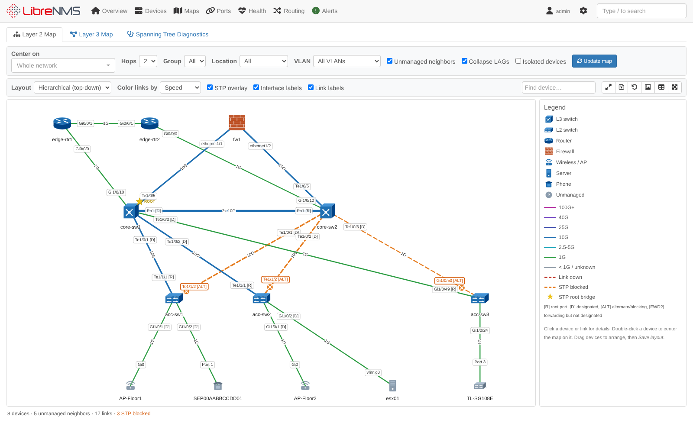

*(Screenshots use a simulated demo network.)*

## Maps

*Overview → Plugins → Topology maps*: Layer 2 Map, Layer 3 Map, Site / WAN Map and Saved Views.

| Layer 2 map | Layer 3 map |
|---|---|
| Switches as Cisco-style icons, tiered top-down (WAN edge / firewall → core → access → endpoints) | Routers, L3 switches and firewalls joined through their subnets |
| Interface names at **both ends** of every link (`Te1/0/1 [R]`), link speed, port-channels collapsed (`2x 10G`) | Point-to-point subnets (/29–/31) as direct links, LAN segments as subnet "media" nodes |
| STP overlay: ★ root bridge, `[R]`/`[D]`/`[ALT]` port roles, ⊗ on blocked ports, dashed orange blocked links | Interface name + IP address at each end, VRF filter, loopbacks and stub networks per device |
| VLAN filter dims switches/links that do not carry the VLAN and switches the STP overlay to that VLAN's instance | OSPF adjacencies and BGP sessions (iBGP/eBGP, external AS clouds), red when not full/established |
| Unmanaged LLDP/CDP neighbors (APs, phones, servers, unknown switches); an unmanaged neighbor behind a root port is flagged `ROOT?` | OSPFv3, IS-IS, IPsec, MPLS LSP and pseudowire [overlays](#layer-3-map-overlays), with an MTU check of the pseudowires' attachment circuits |

Both maps: center on any device with N hops, filter by device group or location, search, hierarchical or organic layout,
drag-and-save layout (per browser, or as [saved views](#sharing--export) shared with the team), color links by speed /
utilization / status, details panel for every device and link (speed, duplex, VLANs, traffic, STP state, port-channel members),
[export](#sharing--export) to draw.io (and from there Visio), yEd, PNG and CSV, full screen, and shareable URLs. On the
L2 map, **Simulate failure** in the details of a device or link shows which devices would lose their path to the core
(failures add up, so "what if both go down" works too), and the top-most down device of an outage is marked with the
number of down devices behind it.

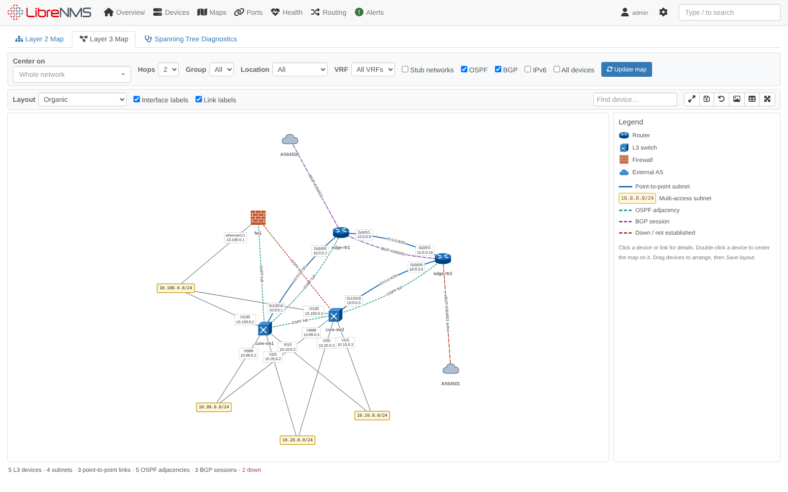

### Layer 3 map overlays

Besides OSPF and BGP, the L3 map draws the overlays of LibreNMS modules that are often off. Each has its own toggle,
shown only when the devices drawn have such data:

| Overlay | LibreNMS module | |
|---|---|---|
| OSPFv3 adjacencies | `ospfv3` (on by default) | neighbors are found by router ID within their context (VRF): their address is usually link-local |
| IS-IS adjacencies | `isis` discovery and poller modules (off by default) | by the neighbor's address (never a link-local one), else its system ID: as learnt from the other adjacencies, or a loopback it encodes (`0100.0000.0001` = 10.0.0.1) |
| IPsec tunnels | `cipsec-tunnels` poller module: off by default, on in the OS definitions of Cisco IOS, IOS XE, IOS XR, NX-OS, ASA and most other Cisco OSes, and of Firebrick | to the device owning the peer address |
| MPLS LSPs | `mpls` (Nokia SR OS) | **toggle off by default**; arrow toward the tail, red when an LSP that is in service is down. Past 500 pairs of devices (an RSVP full mesh) the pairs with LSPs down and then the busiest are drawn, and the status line says so |
| Pseudowires | `cisco-pw` discovery module: off by default, on in the OS definitions of Cisco IOS, IOS XE, IOS XR and NX-OS | orange with both MTUs when the attachment circuits disagree (see below) |

Both ends of an adjacency, tunnel, LSP or pseudowire are merged into one link per pair of devices, and its details
list them all (LSP states and paths, tunnel names, pseudowire VC IDs, ports and MTUs). A far end that is a device you
may see but that is not on the map (beyond the hops, in another location or group, not an L3 device) is drawn faded,
with its name: double-click it to center the map on it. OSPF and BGP do the same. Such a device beyond the hops adds
its own side of the adjacency, session or tunnel; one in another location or group has no data on the map, so its
edge says the state is seen from the drawn side only. At most 100 of these devices are drawn, within the map's device
limit; the others appear as their address or AS, and the status line says so. An unmonitored peer is one external
node per address, whatever saw it (a router can be OSPF neighbor, LSP tail and IPsec peer at once); BGP peers that no
device owns still go to the cloud of their AS. Addresses are looked up in the global table first, so a customer VRF
that reuses a loopback range does not hide the router; a session in a customer VRF only finds a device outside the map
that has the address in that same VRF, as customer address space overlaps.

LibreNMS keeps no pseudowire state and loses most peers: it never sets `peer_device_id`, and `peer_ldp_id` is a signed
INT that holds 2147483647 for every LDP ID from 128.0.0.0 on. When both ends lost it, a pseudowire is paired with the
one other device that has its VC ID, unless a device you may not see has that VC ID too, and its details say "paired
by VC ID (LDP id not stored)": PEs whose real peers are unmonitored and reuse the VC ID can still be paired wrongly.
One that cannot be paired goes to an "unknown peers" node of its PE. The MTU check compares the MTUs the two attachment
circuits signal, which must match for a pseudowire to come up (RFC 4447): the interface MTU, less the Ethernet header on
IOS XR, which counts it (and the VLAN tag of a subinterface): XR 1514, or 1518 on a dot1q subinterface, is IOS XE 1500.

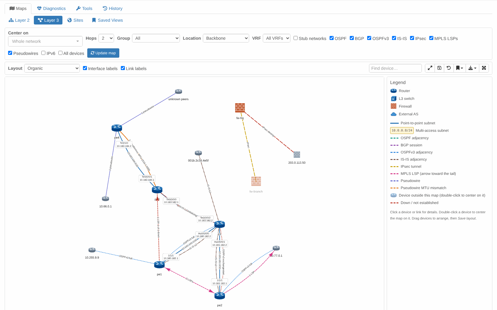

### Site / WAN map

One node per LibreNMS location, with its device count and what is down, and one link per pair of sites that adds up
everything between their devices: LLDP/CDP links (one per cable, port-channel members included), point-to-point
subnets, and OSPF adjacencies and BGP sessions (one per circuit, with the state each router reports). A subnet on a
cable, or on a sub-interface, VLAN interface or port-channel over it, only adds its network to the cable, as does a
transit VLAN from a VLAN interface to a router behind the switch at the other end; other subnets, such as tunnels or
carrier circuits (a port without an LLDP/CDP neighbor, also when the subnet is on one of its sub-interfaces), are links
of their own. BGP sessions to peers LibreNMS does not monitor join the site to a cloud per remote AS, which shows an
MPLS VPN or internet transit provider and which sites hang off it. A private AS number is a cloud per site, since sites
often reuse them, unless the sites peer with the same address and it is either not on a subnet of their routers (a
cloud VPN gateway) or on a tunnel subnet they join with addresses of their own (a DMVPN hub): then they share that cloud.

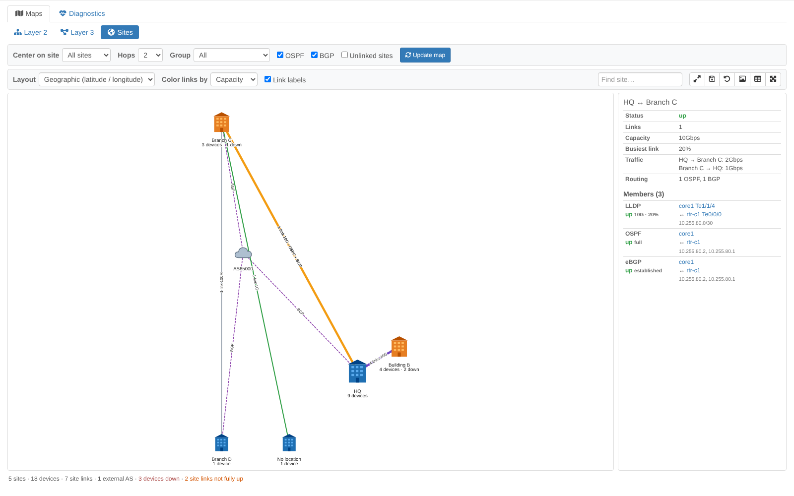

* A site is orange when some of its devices are down and red when all are; a link is dashed orange when some of its
  cables or sessions are down, and dashed purple when it is only a routing session (BGP over a provider network). A
  BGP session shut down by an administrator is gray and does not count as down.
* Link width and color follow the capacity of its cables (or the busiest cable's utilization, or the status); the
  details list every cable with both ports, speed, utilization and subnet, and every session with its state. Tunnels
  (also route-based VPN interfaces such as ipsec, WireGuard, xfrm and OpenVPN ones) and other logical interfaces have
  no capacity of their own (a tunnel's interface speed is a nominal bandwidth), so a link on them only shows its
  traffic; a subnet on a sub-interface is measured on the physical port under it.
* Layouts: hierarchical (the best connected site on top), organic, or **geographic** from the latitude and longitude of
  the locations (sites in one city are pushed apart, sites without coordinates wait in a grid underneath; when most
  sites have none, the map is laid out without them).
* Center on a site to see it with its neighbors within N hops, or filter by device group; double-click a site, or use
  the buttons in its details, to open its L2 or L3 map, redundancy page or device list.

### Sharing & export

**Saved views** (the bookmark button of the L2 and L3 maps, and **Maps → Saved Views**) keep a map under a name on the
server: its scope, filters, device positions and display options (layout, *Color links by*, labels, STP overlay,
outages). A view is personal or shared with everyone who can open the maps, and opens with a link (`l2?view=12`). Each
user sees a shared view with their own permissions: the map is built for them, and only the positions of the nodes on
their map are used (and sent to their browser); a node the view does not place, such as a device they see as an
unmanaged neighbor, goes next to the nodes it is linked to; the view's scope names no device, group, location or VRF
they may not see, but its name is shown as it was typed. The map leaves the view when its scope changes (device, hops,
group, location, VRF); *Update* saves the map as it is now into the open view. Users change and delete their own views,
LibreNMS admins also any shared view. A saved view holds up to 1 MB of layout, and each user up to 200 views.
*Saved Views* lists them (rename, share, delete) and the layouts saved in this browser with the save button, each of
which becomes a view in one click.

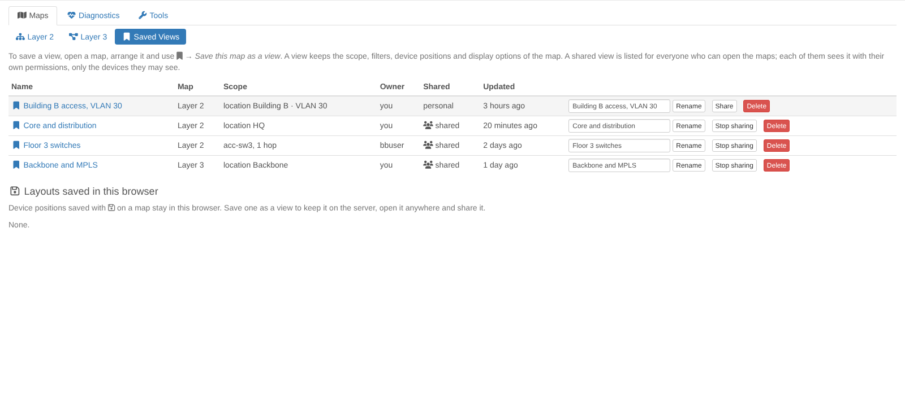

**Export** (the download button of a map) saves the map as it is drawn:

| Format | |
|---|---|
| draw.io diagram (`.drawio`) | opens in [draw.io / diagrams.net](https://www.drawio.com) (web or desktop) with the positions of the map: devices as draw.io's Cisco shapes colored by status (red down, gray unmanaged), the sites of the site map as buildings, links with their color, width and dashes, the link label in the middle and the interface names at both ends. Each device keeps its name, hostname, hardware, OS and location as data (*Edit Data*) and links to its LibreNMS page. **Visio:** open the file in draw.io and use *File → Export as → VSDX* |
| GraphML for yEd (`.graphml`) | opens in yEd Graph Editor with the same positions and labels, without a new layout; the properties are in each node's and link's description. A name that starts with `<html>` gets a zero-width space in front, so that yEd shows it as text |
| PNG image, links as CSV | the picture of the map and one row per link |

The files hold what the map shows: its scope and filters, port-channels collapsed or not, the L3 overlays that are on,
*Color links by*, the STP overlay, VLAN dimming, the *Interface labels* / *Link labels* switches and a host the
[host locator](#host-locator-and-port-tab) placed on the map (`host=`). A failure simulation is left out: the files
show the network as it is.

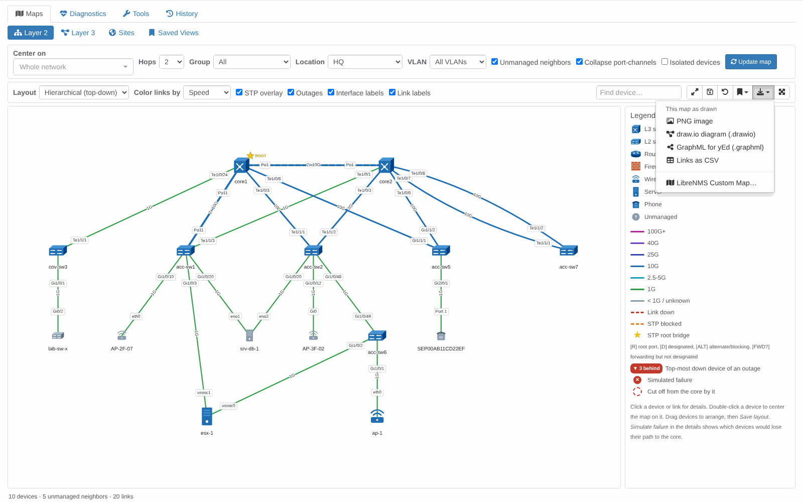

**LibreNMS Custom Map** (Export → *LibreNMS Custom Map…* of the L2 and L3 maps, LibreNMS admins) turns the map into a
native LibreNMS Custom Map (*Maps → Custom Maps*): LibreNMS draws it with the status of the devices and the status and
utilization of the links, it can be changed in LibreNMS' map editor and put on a dashboard with the Custom Map widget.
The dialog previews what will be written (nodes, links, size) before anything is saved:

* devices keep their positions and are drawn as the icon of their role, which LibreNMS colors by status (blue up, red
  down); unmanaged neighbors are gray icons, subnets of the L3 map boxes. A new map takes LibreNMS' defaults for new
  custom maps (the `custom_map` settings: fonts, legend colors, background);
* each link takes its status and utilization from a port that is that link only: the port-channel of either end when all
  of its members that are up (by the port stack, whether LLDP/CDP reports their cables or not) are this link's cables,
  else the port of a link that is one cable. A port-channel split over two switches (MLAG) is used for neither of its
  links, which then take the other end's port-channel; a link of several cables without one has no port. OSPF/BGP
  adjacencies and the other L3 overlays have no port either and are drawn without utilization;
* names are written with look-alikes for the characters HTML uses (`<` `>` `"` `'` `&` `` ` `` become ‹ › ″ ’ ＆ ˋ):
  LibreNMS' map editor puts labels into HTML, and LLDP/CDP neighbors name themselves. The editor puts the map's name
  into its script, so line breaks in the name and menu group become spaces and a backslash becomes ＼. The icons are
  among those of the editor's node dialog, so a node edited there keeps its icon;
* *Map* can replace a custom map this plugin made before: its nodes and links are written again (also changes made in
  the editor), its id, menu group, settings, legend and background stay, so dashboards keep showing it. If it changed in
  the editor after the preview, the export stops and shows a new preview. Maps made in LibreNMS are never changed. The
  export is noted in the eventlog.

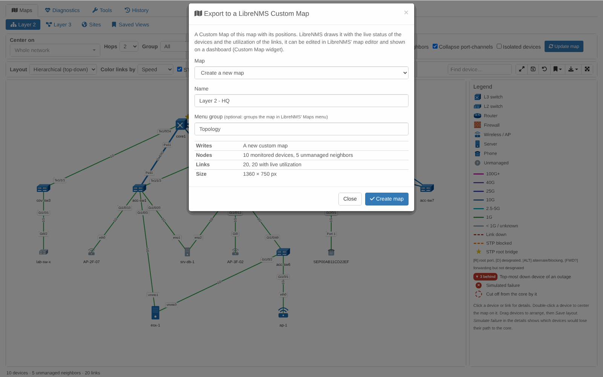

## Diagnostics

*Overview → Plugins → Topology diagnostics*: Spanning Tree Diagnostics, Link & VLAN Diagnostics, Routing & IP
Diagnostics, Redundancy & Failure Impact and Monitoring Coverage.

### Spanning tree diagnostics

One page (plus a JSON API) that analyzes every STP instance (802.1D/RSTP/MST CIST and Cisco PVST+/Rapid-PVST+ per VLAN):

| Check | Severity |
|---|---|
| Bridges of one connected L2 domain disagree on the root bridge | critical |
| Bridging loop: a cycle of links that are forwarding on both ends (port-channel and MLAG/vPC aware) | critical |
| Ports in `broken` state (root/loop inconsistent, guard err-disable) | critical |
| Root bridge not monitored by LibreNMS (rogue switch) – traced along root ports to the exit port, FDB sightings and OUI vendor | warning |
| Root elected with default priority, root not one of your designated roots, root at the edge of the topology | warning |
| High topology change rate per day of uptime, with the most likely source ports (edge ports without portfast) | warning |
| Ports with many transitions to forwarding (flapping) | warning |
| Forwarding ports that are neither root nor designated | warning |
| Operational timers different from the root, invalid 802.1D timer relationship, non-default timers | warning / info |
| Mixed STP modes (PVST+ / Rapid-PVST+ / MST) in one domain | warning / info |
| Bridges more hops from the root than the configured diameter | warning |
| Inter-switch switchports without STP (BPDU filter / STP disabled) | warning |
| Switches without STP data that sit on redundant L2 paths, switches without STP data | warning / info |
| Root bridge / root port changes from the LibreNMS eventlog | warning / info |
| **Loop evidence:** broadcast storm on inter-switch links (packet rate above the threshold and a large share of the port's packets or of the link) | critical from 10x the threshold or 10% of the link, else warning |
| **Loop evidence:** heavy multicast on inter-switch links | warning |
| **Syslog:** a switch detected a loop (loop protection, keepalive loopback) | critical |
| **Syslog:** MAC address flapping | critical for 10+ addresses (on one switch or across several), else warning |
| **Syslog:** storm control triggered or excessive broadcasts reported | critical on several switches, else warning |
| **Syslog:** UDLD, BPDU guard, loop guard and root guard actions, native VLAN and duplex mismatch reported by CDP / PVST+, err-disabled ports | warning |

Identical findings in many PVST VLANs are reported once with the list of VLANs. The page also lists every
STP domain (root bridge ID, members, blocked ports, max hops, last topology change, timers), all
blocked ports with their neighbor across the link, every bridge instance and recent STP events.

**Loop evidence** shows what a loop leaves behind even when the spanning tree data looks fine (or a switch does not
report it): the broadcast and multicast rates of the inter-switch links at the last poll, storms first, compared with
the unicast traffic and the link speed; and the loop related messages the switches sent to LibreNMS' syslog in the last
24 hours, grouped by device and check, with the ports, MAC addresses and VLANs they name and a link to those messages.
Links to phones, access points and servers are not inter-switch links (an unmanaged neighbor is typed as on the L2 map,
from its CDP platform or LLDP system description). The syslog checks recognize the messages of
Cisco IOS / IOS-XE / NX-OS, Arista EOS, Junos and ProCurve / ArubaOS-Switch; each pattern is a setting, so other vendors
can be added. A message counts for the first check that matches it, so a port err-disabled by BPDU guard is a BPDU guard
finding (and with `bpdu_guard` in the disabled checks, those messages are left out rather than reported as err-disable).
Configuration commands echoed to syslog (`logged command:storm-control ...`, Junos `UI_CMDLINE_READ_LINE`) and
recoveries named by their message (`ROOTGUARD_UNBLOCK`, `ERR_RECOVER`, `STORM_CONTROL_BELOW_THRESHOLD`) are ignored, also
by a setting; the CDP neighbor named after ", with" is not matched.

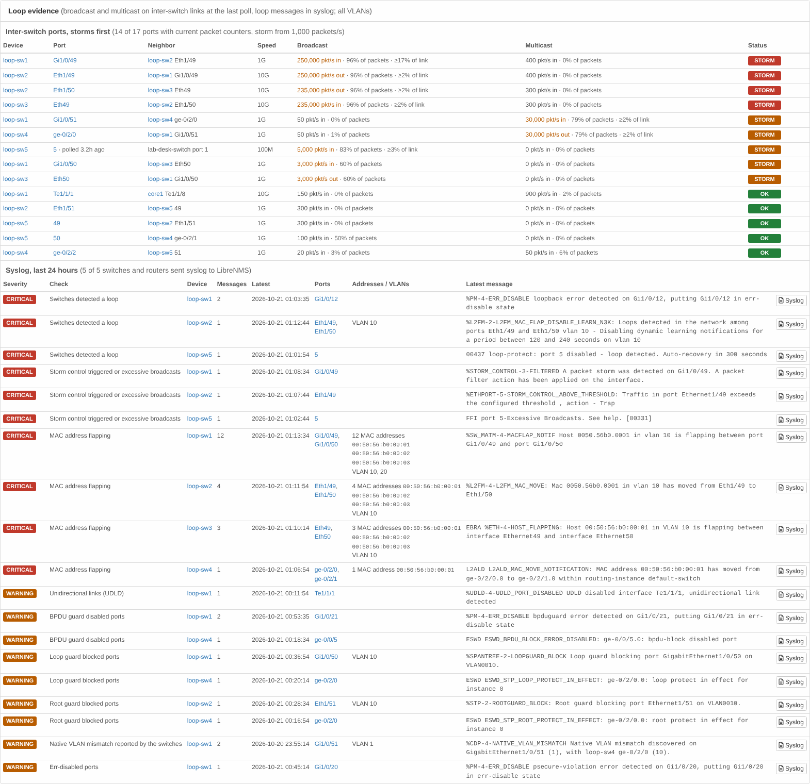

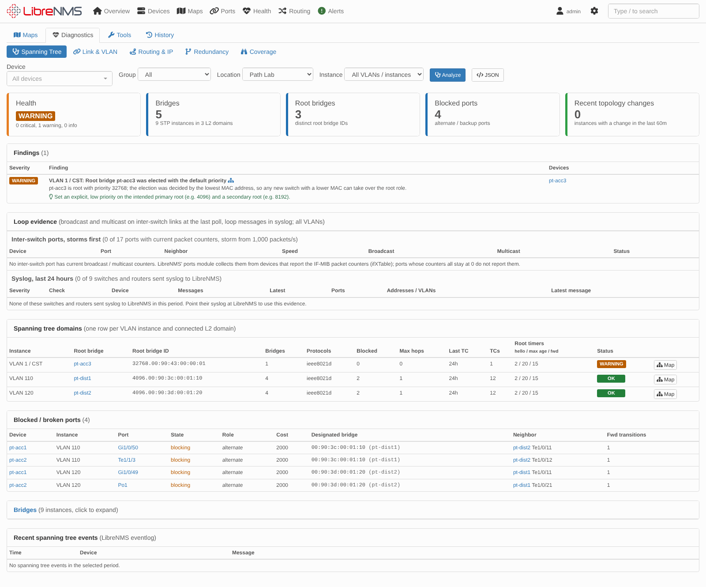

VLAN view with the STP overlay – pt-dist2 is the VLAN 120 root bridge, and pt-acc1 and pt-acc2 block their uplinks to
pt-dist1 (`[ALT]`, dashed orange); pt-acc3 does not carry the VLAN and is faded:

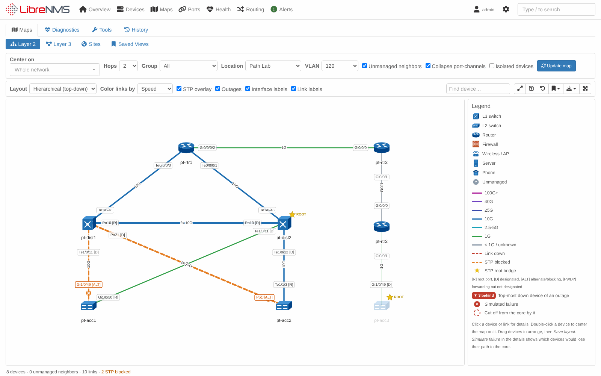

### Link & VLAN diagnostics

Both ends of every LLDP/CDP link between two monitored devices are compared (a port-channel counts as one link) and
every VLAN is followed across the trunks:

| Check | Severity |
|---|---|
| Optical receive power below the transceiver's alarm threshold (the DOM thresholds the device reports) | critical |
| Speed, duplex and MTU mismatches between the two ends, half-duplex links (MTU differences up to 22 bytes are header accounting) | warning |
| Trunk facing an access port, native VLAN mismatch, access ports in different VLANs | warning |
| **Split VLAN**: a VLAN in use (hosts or a VLAN interface such as Vlan30, irb.30 or ve 30) on switches of one L2 domain that no trunk path connects, naming the trunks that allow it on one end only | warning / info |
| Allowed VLANs differ on a trunk although both switches use the VLAN (a redundant path that silently does not carry it) | warning |
| Port-channel on one end only, members landing in different port-channels, degraded port-channel (members down), uneven load across members | warning |
| Interface errors and packet discards in the last poll | warning |
| Optical receive power below the warning threshold, or within a margin of the alarm threshold | warning / info |
| Port descriptions naming the wrong neighbor (also ports that now face an unmanaged AP or phone), inter-switch ports without description – with the configuration lines that fix them (Cisco-style, Junos, ProCurve, RouterOS). Ports toward phones and servers need no description | warning / info |
| Neighbors listed by one end only (LLDP/CDP off on one side, or a unidirectional link), devices without neighbor data | info |

The page also lists every link with both ends side by side (speed, duplex, MTU, mode and native VLAN, VLANs, errors,
receive level) and highlights the values that differ. Links to monitored neighbors outside the selected group or location
are compared too. A VLAN that is only allowed toward a switch without hosts in it (pruned by design) is not reported;
VLANs that are local to each switch on purpose can be ignored, and every check can be switched off, in the settings.

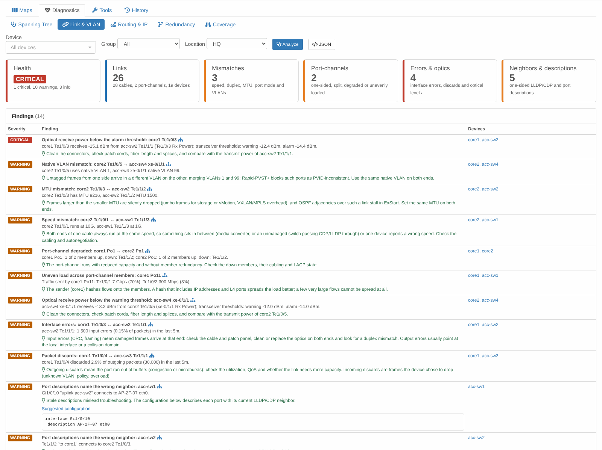

### Routing & IP diagnostics

The Layer 3 counterpart of the spanning tree page: OSPF routers and adjacencies, BGP sessions and the interface
addresses of every device you can see are checked against each other:

| Check | Severity |
|---|---|
| **Duplicate OSPF router ID** on two routers (critical when they are in one OSPF domain), or a neighbor reporting the router's own ID | critical / warning |
| **OSPF adjacency stuck in ExStart / Exchange** with the MTU of both ends (critical when the interface MTUs differ) | critical / warning |
| OSPF hello / dead interval, area, area type (stub / NSSA) or authentication that differs between the interfaces of one link or the routers of one area: no adjacency can form | critical |
| **BGP remote AS** configured on one router that is not the local AS of the (monitored) peer, when the peer was rejected for it (Bad Peer AS) or the session never came up | critical |
| OSPF adjacency stuck in Init or Loading, 2-Way on a point-to-point interface, a configured neighbor that is down | warning |
| OSPF network type that differs on one link; routers of one area whose LSA counts differ by more than 1 % | warning |
| **BGP session down** (unless shut down on purpose), with its last error as text ("Cease / Maximum Number of Prefixes Reached (6/1)") and what usually causes it; sessions configured on one router only (never established, while the peer's sessions in that VRF are polled) | warning |
| Accepted prefixes near (warning) or at (critical) the peer's maximum-prefix limit, per address family | warning / critical |
| **Duplicate IP address** in one VRF on interfaces that are up, within one network; different prefix lengths on two neighbors | warning |
| BGP session reset recently (with its cause, or the router's own restart); session up without any accepted prefix | info / warning |
| OSPF cost that differs per direction on a link; DR election on a point-to-point link (/30, /31) | info |
| Shared addresses on several devices: a gateway address when each device also has its own (VRRP, HSRP, anycast gateway), anycast on loopbacks, host addresses or three or more devices, or devices LibreNMS sees no link between (separate networks may reuse addresses) | info |
| A link (LLDP/CDP, or an OSPF adjacency) that joins two differently named VRFs, on routers that both have both VRFs | info |

Subnets are reused by networks that never meet (customers, sites, VRFs), so interfaces and addresses are only compared
where they are on one link: the two ports of an LLDP/CDP link (with their subinterfaces), the two ends of an OSPF
adjacency, neighbors in one routing table, the two addresses of a /30 or /31 held by two devices, or, for OSPF
interfaces, one OSPF domain. A link whose ends are in differently named VRFs (a provider edge facing a customer router)
is a routing boundary, so a provider and its customers are separate networks; a link end without an address (an L2
port, a port-channel member, a port with SVIs behind it) is in the VRFs of its device's addresses that share a subnet with the
other end. A link without addresses on either end (a trunk) joins every routing table, unless a subnet its two devices
share is in VRFs of different names only (no VRF name holds it on both) and is point-to-point (/30, /31, /126, /127: a
provider edge facing a customer router over a port-channel) or both devices have addresses in VRFs of their own: then it
joins only the VRFs that agree. Out-of-band management never crosses a link and is left out of these rules: the vendors'
management VRFs (Mgmt-intf, Mgmt-vrf, management, mgmt_junos) and dedicated management ports (mgmt0, Management1,
MgmtEth, fxp0 and em0 on Junos, Gi0/0 in a management VRF). A duplicate address between devices that LibreNMS sees no
link between in that routing table is only info: that includes sites joined only through BGP or an MPLS VPN, which
count as separate networks. Host-local bridges (virbr0, docker0, ...) are left out.
VRF names are local to each router and compared without case: a provider edge facing a customer router joins VRFs on
purpose and is not reported. LSA checksum sums are not compared (they change with every LSA refresh), BGP sessions in a
state outside the BGP state machine (Junos peers that LibreNMS has not matched yet) are listed but not checked.

Below the findings the page lists the OSPF routers (router ID, ABR / ASBR, areas), every adjacency as each router
reports it, and every BGP session with its state, uptime, last error and prefixes, problems first. Filter by device,
group, location or VRF; routers outside the selected group or location still count as neighbors and peers. The
[background checks](#topology-history-baseline-and-background-checks) run these checks after each snapshot too: a
finding of their latest run is marked **new**, and a router gets an eventlog entry when it gets or loses one.

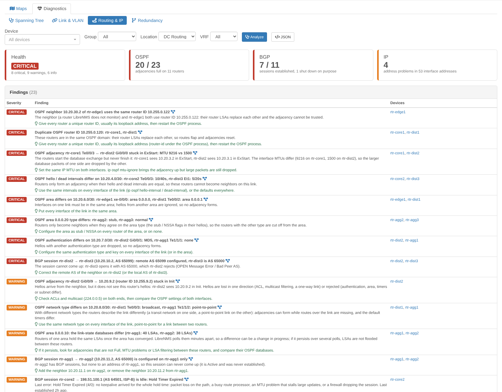

### Redundancy & failure impact

Every device should keep a path to **the core**: the core devices set in the settings, else the designated root
bridges of the spanning tree settings, else the switches given the lowest spanning tree bridge priority (when it was
lowered on purpose), else the most central switches. The page shows which one it used. Paths are followed through the
whole network you can see; port-channels count as one link and their members back each other up. Servers, access points
and phones are never a path between two switches, even when they are cabled to both.

| Check | Severity |
|---|---|
| **Outage**: the top-most down device, with the down devices that are only reachable through it ("acc-sw3 is down, 14 devices behind it") – start there, the others are probably fine | critical |
| **Redundancy lost**: devices that normally have a second path, but it is down (link down, shut down, or the device at its end down), with the single points of failure they depend on now; a single uplink port-channel running on one cable | warning |
| **Fake redundancy – stack member / line card**: all uplinks of a device, or all members of a port-channel, on one stack member or line card of a device that has several (from the hardware inventory, else from interface names such as `Gi2/0/1` or `xe-1/0/0`) | warning |
| **Single point of failure**: a device or a single cable whose failure cuts switches, routers or firewalls off the core, with what it cuts off | warning from 2 switches cut off, else info |
| **Fake redundancy – same switch**: several separate links to the same switch, which only protect against a cable failure | info |

Below the findings, the **failure impact** table lists every device and link whose failure cuts monitored devices off
the core, largest first (including what only takes access points or servers with it), each with a *Simulate* button that
opens the L2 map with that failure applied.

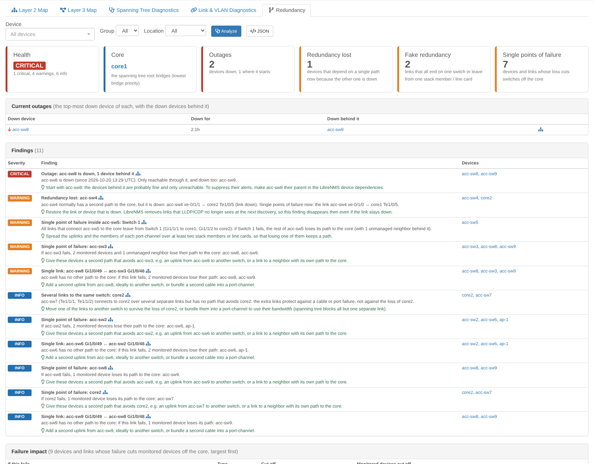

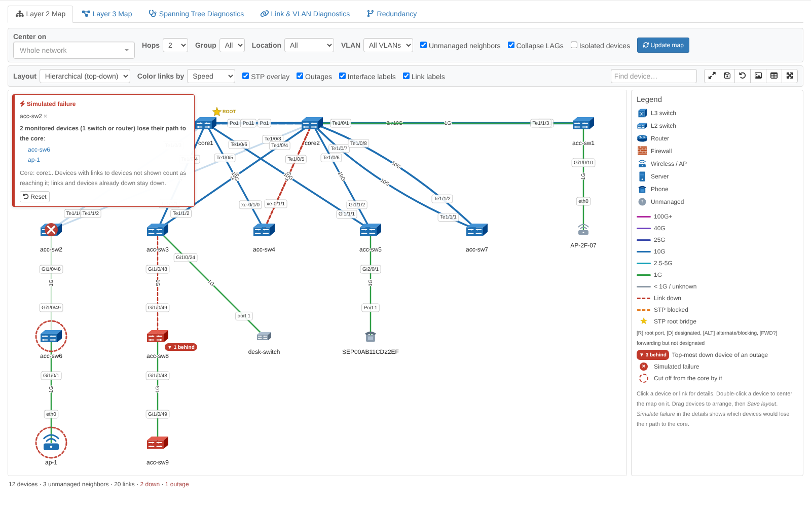

### Monitoring coverage

What LibreNMS does not see, so the gaps in the maps and the checks are known:

| Check | Severity |
|---|---|
| **Not monitored**: an LLDP/CDP neighbor whose CDP platform, LLDP system description or name says switch, router, firewall or access point, with every port it is seen on (its LLDP and CDP sightings merged) and an *Add* button for users who may add devices | warning (access points and wireless controllers: info) |
| **Not linked**: a neighbor whose name or address is that of one monitored device, but LibreNMS did not link the two (the name it advertises is not the device's hostname or sysName, or the link is older than the device), so the link is missing from the maps | info |
| **Name of several devices**: a neighbor named like several monitored devices (and the hostname of none of them): LibreNMS cannot tell which one it is and links none | info |
| **Disabled**: a neighbor that is a device disabled in LibreNMS, so it is not polled | info |
| **No LLDP/CDP neighbors reported**: a monitored switch, router, firewall or access point that other devices see but that reports no neighbors itself, so its links come from the other end only (the Link & VLAN page reports it too; it says when LibreNMS' `discovery-protocols` module is off for the device) | info |
| **No neighbor data**: a monitored switch, router, firewall or access point that reports no neighbors and that no monitored device sees: it stands alone on the maps | warning for switches and routers that are up, else info |
| **Several neighbors on one port**: two or more LLDP/CDP neighbors on one port (two that are not phones, or two phones): something LibreNMS does not see connects them | info |
| **Possible hub or unmanaged switch** (no LLDP/CDP): an Ethernet access port with 4 or more MAC addresses (setting) in its device's last forwarding table discovery and no LLDP/CDP neighbor that explains them (a phone only explains the PC behind it) – an unmanaged switch or hub, or a server, hypervisor or access point that bridges without announcing itself | info |

The type of a neighbor comes from its CDP platform or, for LLDP, its system description, which names the software: Cisco
IOS (the model in it tells a C2960 switch from a C2900 router), IOS XE, NX-OS and IOS XR, Arista EOS, Juniper, Aruba
(CX switches and access points), ExtremeXOS, Dell OS10, MikroTik, VyOS, FortiGate and Firepower, Catalyst 9800 wireless
controllers and UniFi access points, for example. Neighbors of unknown type are listed (folded away) without a finding,
phones and servers are only counted. A neighbor LibreNMS linked to a device you may not see is listed as monitored,
without a finding. Servers, printers, other devices that usually run no LLDP/CDP and firewalls whose OS supports neither
(Cisco ASA and FTD) are listed without a finding among the monitored devices without neighbors; a device that is down is
info.
Factory default names (`Switch`, `MikroTik`, ...) are one neighbor per port and never match a monitored device. Trunks,
port-channels, ports that are not Ethernet (such as an access point's radio) and ports whose MAC addresses are in three or
more VLANs (access points, hypervisors) are not counted as a possible hub or unmanaged switch. The advice for an unmonitored
neighbor depends on LibreNMS' LLDP/CDP autodiscovery: off (`autodiscovery.xdp`), on without discovery networks (`nets`
is empty by default, then it adds nothing), or on (then the eventlog of the device that sees the neighbor says why adding
it failed). Each list stops at 500 rows (the most important first) and says how many there are; the summary counts all.

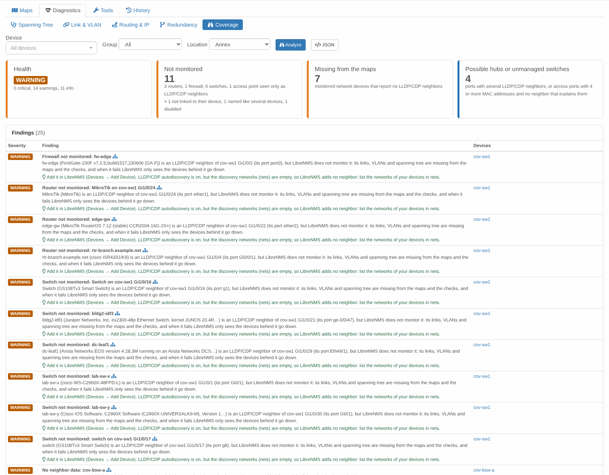

## Tools

*Overview → Plugins → Topology tools*: Host Locator, Path Trace, Rollout Planner and Device Dependencies.

### Host locator and port tab

*Where is this plugged in?* Enter an IPv4 or IPv6 address, a MAC address in any notation or a hostname (a device in
LibreNMS, else DNS) under **Overview → Plugins → Topology tools → Host Locator**. The answer is the switch port, its VLAN and description, the vendor of
the MAC, the host's IP addresses, its 802.1X / MAB user, and first / last seen.

A host's MAC is learned on every switch along its path, on the port toward it. LibreNMS' own MAC search lists all of
them and only marks a port that holds a single MAC. The host locator follows each entry to the LLDP/CDP neighbor on its
port instead: an inter-switch link or port-channel toward a switch that learned the MAC too is a hop on the way, so the
search ends on the switch the host is plugged into, including:

* a computer behind an **IP phone**, a wireless client behind an **access point**, a virtual machine behind a server
  (the neighbor on the port says which: its CDP platform, or for LLDP its system description);
* hosts behind a **switch that LibreNMS does not monitor** (an unmanaged LLDP/CDP neighbor), or on a port with several
  MACs and no neighbor at all (flagged: probably a hub, switch or virtualization host); a port with many MACs toward
  such a neighbor, or toward a switch you may not see, is a switch on the way rather than a second place of the host;
* a switch without LLDP/CDP: a port that learned the switch's own MAC leads to it; without that, its uplink carries the
  MACs of everything behind it and loses to a port with far fewer;
* a host that **moved** or a wireless client that **roamed**: entries from before a switch's last forwarding table
  discovery are listed as old, and of two sightings the newer wins ("seen here 3.8h before the newest sighting");
* a server on **two switches** (a port-channel across a switch pair): the second link is named as such, no warning;
* a **silent host**: when the trail ends at a monitored switch that does not list the MAC (switches forget idle hosts
  after a few minutes) or has no forwarding table data, the answer is *behind* that switch, and the L2 map draws the host
  next to it;
* the address of a **switch, router or firewall** itself, an interface MAC or a **VRRP / HSRP / GLBP** virtual router MAC:
  the answer is the device (for a gateway, the router that is master / active now), not a port on the way to it. A
  device without forwarding table data may be a switch on the way (or a bridging firewall): it is named as the gateway
  only when it routes (two or more routed IPv4 interfaces, or OSPF / BGP, as the maps tell routers) and has an address
  in the subnet of the searched address or an interface in its VLAN, else the answer is *behind* it (a switch's
  management address in that VLAN is no evidence);
* a host the forwarding tables do not show yet (LibreNMS reads them every 6 hours), that sits behind a switch without
  one, or that moved since: its current **802.1X / MAB session** (polled every 5 minutes) gives the port. Behind a
  switch it counts on that switch or one behind it. Instead of a port the forwarding tables found, a session on another
  switch counts only when it started after they last saw the host there (a phone keeps the link, and an old session, up
  after the computer behind it left); on the same switch, when LibreNMS updated it after that (it keeps one session per
  MAC and switch and moves it to the new port, so a hot desk move shows). Sessions that do not count are grayed out
  with the reason.

The HSRP and VRRP MACs are the same in every VLAN that uses the group number, so a gateway is located in the VLAN of
the router interface with the ARP entry (Vlan10, irb.10, ve 10, the unit of a subinterface such as Gi0/0.10); when that
names no VLAN the MAC is learned in, and when the MAC itself is searched, there is one answer per VLAN. Every other port
that learned the MAC is listed with the reason the host is not there. **Show on the L2 map** opens the map centered on
the switch with the host drawn next to it on its port (next to the switch it is behind; for a device's own address, the
device).

Every **port page** gets a *Plugins* tab with the port's far end (LLDP/CDP in both directions), port-channel, VLANs,
spanning tree state and role per instance, the MAC addresses learned on it (vendor, IP addresses, last seen, a *Locate*
link each) and its 802.1X / MAB sessions.

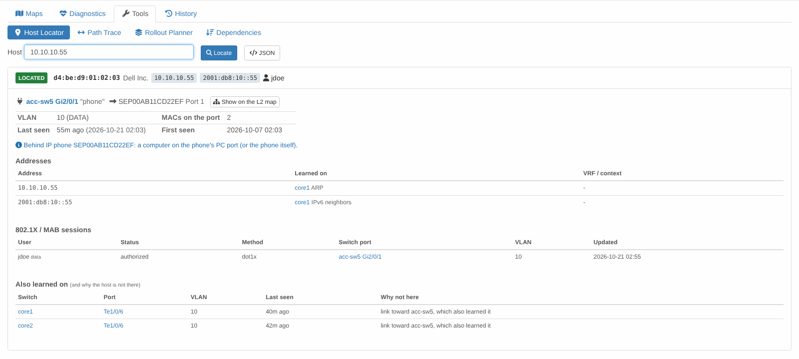

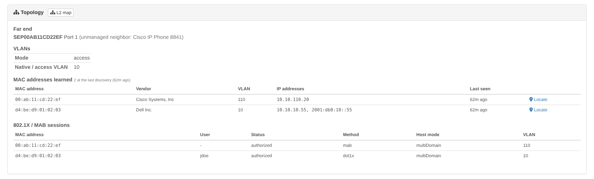

### Path trace

*Which way does traffic from A to B go, and is anything on the way?* Under **Overview → Plugins → Topology tools → Path Trace** enter both ends: an IP
or MAC address, a hostname or the name of a device in LibreNMS. Hosts are located with the host locator (their switch
port and VLAN), an address of a device's interface is that device and interface (`path?a_device=12&a_port=345` gives a
device and port by id). The page lists every hop with the ports it comes in and goes out by: speed, utilization in and
out, errors, duplex, spanning tree state and role, port-channel members, the router interface and address the traffic
uses, and how the router forwards it.

* **Within a subnet** (or a VLAN, for ends without an IP address) the path follows the LLDP/CDP links whose ports are up,
  carry the VLAN and forward in the spanning tree instance of that VLAN (PVST: its own instance, else the common one), so
  a blocked uplink is avoided and a different VLAN can take another way. A port-channel is one hop. Only switches pass
  frames on: a router, firewall or server is never a hop in the middle. Where ports have no spanning tree data, or a
  port-channel spans a switch pair (MLAG / vPC), several paths of the same length remain: the page says so and shows the
  one with ports known to forward, then the faster links.
* **Between subnets** the path goes from A's gateway (the router with A's subnet connected, preferably the one with A's
  ARP entry) router by router: each looks up B's address in its route table in LibreNMS and its connected subnets
  (longest prefix, in the VRF of the interface the traffic arrives on; an interface that is down does not count, nor a
  route over it; equal cost next hops are listed and the path follows the lowest), and the next hop leads to the router
  that owns that address, until a router has B's subnet connected. An IPv6 link-local next hop is the router on the
  route's interface (the one with that address, or the router LLDP/CDP or a shared subnet shows on that link); a
  recursive one (iBGP from a loopback, an MPLS VPN toward the far PE) is reached through the router's own route toward
  it, and the routers after it route B themselves when they have a route to it, else forward toward that next hop. When
  several devices have the next hop's address (overlapping VRF subnets, anycast gateways), the one on the egress link
  counts: its LLDP/CDP neighbor, else the one on its subnet; else the page says it cannot tell and goes on at the first
  whose own route does not lead back, and what it finds after such a guess (or an estimate) is a warning, not critical.
  The switches between two routers, and between the last router and B, are the Layer 2 path in the VLAN of the router
  interfaces (an SVI or a sub-interface: its parent port).
* A router without current routes in LibreNMS is crossed by an **estimate**: the first step of the shortest way, over
  its OSPF / BGP neighbors and the subnets it shares with other routers (never back to a router already on the path),
  toward a router with B's subnet connected. The estimate says why: the `route` discovery module is off (the default),
  its routes were not read again at its last discovery (the module was turned off, or it has more routes than
  LibreNMS reads of a device), it has none in that VRF, the route table is larger than a trace reads, the routes toward
  that address were not read (a trace reads the route table toward 6 addresses at most), or your LibreNMS role may not
  view routes.
* **Problems on the path** are listed with a fix: ports down, half duplex, interface errors and discards (the link
  diagnostics' thresholds), links at 80 % or more (*Busy link*, critical from 95 %), port-channels missing members, no
  route or a null route toward B, a routing loop (only "path unknown" when an estimated hop is part of it), no
  forwarding path in the VLAN (with the ports that stop it on the shortest chains of links), and a next hop that is no
  device you can see, after which the path resumes at the router with B's subnet connected when there is one (the
  routers between are not known, so the path counts as incomplete). The summary names the slowest link and the
  busiest port; every routed hop says when its routes were read.
* **Show on the L2 map** opens the map around the path with its devices framed and its links highlighted
  (`l2?...&path=d:12,d:7&path_ports=345:678`). A path across a device you may not see is shown only up to it.

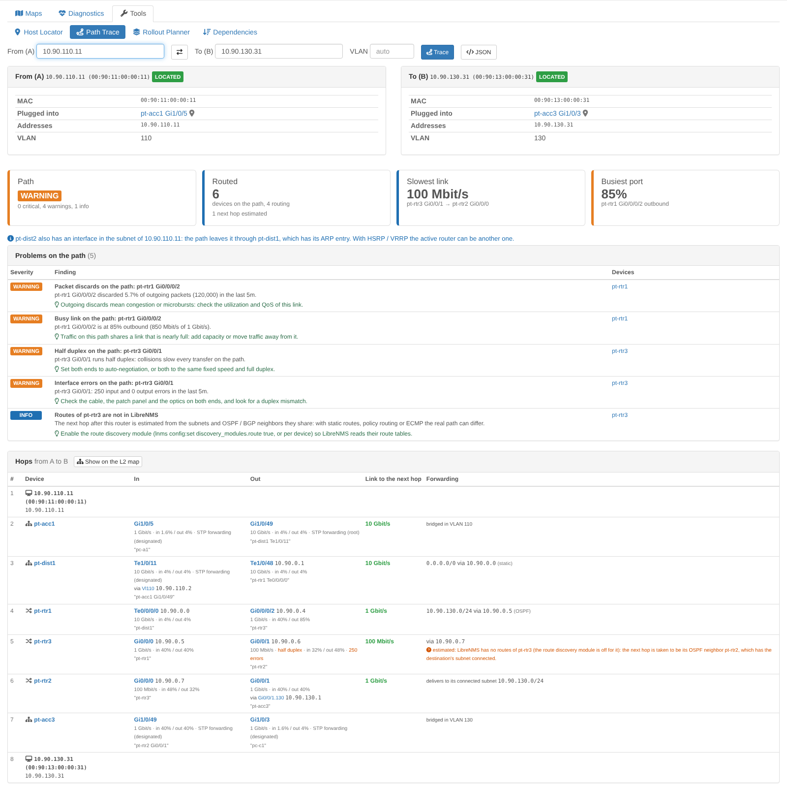

### Rollout planner

**Overview → Plugins → Topology tools → Rollout Planner** puts the devices of a firmware upgrade, a reboot or a configuration change in batches, using
the core and the links of the redundancy page as they are now. Pick devices, or a device group or location (its
switches, routers and firewalls by default), and optionally the most devices per batch:

* **Farthest from the core first, the core last.** A device's path to the core only runs through devices closer to the
  core, so a change that breaks a device never cuts off a device that still waits for it.
* **Never two devices that back each other up in one batch**: a batch going down as a whole cuts off no more than its
  devices one at a time. The two switches of a redundant pair, two switches that share a dual-homed server or an
  unmonitored switch, and two core switches always land in different batches.
* **What goes down while a batch runs**: the monitored devices it cuts off and the unmanaged neighbors (phones, access
  points) that go down with it – what its maintenance window must cover. Each batch has its hostnames ready to copy and
  a *Simulate* button that fails the batch on the L2 map. A batch that takes down the last core device of a part of
  the network is counted like that simulation: the largest remaining piece carries on.

Picked devices are planned as they are. Devices that are down now, without any LLDP/CDP neighbor or without a path to
the core now are left out and listed to plan by hand (nothing tells what depends on them), and so are picked ids that
are unknown, disabled or not visible to you. When a part of the network has a single core device and another switch
is cabled like a second core switch, the page names it: add both to *Core devices*. `api/rollout?devices=12,13` (or
`group`, `location`, `size`, `network=0`) returns the plan as JSON.

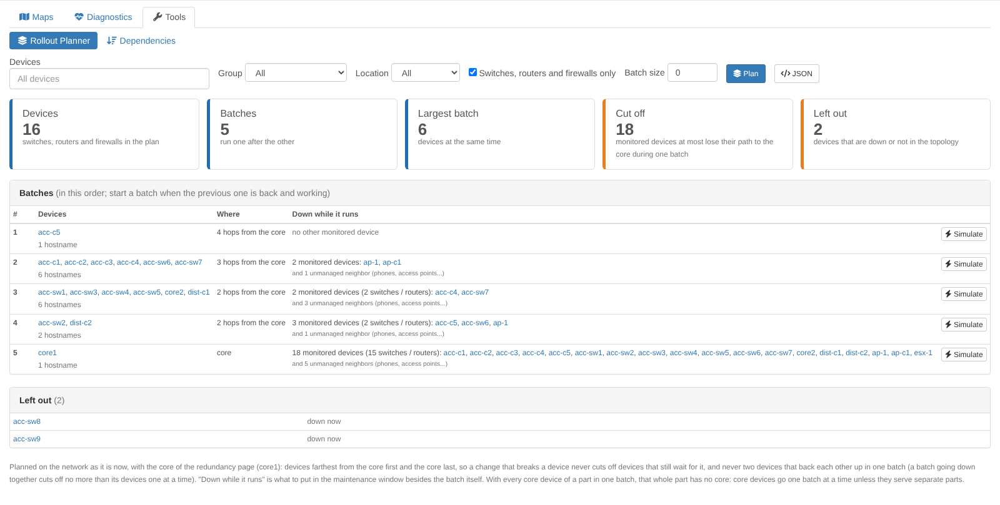

### Device dependencies

LibreNMS suppresses a device's alerts while **all** its parent devices are down, but the parents are set by hand.
**Overview → Plugins → Topology tools → Device Dependencies** derives them from the topology: the parents of a device are its neighbors one hop closer to
the core over every LLDP/CDP link, also links that are down now.

* Dual-homed devices get both uplink devices, so their alerts are only suppressed when both are down.
* A switch also gets the switches next to it at the same distance from the core that rank before it: lower spanning
  tree bridge priority (without the VLAN bits), then a switch cabled like a second core switch, then lower device id.
  So a switch cabled to both switches of a core pair gets both even when only one of them is set as core, and the order
  of two switches stays the same when other switches are added or removed.
* Parents always come first in that order (closer to the core, then by rank), so derived dependencies never form a loop.
* An unmonitored switch in between is skipped to the next monitored device toward the core.
* Core devices and devices without a path to a core keep their current parents.

The page shows the core, the current and the derived parents of each device (changed, new, same or kept), and how many
of its outages in the last 30 days started while all its parents were down – with the current and with the derived
parents: the alerts LibreNMS suppresses. A disabled parent is labeled as such: it never counts as down. Admins apply
selected changes, or every change of the view at once (also for thousands of devices). What the preview showed goes
with the request: a device whose derived parents changed since is skipped, a view whose changes changed is not applied.
A device that would end up on a loop with dependencies kept by hand is refused, the other changes are applied, and
every change is written to the device's eventlog with how many parents it had before. The names of the parents, which
users of the device may not see, are logged at info level in `logs/librenms.log`, which LibreNMS only writes when its
log level (`LOG_LEVEL` in `.env`, warning by default) is info or debug.

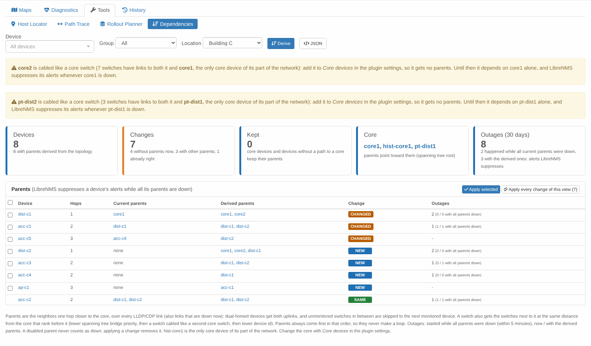

## History

*Overview → Plugins → Topology history*: Topology Changes.

### Topology history, baseline and background checks

The plugin records the topology every *History interval* (an hour by default) through the LibreNMS scheduler: LLDP/CDP
links (unmanaged neighbors included, phones left out), port-channel members, the root bridge each switch sees, blocked
ports, OSPF adjacencies and BGP sessions. Only changes are written. The **Topology Changes** page shows what
changed in the last day, week or month, or between two dates:

| Change | |
|---|---|
| **Cable moved**: a port whose neighbor changed ("acc-sw2 Gi1/0/49 now connects to core2 Te1/0/5 (was core1 Te1/0/5)"), or a link that came back | links |
| **Link gone**, **new link**, port-channel members that joined or left | links |
| **New switch, access point, router or firewall that LibreNMS does not monitor**, and other new LLDP/CDP neighbors | links |
| **Root bridge moved** (one line per move, with its VLANs and the switches that saw it), ports that started or stopped blocking | spanning tree |
| **OSPF adjacency lost / up**, **BGP session down / established** (one line when both routers report it) | routing |
| **New device**: a device LibreNMS started to monitor, with what it brought | devices |

An admin can **save the baseline**: the topology as it should be (links, port-channel members, root bridges, OSPF
adjacencies, BGP sessions), for everything or for the devices of the current filter. The page then lists what is missing
compared to the baseline, with since when, and what is new; root bridges are compared per switch and VLAN and listed per
old and new root bridge with the VLANs of all their switches ("VLANs 10-29: root bridge core1 → core2 on 1,242
switches"; when the switches differ, with the switches of each VLAN: "VLAN 31 on 1,242 switches, VLAN 33 on 1 switch").
**Accept** takes one missing item out of the baseline when it is gone on purpose, or makes a root bridge change the
expected one on all its switches, each for its own VLANs (two admins accepting overlapping changes at once take turns).
The page shows when the baseline was saved and by whom; each save, clear and accept is also logged at info level with
the admin's name, which LibreNMS only writes when its log level is info or debug, and writes no eventlog entry.
The redundancy page, the rollout planner and the device dependencies use it too: a baseline link that LLDP/CDP no longer
reports counts as a down link, so a lost uplink is still reported after LibreNMS deleted its neighbor at the next
discovery (a port that now has another cable is a moved cable, not a lost path).

After each snapshot the **background checks** run the spanning tree (one VLAN at a time, with the loop evidence of
storms and syslog messages), link, redundancy and routing & IP checks over all devices, one after the other and each in
its own process, and keep a findings history. A finding counts once two runs in a row report it, or when it takes the
place of a finding of the same check and VLAN about the same devices that is gone (findings whose ports change from run
to run go on). The devices a finding is about are those its title names, kept by id (a device renamed later is still the
same), else all its devices; two findings are about the same devices when one is about all the devices of the other:
"redundancy lost: acc-sw7" is about acc-sw7, so a one-run blip of another access switch behind the same core counts for
nothing. A finding is resolved once two runs in a row do not report it, so a check that flickers from run to run does
not flood anything; the Changes page lists the findings that count, with the highest severity they reached. A device
gets an entry in its eventlog (type `topology`) when the highest severity of its findings of a check reaches *Eventlog
from severity* (warning by default; also when an info finding becomes a warning), and one when none of them is at that
severity any more: a finding that gets milder stays open as what it was, so a severity that flips with the network
writes nothing. The *Checks kept out of the eventlog* (those that follow the counters of the last poll or a time window,
such as a BGP session reset in the last day, and the duplicate addresses that are probably shared on purpose or in
separate networks) write no entries (a warning that becomes such an info finding stays a warning: no "resolved" either).
The entries show on the device pages and in the eventlog widget, and alert rules can match them. An entry names the
check only ("Topology warning: Redundancy lost (redundancy check), details: plugin/topology/redundancy?device=12"):
findings name other devices, and everyone who may see a device reads its eventlog. Entries of the spanning tree check
can name its syslog based checks ("Topology warning: MAC flapping (spanning tree check)"), also for users whose role may
not view syslog; the Changes page leaves the findings of those checks out for them, as the spanning tree page does. The
spanning tree, link, routing and redundancy pages mark findings that are **new** since the previous run, and the Changes page lists the confirmed
findings that came or went. When a window holds more changes than the page reads (5,000 facts that started and 5,000
that ended), it lists the changes after the snapshot where that limit fell and counts the facts of that snapshot and the
earlier ones per kind, the ten newest one by one ("Oct 20 10:07: 6,000 root bridge facts changed, not listed"); a filter
by device, group or location lists them.

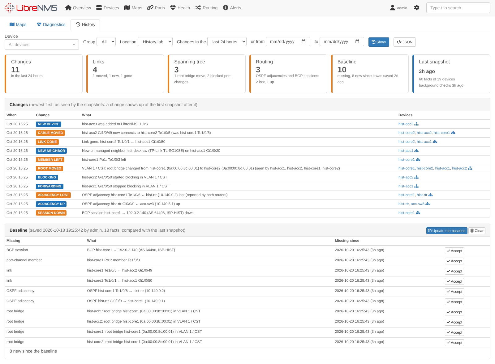

## Device page

A **Topology** panel on the overview page of each device with neighbors, spanning tree or routing data shows its
neighbors, whether it runs OSPF or BGP or has routed interfaces (addresses on two or more ports), its STP role per VLAN
(root / root port / cost / blocked ports / last topology change) and spanning tree issues, and links to the maps,
diagnostics and changes of that device. Ports get a **Plugins** tab (see
[Host locator and port tab](#host-locator-and-port-tab)).

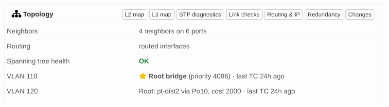

## Requirements

* LibreNMS 26.x (developed and tested against 26.10), PHP 8.2+
* The LibreNMS modules that feed the plugin enabled for your devices:
  `discovery-protocols` (links), `ports`, `vlans`, `ports-stack`, `stp`, `ipv4-addresses`
  (`ipv6-addresses`), `vrf`, `ospf`, `bgp-peers`, `route` (path trace, off by default), `fdb-table` (rogue root
  tracing, host locator), `arp-table` and `ipv6-nd` (host locator), `nac` (802.1X sessions, off by default),
  `transceivers` and `sensors` (optical levels), `entity-physical` (stack members and line cards), and those of the
  [L3 map overlays](#layer-3-map-overlays). The maps and checks work with whatever subset is available; the
  MAC vendors need LibreNMS' OUI table (`mac_oui.enabled`), DNS lookups of the host locator `getent` (glibc or musl).
* The plugin keeps its data in tables of its own (`topology_*`), created by database migrations of the plugin: the
  topology history (four tables, recorded through the LibreNMS scheduler), the saved views and the list of the custom
  maps it made. `./validate.php` warns about those migrations; read [Installation](#installation) before acting on them.

## Installation

The plugin is a standard Composer package (LibreNMS "plugin package"). Run everything as the `librenms` user.

```bash
sudo su - librenms

# 1. tell composer where the package lives (stored in the librenms user's global composer
#    config so it survives LibreNMS updates)
composer config --global repositories.librenms-topology vcs https://github.com/agoodley/librenms_dashplugin

# 2. install it with LibreNMS' plugin installer
cd /opt/librenms
./lnms plugin:add agoodley/librenms-topology-plugin dev-main
```

If the repository is private, give composer a GitHub token first:
`composer config --global github-oauth.github.com <token>`.

To install from a local checkout instead, use a path repository:

```bash
composer config --global repositories.librenms-topology '{"type": "path", "url": "/opt/librenms-plugins/librenms_dashplugin", "options": {"symlink": true}}'
./lnms plugin:add agoodley/librenms-topology-plugin @dev
```

The plugin is enabled automatically. Its pages are listed under **Overview → Plugins** in four groups (maps,
diagnostics, tools and history), after **Topology overview** (`/plugin/topology`), which shows them all with a short
description. It can be disabled or configured in **Overview → Plugins → Plugin Admin → topology → Settings**.

The plugin keeps its data in tables of its own: the topology history and the baseline (`topology_facts`,
`topology_baseline`, `topology_runs`, `topology_findings`), the saved views (`topology_views`) and the custom maps it
made (`topology_custom_maps`). Create them once with `./lnms migrate` (LibreNMS updates run it too, so later versions of
the plugin update them). The history is recorded by the LibreNMS scheduler, which LibreNMS needs anyway
(`librenms-scheduler` timer or cron, see `./validate.php`): `topology:snapshot` every *History interval*, which records
the snapshot and then runs `topology:checks stp|links|redundancy|routing` one after the other, each in a process of its
own; the output goes to `logs/topology-snapshot.log`, a failure to the eventlog. `./lnms topology:snapshot` does the
same now. With several pollers (distributed polling) it runs on one of them at a time: the snapshot and each check
take a lock in LibreNMS' cache (the database, unless `CACHE_STORE` or `CACHE_DRIVER` in `.env` names a store all
pollers share, as distributed polling needs), so a run, scheduled or manual, skips while another one holds it.

`./validate.php` then warns that the database schema "has extra migrations
(2026_10_20_000000_create_topology_history_tables, 2026_10_20_100000_create_topology_custom_maps_table,
2026_10_20_100100_create_topology_views_table, 2026_10_21_000000_add_finding_subjects_to_topology_history,
2026_10_22_000000_widen_topology_finding_devices)" (in the order they were applied) and is "between releases": those
are the plugin's migrations, and the warning stays while the plugin is installed. While it warns, validate.php skips its
checks of LibreNMS' own schema (structure and collation). **Do not delete the plugin's rows from the `migrations` table**
to silence it: validate.php then lists the `topology_*` tables as extra tables and offers to drop them. **Never apply
that fix**: it deletes the history, the baseline and the saved views.

To remove the plugin and its tables:

```bash
# drops the topology_* tables and removes their rows from the migrations table
# (it lists LibreNMS' own migrations as "Migration not found" and leaves them alone)
./lnms migrate:reset --path=vendor/agoodley/librenms-topology-plugin/database/migrations
./lnms plugin:remove agoodley/librenms-topology-plugin
```

`./lnms plugin:remove` alone keeps the tables, so a reinstall keeps the history, the baseline and the saved views.
Custom maps the plugin made are LibreNMS' own: they stay either way.

## Usage tips

* **Center on a device** and pick the number of hops for large networks (the map is capped at *Maximum devices*,
  default 400). Double-click any device to re-center on it. When the devices and their unmanaged neighbors are more
  than that, the phones, servers and access points of each switch are drawn as one node per kind ("20 phones"), and
  **Find device** finds a device in its group; centered on a switch with few hops, they are drawn one by one again.
* Pick a **VLAN** on the L2 map to see which switches/trunks carry it and that VLAN's spanning tree
  (root bridge, port roles, blocked ports). Domain rows and findings on the STP page link straight to that view.
* Arrange devices by dragging, then **Save layout** (stored in your browser for that map scope), or save the map as a
  **view** to keep it on the server and share it with a link.
* On the L3 map, click a router and pick an overlay under *Connections* to list its LSPs, tunnels or pseudowires;
  `l3?isis=0&mpls=1` (and `api/l3`) switches IS-IS off and the MPLS LSPs on. A faded device is outside the map:
  double-click it to follow the tunnel or LSP there.
* The suggested configuration under a description finding is ready to paste; it names each port after its current
  LLDP/CDP neighbor (`core2 Te1/1/1`).
* Before maintenance on a switch, open it on the L2 map and use **Simulate failure**: the box lists what loses its path
  to the core, computed on the whole network as it is right now (links and devices that are already down stay down),
  including devices that are not on the map. Add more failures to check a pair, *Reset* to start over.
  `l2?fail=d:12,p:345` opens the map with device 12 and the link of port 345 failed (`api/simulate?fail=...` returns the
  same as JSON).
* After a planned change, save the **baseline** again (for the affected location or group only, by filtering first) so
  the Changes page and the redundancy analysis expect the new topology, or **Accept** the single items that are gone on
  purpose (the redundancy finding of a missing link points to its device on the Changes page). `./lnms topology:snapshot
  --baseline` records the topology and saves it as the baseline of every device; `--no-checks` skips the background
  checks, `./lnms topology:checks stp` runs one of them (`stp`, `links`, `redundancy`, `routing`).
* The **Coverage** page lists the network devices LibreNMS only knows as LLDP/CDP neighbors: adding them (or turning on
  LLDP/CDP autodiscovery, `autodiscovery.xdp`) fills the gaps in the maps and in the redundancy analysis.
* When the STP page reports a broadcast storm, start with the MAC flapping messages in **Loop evidence**: the ports a
  switch names are the two sides of the loop. A sudden storm with clean spanning tree data usually means an unmanaged
  switch or a hub on an access port.
* If the automatic core is not your core, set **Core devices** in the settings; the switches next to the LibreNMS
  poller are a good choice when you want "what can the poller still reach". Set both switches of a core pair: with only
  one, the other one gets parents on the dependencies page and the rollout planner plans it like any other switch
  (both pages name a switch that is cabled like a second core switch).
* Before a firmware rollout, plan it on **Rollout Planner** for the device group or location, then put each batch and
  the devices listed under it in a LibreNMS maintenance window while it runs.
* On the routing page, a BGP session's last error is decoded ("Hold Timer Expired (4/0)": keepalives lost) – look there
  first when a peer flaps. Addresses that are shared on purpose (anycast, VRRP / HSRP virtual addresses that a device
  reports as interface addresses) can be left out of the IP checks in the settings.
* **Host locator** links are shareable: `hosts?q=10.10.10.55`, and `l2?device=7&host=d4bed9010203` opens the L2 map
  around device 7 with that host drawn next to the switch it is plugged into (the switch has to be on the map). On a port
  page, *Plugins* → *Locate* on a MAC finds where that host really is when the port is an uplink.
* **Path trace** links are shareable too: `path?a=10.10.10.55&b=10.20.30.40`; the ⇄ button traces the way back, which
  can differ (asymmetric routing, a different gateway).
* Give the locations a latitude and longitude (LibreNMS can look them up from the address) and the site map can lay
  the network out geographically; the first visit uses that layout.
* `plugin/topology/api/l2`, `api/l3`, `api/sites`, `api/stp`, `api/links`, `api/routing`, `api/redundancy`,
  `api/coverage`, `api/rollout`, `api/dependencies` and `api/changes` return the same data as JSON (same query
  parameters as the pages, e.g. `api/stp?vlan=30&group=2`, `api/links?device=12`, `api/routing?vrf=PROD`,
  `api/changes?window=7d` or `api/changes?from=2026-10-01&to=2026-10-07`) for automation, `api/simulate?fail=...` a
  failure simulation, `api/hosts?q=...` the host locator's answer, `api/path?a=...&b=...` the path trace and
  `api/views` the saved views (`api/l2?view=12` adds a view's positions). Like the pages, they need a LibreNMS login
  session (a LibreNMS API token does not open them) and answer with the user's permissions; API answers list the
  kinds of data the user's role hides in `role_hidden`. `api/coverage` cuts each list at the same 500 rows as the page
  and returns the full counts as `findings_total`, `neighbors_total`, `devices_total` and `ports_total`: narrow it with
  `device`, `group` or `location` for the rest. Phones and servers among the neighbors are only counted, in
  `summary.other_neighbors`. The POST routes behind the map buttons (`api/views`, `api/views/{id}` and
  `api/views/{id}/delete` save, update and delete a view; `api/custom-map/preview` and `api/custom-map` export a
  LibreNMS Custom Map) also take the session's CSRF token.

## Settings

| Setting | Default | |
|---|---|---|
| Default hops | 2 | hops drawn around a centered device |
| Maximum devices | 400 | larger maps are trimmed to the best connected devices (on the site map: sites) |
| Show unmanaged neighbors / Collapse port-channels / Hide stub networks | on | defaults of the map toggles |
| Point-to-point prefix | 29 | two-device IPv4 subnets this long or longer become direct links (L3 and site maps) |
| Excluded subnets | – | CIDRs never drawn on the L3 and site maps (e.g. management networks) |
| Designated root bridges | – | hostnames/sysNames/ids; warn when any other bridge is root |
| Topology change window / rate | 60 min / 50 per day | topology changes this recent are reported; more per day of uptime warn |
| Flapping threshold | 100 | transitions to forwarding |
| Maximum diameter | 7 | bridge hops from the root |
| Event history | 7 days | STP eventlog entries analyzed |
| Storm threshold / share | 1,000 packets/s / 20 % | broadcast or multicast rate on an inter-switch port that is a storm when it is also this share of the port's packets or 1 % of the link (0 disables; check codes `broadcast_storm`, `multicast_storm`) |
| Syslog window | 24 hours | loop related syslog messages this recent are analyzed |
| Disabled STP checks | – | check codes (the `code` of each finding in `api/stp`) or categories (`root`, `config`, `changes`, `ports`, `loops`, `storms`, `syslog`), e.g. `timers_non_default multicast_storm` |
| Syslog patterns | Cisco, Arista, Junos, ProCurve messages | one regular expression per check, matched against the program and the message (case-insensitive, or written with delimiters and flags such as `/udld/i`), tried in this order: `loop_detected`, `udld`, `bpdu_guard`, `loop_guard`, `root_guard`, `storm_control`, `mac_flapping`, `syslog_native_vlan`, `syslog_duplex_mismatch`, `err_disabled`; messages matching *Messages to ignore* are skipped first (`(?!)` ignores nothing). An empty field uses the default, so improved defaults apply after an upgrade; a pattern that keeps failing (backtracking limit) is reported and set aside |
| Interface error threshold | 10 | errors per poll on an inter-switch port (0 disables) |
| Discard threshold | 1 % | share of the packets discarded (0 disables) |
| Port-channel imbalance | 40 % | a member above this utilization carrying 3x the traffic of another member (0 disables) |
| Optical margin | 2 dB | receive power this close to the alarm threshold is reported (0 disables) |
| Ignored VLANs | – | e.g. `999 1002-1005`: VLANs local to each switch by design |
| Disabled link checks | – | check codes or categories (`mismatch`, `vlans`, `lags`, `counters`, `optics`, `neighbors`, `descriptions`), e.g. `mtu_mismatch description_missing` |
| BGP reset window | 24 h | sessions that came up less than this ago are reported as reset (0 disables) |
| Prefix limit warning | 80 % | share of a peer's maximum-prefix limit that warns (100 % is critical; 0 only reports peers at the limit) |
| Ignored addresses | – | CIDRs or addresses left out of the IP checks (anycast, virtual gateway addresses) |
| Disabled routing checks | – | check codes or categories (`ospf`, `bgp`, `ip`), e.g. `ospf_cost_asymmetric bgp_no_prefixes` |
| Core devices | – | hostnames/sysNames/ids every device should keep a path to; empty: designated root bridges, else automatic |
| Warn from | 2 | switches, routers or firewalls cut off by one failure before a single point of failure is a warning |
| Disabled redundancy checks | – | check codes or categories (`outages`, `lost`, `fake`, `spof`), e.g. `spof_link uplinks_same_device` |
| DNS lookups | on | hostnames that are not LibreNMS devices are resolved with the server's resolver (`/usr/bin/getent` or `/bin/getent`) in a subprocess stopped after 2 seconds, 4 seconds per search; answers and failures are cached for 5 minutes, 20 lookups per user and minute |
| Busy link on a path | 80 % | utilization in or out from which a port on a traced path is a finding (critical from 95 %) |
| Route table limit | 500,000 | a path trace reads LibreNMS' route table (no index but its key: one full read per address it routes toward; the per-router summary is kept for 5 minutes) only while it holds fewer routes than this; larger, every router is crossed by an estimate (0: no limit) |
| Hub or unmanaged switch from | 4 MAC addresses | an access port with at least this many MAC addresses in its last forwarding table and no LLDP/CDP neighbor that explains them is probably a hub or unmanaged switch: reported by the coverage report and noted by the host locator (0 switches it off; several neighbors on one port are still reported) |
| Disabled coverage checks | – | check codes or categories (`unmonitored`, `devices`, `ports`), e.g. `not_linked hub_suspected` |
| Record the topology history | on | every *History interval* through the LibreNMS scheduler |
| History interval | 60 min | 5 to 1440 minutes, rounded down to 5, 10, 15, 20, 30, 60, 120, 180, 240, 360, 480, 720 or 1440 (whole hours run at 7 minutes past) |
| Keep changes for | 90 days | facts and findings that ended earlier are deleted |
| Background checks | all four | spanning tree, link & VLAN, redundancy and routing & IP, run every *History interval* one after the other; none checked switches them off |
| Eventlog from severity | warning | a device gets an eventlog entry when it gets or loses a background finding from this severity (`critical`, `warning`, `info` or `none`) |
| Checks kept out of the eventlog | `link_errors link_discards lag_imbalance optical_rx port_transitioning tc_rate tc_recent multicast_storm bgp_recent_reset ip_duplicate:info` | check codes that follow the counters of the last poll (`multicast_storm`: the multicast rate of the last poll, which routing protocols and video streams raise too) or a time window (`bgp_recent_reset`: a reset in the last *BGP reset window*); `code:severity` keeps the findings of a check with that severity out (`ip_duplicate:info`: duplicate addresses that are probably shared gateways, anycast or separate networks reusing the address). They stay on the pages; a warning that becomes such an info finding stays a warning (no "resolved"). The settings page warns about entries that are no check code |
| Rollout batch size | 0 | default most devices per rollout batch (0: no limit); the planner page can change it |
| Outage history | 30 days | outages the derived dependencies are checked against |

## Permissions

Every map and diagnostic only uses devices the logged-in user may see (LibreNMS device permissions).
Neighbors on devices the user cannot see are shown as unmanaged neighbors (their LLDP/CDP name only), and a
root bridge on such a device is not reported as a rogue switch. The coverage report lists a neighbor LibreNMS linked to
such a device as monitored without naming the device (LibreNMS shows the neighbor's name on the device's neighbors tab
too), and compares the names of neighbors LibreNMS did not link only with the devices the user may see (also disabled
ones), so it tells nothing else about the others. The topology history is recorded for all devices; the Changes page
shows a user the changes of their devices, names other devices by their LLDP/CDP name or as "another device", and only
lists background findings about their devices alone. Only LibreNMS admins can apply derived device dependencies and
save, clear or accept items of the baseline; other users see those pages read only. A baseline change for a device, group
or location that no longer resolves (disabled, deleted or not permitted) is refused rather than applied to everything.

Only LibreNMS admins who may create custom maps (and update them, to replace one) can export a map to a LibreNMS Custom
Map; the map is built with their permissions. Everyone who can open the maps may save views and share their own; they
change and delete their own views, LibreNMS admins any shared view. A shared view is built with the permissions of
whoever opens it: its positions are only sent for the nodes of their map, and it names no device, group, location or VRF
they may not see.

Besides the devices a user may see, LibreNMS checks a role permission for each kind of data (`port.view` for ports and
what LibreNMS keeps of them: interface addresses, VLAN memberships, port-channel stacks, statistics, forwarding, ARP,
IPv6 neighbor, 802.1X and spanning tree rows; `link.view` for LLDP/CDP links, `routing.view` for OSPF, BGP, IS-IS, MPLS
and pseudowires, `outage.view`, `eventlog.view`, `syslog.view` ...), and admins can give custom roles only some of them
(the built-in user role has them all). The plugin leaves out what a user's role may not view, as LibreNMS' own pages do:
LLDP/CDP links on the maps and the link based pages, spanning tree data, OSPF / BGP / OSPFv3 / IS-IS / IPsec / MPLS /
pseudowire data on the L3 map, routing and site pages, outages, STP eventlog entries, interface addresses on every page
(with them the subnets of the L3 and site maps, the IP checks of the routing page and the routers of the host locator),
VLAN memberships, port-channels and statistics of ports, forwarding / ARP / IPv6 neighbor tables and 802.1X sessions in
the host locator and the port tab (which also need the permission to view ports), and the matching facts and findings on
the Changes page. Each page says what its user's role hides ("Your LibreNMS role may not view BGP sessions"), so an
empty answer is not taken for "nothing found"; the JSON API, saved views and the file and Custom Map exports hold the
same reduced data, and the Saved Views page marks with a lock the views whose map leaves something out. The syslog
evidence of the spanning tree page, and the findings of its syslog based checks on the Changes page, are only shown to
users whose role may view syslog (the eventlog entries of the spanning tree check name those checks to everyone who may
see the device). The background checks run without a user and read everything; their eventlog entries name the check
only, and an entry capped at the first devices says "and on other devices" without a count. Applying device dependencies
always writes the number of parents, and only that, to the device's eventlog, as users who may see the device may not
see its parents; the names are logged at info level (see [Device dependencies](#device-dependencies)).

VRF names have no role permission of their own in the plugin. LibreNMS shows the VRF of a port to everyone who may view
the port, and the plugin needs the names to keep apart the subnets and sessions of different VRFs: without them the L3
map would join subnets of different VRFs into links that do not exist. So they come with the addresses (`port.view`) and
the sessions (`routing.view`) they belong to, and the VRF filter of the routing page and the scope of a saved view name
the VRFs of the devices the user may see without asking for either.

LibreNMS 26.10 checks `link.view` or `link.viewAll` for LLDP/CDP links. Its installation creates neither permission,
only `link.viewAny`, which the link policy does not check; LibreNMS' role editor creates `link.view` and `link.viewAll`
when a role is saved with *Links → View links* or *View all links*. A custom role without one of them sees no LLDP/CDP
links, in LibreNMS or in the plugin; the admin, global-read and user roles are not affected.

A path trace only resolves ends the user may see and shows devices out of their sight on the path without name, ports
or addresses; only admins see the size of the whole route table. It leaves out what the user's role may not view and
says so on the trace: without LLDP/CDP links a Layer 2 path is "not shown", without `port.view` (which also covers
interface addresses, ARP and forwarding tables) the hops show no ports, hosts are not located and the routed path is
not followed, and without `routing.view` every router is crossed by an estimate that says the role may not view routes
(OSPF / BGP neighbors are then left out of the estimates too).

## How it works

* `src/Data/` – all database access, permission scoped (`ScopedRepository`: the devices the user may see and the role
  permission of each LibreNMS table); `TopologyRepository` serves the maps and the diagnostics.
* `src/Support/Navigation.php` – the pages, as listed in the navigation, the plugin menu and the landing page;
  `src/Support/RoleData.php` – the LibreNMS tables each page reads that a role permission can hide, for the notice
  that says what the user's role hides.
* `src/Hooks/` – the LibreNMS plugin hooks (menu entries, landing page, settings page, device panel, port tab);
  `src/Http/Controllers/` – the pages and their JSON API, routed in `routes/web.php`.
* `src/Topology/L2Builder.php`, `src/Topology/L3Builder.php` – build the map graphs (link de-duplication,
  port-channel/MLAG handling, VLAN membership, subnet classification, hierarchy tiers, and the L3 overlays: OSPF, OSPFv3, IS-IS,
  BGP, IPsec, MPLS LSPs and pseudowires, whose far ends are devices of the map, stubs of devices outside it or one
  external node per address). `Data\L3LayerRepository` reads the newer layers and recognizes far ends among the devices
  the user may see.
* `src/Stp/StpIndex.php`, `src/Stp/StpAnalyzer.php` – STP role derivation (BRIDGE-MIB has no port role) and
  the diagnostics; `src/Stp/LoopEvidence.php` – storms on inter-switch links and the loop related syslog messages
  (`SyslogPatterns` classifies the messages, `Data\LoopEvidenceRepository` reads the packet rates and the syslog).
* `src/Links/LinkAnalyzer.php` – the link and VLAN checks (both ends of each link, port-channels, VLAN islands per
  L2 domain, descriptions and their configuration lines).
* `src/Routing/RoutingAnalyzer.php` – the OSPF, BGP and IP checks (OSPF domains from the adjacencies, the interface
  facing each neighbor, BGP peers resolved to monitored devices); `BgpErrors` turns NOTIFICATION codes into text. The
  rows are streamed in and kept in small objects (2,000 routers with 50,000 addresses take about 50 MB and 0.6 s);
  with a device selected, `RoutingService` reads only the addresses its checks need.
* `src/Hosts/HostLocator.php` – follows a MAC's forwarding table entries to the switch port it is plugged into;
  `HostService` turns IP addresses and names into MACs and builds the port tab.
* `src/Path/L2Tracer.php`, `src/Path/L3Tracer.php` – the forwarding path in a VLAN's spanning tree instance (and how
  far its links must be read to be sure of it) and the router by router lookups (with the estimate for routers without
  current routes); `PathNetwork` reads what a trace needs, `PathEndpoints` resolves the ends (with the host locator),
  `PathAssembler` joins the Layer 2 segments and the routers, `PathReport` describes the hops and their problems
  (`Data\PathRepository` reads the links, keeping devices out of the user's sight anonymous, and the route table).
* `src/Redundancy/RedundancyAnalyzer.php` – single points of failure (cut vertices and bridges toward the core,
  `Support\Graph::cuts()`), fake and lost redundancy and outages; `CoreFinder` picks the core, `PortUnits` reads stack
  members and line cards from the hardware inventory.
* `src/Topology/SiteConnections.php`, `SiteSessions.php`, `SiteBuilder.php` – the site map: the cables and
  point-to-point subnets between devices at different locations (the L2 map's link de-duplication and the L3 map's
  subnets, placed on physical ports through the interface stack), their OSPF adjacencies and BGP sessions per circuit,
  added up per pair of sites.
* `src/Redundancy/RolloutPlanner.php`, `src/Redundancy/DependencyPlanner.php` – rollout batches and device dependencies
  on the graphs of the redundancy analysis (`Topology\PlanningService`, `Data\DependencyRepository`); `CoreAdvice` names
  a switch cabled like a second core switch.
* `src/Coverage/CoverageAnalyzer.php` – the coverage report (unmonitored, unlinked and ambiguous neighbors, devices
  without neighbor data, ports with several neighbors or many MAC addresses); `Links\NeighborReports` is the index of
  which device reports which neighbor, shared with the link checks.
* `src/History/` – the topology history: `FactCollector` (what a snapshot records: one fact per link, port-channel
  member, root bridge a switch sees and blocked port, the last two with their VLANs), `FactDiff` (what it writes),
  `ChangeReport` (moved cables, root bridge moves, lost adjacencies), `Baseline`, `FindingHistory` (findings confirmed
  by two runs, eventlog entries); `HistoryService` runs them, `Console/` holds the scheduled `topology:snapshot` and
  `topology:checks`.
* `src/Sharing/SavedView.php` – what a saved view keeps and which of its positions a viewer gets (`Data\ViewRepository`
  stores the views and checks who may open and change them).
* `src/Sharing/CustomMapLayout.php` – the custom map of an L2 or L3 map (nodes, icons, positions, the port of each
  link); `Data\CustomMapRepository` checks LibreNMS' custom map schema and writes it.
* `database/migrations` – the plugin's tables: the topology history, the saved views and the custom maps it made.
* `resources/assets/topology.js` – the map client, drawn with the vis-network library bundled with LibreNMS. It also
  writes the draw.io and GraphML files, in the browser, from the map as drawn.

The builders and analyzer are plain PHP with no LibreNMS dependency and are covered by unit tests:

```bash
composer install
vendor/bin/phpunit
```

## Limitations

**Maps**

* Saved views and the Custom Map export cover the L2 and L3 maps; the site map has the file exports only.
* Layouts saved with the save button live in the browser's local storage; save them as views to share them. A view keeps
  the positions of its nodes by their map id: a device that is renamed keeps its place, an unmanaged neighbor that gets
  a new name moves next to its links.
* The custom map export is verified against LibreNMS 26.10, whose custom map tables have not changed since November
  2024. On other versions it writes only the columns that exist, and refuses with a message when a column it needs is
  missing or one it does not know must be filled. The custom map shows the map as the admin who exported it sees it;
  LibreNMS shows a custom map to the users who may see all of its devices.
* The draw.io file uses draw.io's Cisco shapes, which draw.io loads from its own shape library (built into draw.io
  desktop). yEd has no Cisco icons: the GraphML file draws the roles as basic shapes (rectangle for a switch, ellipse
  for a router, octagon for a firewall, triangle for an access point), colored like the map.
* L3 overlays: a far end found on several devices (a duplicated address or router ID) is not guessed: it is an external
  node, like an unknown peer or one on a device you may not see, which shows only the address. Pseudowires whose peers
  LibreNMS lost on several PEs with the same VC ID stay unpaired, and their state is unknown; the MTU check assumes one
  VLAN tag on an IOS XR subinterface (a QinQ one is flagged). Far ends that are not on the map are looked up in
  `ipv4_addresses` / `ipv6_addresses`, which have no index on the address: one table scan per map load for up to 5,000
  addresses.
* The site map knows the links between monitored devices. Unmanaged neighbors, devices the user may not see and OSPF
  neighbors LibreNMS does not monitor are left out (their location is unknown), as are sessions to devices outside a
  device group filter; BGP peers LibreNMS does not monitor are grouped by AS, so two providers in the same AS are one
  cloud. The devices without a location are one site, which the map never walks through (hops, hierarchy).
* A provider in a private AS with its own PE at every branch (an MPLS L3VPN) looks like the firewalls of the branches,
  so it is a cloud per site, and so is a hub or route server on a shared Ethernet segment (VPLS): only a tunnel subnet
  (DMVPN) counts as one network, since a template transit LAN at every branch looks the same. Whether sites share a
  private AS cloud comes from the routers' addresses: the session's local address, or the router's interface addresses
  while the session is down, so a shared cloud only splits when LibreNMS has neither.
* A subnet between two sites only rides the cables between them when both ends reach them through their own site (a VLAN
  interface, or a port facing a switch that leads to such a cable through switches only; a carrier's CPE, router or
  firewall in the way makes it a circuit of its own), which needs LLDP/CDP: a router behind a switch that does not show
  up as its neighbor makes a transit VLAN to it a circuit of its own, counting its traffic twice. Without VLAN data, a
  carrier circuit (a VPLS backup) between two routers that both sit behind their sites' switches, next to a fiber
  between those switches, looks like such a transit VLAN and is counted as riding the fiber.

**Spanning tree and loop evidence**

* STP data comes from the BRIDGE-MIB as polled by LibreNMS: MST instances other than the CIST are not available, and
  findings reflect the last poll (a check can fire during re-convergence).
* Loop evidence from syslog only covers devices that send their syslog to LibreNMS (the page says how many do) and users
  whose LibreNMS role may view syslog. Up to 100,000 messages are searched per page view, newest first, the devices
  taking turns (the most recently active first), so a busy device (ACL logging) does not crowd out the others; the page
  says how many devices were not searched, or not back to the start of the window. Storm rates come from the broadcast
  and multicast counters the ports poller reads (IF-MIB ifXTable); LibreNMS stores 0 for counters a device does not
  report, so a port whose counters all stay at 0 counts as not reporting them. Ports not polled for a day are left out,
  and counters older than a few polls are shown with their age. Heavy multicast can be intended (video, IPTV): disable
  `multicast_storm` there.
* Stacks / virtual chassis that are not modeled as one device, and MLAG pairs without a detected port-channel, can
  produce a "possible bridging loop" warning – the finding says so.
* The STP page analyzes every VLAN at once when their spanning tree instances (a PVST network has one per switch and
  VLAN) fit in the memory a page may use: about 8,000 instances at PHP's 128 MB default, 25,000 at the 256 MB the
  plugin's pages take unless LibreNMS sets `php_memory_limit`; a device's page needs only the instances of that device's
  VLANs. Beyond that, or above 150,000 STP port rows, it analyzes one VLAN at a time, VLAN 1 / CST until another is
  picked; the background check covers every VLAN.

**Link & VLAN, routing & IP**

* LibreNMS refreshes VLAN memberships at discovery (every 6 hours by default) and counters at every poll, so a VLAN
  change can take until the next discovery to show up. The split VLAN check can only follow links that LLDP/CDP reports;
  a VLAN that crosses a link without LLDP/CDP can be reported as split.
* The routing checks see what LibreNMS polls: OSPFv2 (OSPF-MIB; OSPFv3 is not checked) and BGP sessions; accepted prefix
  counts come from Cisco, Junos, Arista, Dell OS10 and Huawei VRP routers (bgpPeers_cbgp), the maximum-prefix limits
  only from Cisco. Adjacency and session states are a snapshot of the last poll, so a state seen during a change can
  show up once. A session or address is matched to a device only when that device is monitored and visible to you and
  the address is on that device only; a one-sided session needs the peer's BGP sessions in that VRF to be polled (an
  SNMP context per VRF). A session that has never come up to a confederation peer can be reported as a remote AS
  mismatch, and interfaces on one LAN behind a switch are only compared when their routers are in one OSPF domain.
  Subinterfaces are matched to the port LLDP/CDP reports by name (Gi0/1.100 to Gi0/1), but port-channel members are not
  matched to their port-channel: a port-channel PE-CE handoff larger than a point-to-point subnet (a /29, an IPv6 /64),
  toward a customer router without VRFs, still joins every routing table, so addresses reused across it are warnings.

**Redundancy and monitoring coverage**

* The redundancy analysis only knows links that LLDP/CDP reports. LibreNMS removes a link that LLDP/CDP no longer sees
  at the next discovery, so "redundancy lost" covers failures since the last discovery run; a link that has been down
  for longer is simply missing, unless a baseline is saved on the Topology Changes page. It looks at device and link
  failures, not at VLANs: a backup trunk that does not carry a VLAN is a link & VLAN finding.
* Servers, access points and phones are recognized by their LibreNMS device type, unmanaged neighbors by their CDP
  platform or, for LLDP (which has no platform), their system description; a neighbor with neither counts as a switch.
  Down devices without any LLDP/CDP neighbor are not listed as outages: nothing tells what they depend on.
* The coverage report only knows what LLDP/CDP and the forwarding tables report: a switch that sends no LLDP/CDP shows
  up at best as a port with many MAC addresses. LibreNMS does not keep the management address a neighbor advertises, so
  *Add* opens the Add Device page without it. Neighbors LibreNMS did not link are matched to monitored devices by
  hostname, sysName, display name (a name without domain matches the same first label with any domain) and interface
  address; LibreNMS itself also links by MAC address, which the report cannot check. A neighbor whose platform,
  description and name tell nothing is listed as of unknown type, without a finding. MAC addresses are those of each
  device's last discovery (LibreNMS keeps older ones for `ports_fdb_purge` days): when that discovery found none on a
  port, the port is not reported. The LLDP/CDP rows are read from the database in chunks and phones and servers are only
  counted, so the whole network of 1,200 switches with 36,000 phones and 2.8 million forwarding table entries takes
  about 2 seconds and 30 MB of PHP memory.

**Host locator**

* The host locator works from the forwarding (MAC address), ARP and IPv6 neighbor tables LibreNMS reads at discovery,
  every 6 hours by default (the `arp-table` poller module refreshes ARP every poll, `nac` is off by default), so every
  answer shows when the host was last seen. LibreNMS keeps forwarding table entries it no longer sees for 10 days
  (`ports_fdb_purge`); the locator lists entries from before a switch's last discovery as old (the start of the device's
  last discovery, confirmed by one entry from it) and counts MACs on a port from that discovery only. Switches whose
  forwarding table LibreNMS does not read end the trail.
* An 802.1X / MAB session counts while LibreNMS polls it: at every poll of the `nac` module it marks the sessions a
  switch no longer reports as historical (it updates the others only when one of their values changes), so a session
  that is not historical is current if the switch's `nac` poller module is on (the device's setting, else its OS's, else
  the global one, which is off by default) and the switch was polled within the last three poll intervals (15 minutes by
  default). A session starts at its update time minus its session time, else when LibreNMS first saw it (Cisco reports
  no session time, and a host that moves to another port of the same switch keeps its session's start).
* Query cost: LibreNMS has no index on the address in the ARP table or on anything but port and device in the IPv6
  neighbor table, so an IPv4 search reads the whole ARP table once and every search the whole IPv6 neighbor table (twice
  for an IPv6 address); the port tab (on every port page) shows IPv4 addresses only and uses indexed lookups. 802.1X
  sessions are looked up on the ports where the MAC is learned, and by the MAC alone (the whole, small session table)
  when none of them has a current one. Whether a session is on a switch behind the one a trail ends at follows the
  LLDP/CDP links of each device once per search, by indexed lookups (the links a device reports, and those reported to
  its ports: a link without a known far port is missed).

**Path trace**

* Path trace query cost: the links are read outward from both ends of each Layer 2 segment, a few devices at a time,
  until the path found is the shortest one (every path that could be as short is loaded) or one end has nothing left to
  read; at most 3,000 devices' links per trace. Only the VLAN rows and the spanning tree rows of the traced VLAN on those
  links are read, and the counters of the ports on the answer. Routing reads what the walk needs: the interfaces of the
  routers it reaches, the owners of an address and the subnets that hold it (through LibreNMS' networks tables), the
  neighbors of the routers an estimate looks at (at most 500), and the route table once per address routed toward (the
  destination, a recursive next hop).
* The path trace is worked out from what LibreNMS last read, not sent through the network: no live traceroute, so
  policy routing, ECMP hashing (the path follows the lowest next hop), asymmetric return paths and changes since the last
  discovery can make the real path differ. Route tables need the `route` discovery module, which LibreNMS skips on
  routers with more than `routes_max_number` routes (1,000 by default, so not on routers with a full BGP table) and
  keeps their last table: a table older than its router's last discovery is not used, those routers are estimated. A
  route whose next hop is no address of a device you can see (an unmonitored router) leaves the devices you can see
  there; the path resumes at the router with B's subnet connected when there is one, without the routers between. A
  next hop out of an unnumbered interface is the device LLDP/CDP sees on it. VRFs are followed by name. After a
  recursive next hop (iBGP, an MPLS VPN) a router with a route to B is taken to route B itself, and one without goes
  toward that next hop: right for plain IP and for a label switched path through a BGP-free core, but with MPLS a router
  that also has a route to B still label-switches, and the real path can differ. Gateway redundancy (HSRP / VRRP) is
  not resolved: the path leaves A's subnet through the router with A's ARP entry. A device you may not see is crossed as
  "a device you may not see" when the visible devices on both sides report it as their LLDP/CDP neighbor; its ports and
  name are not shown, and it is assumed to pass frames on. A bridge with a single spanning tree instance in LibreNMS
  (RSTP, or MSTP, whose other instances LibreNMS does not read) has its states taken for every VLAN, which the page
  notes. A gateway (the router with an end's subnet connected) and the subnets an estimate crosses are found through
  LibreNMS' networks tables (ipv4_networks, ipv6_networks), which it fills for every address with a subnet. For an
  address row without a network the gateway is the router whose interface holds the host's ARP / neighbor entry, and
  an estimate does not cross that subnet (it still follows OSPF / BGP neighbors).

**Rollout planner and device dependencies**

* The rollout planner and the device dependencies follow the same LLDP/CDP links, and the baseline links LLDP/CDP no
  longer reports: devices without neighbor data get no parents and are left out of rollout plans. Whether devices back
  each other up is decided strictly (a part without its core devices counts as cut off as a whole), so the core devices
  of a part never share a batch.
* Derived parents never form a loop, so of two switches at the same distance from the core only one can depend on the
  other, and in a mesh a device can keep a path through switches farther from the core while all its parents are down:
  LibreNMS then suppresses its alerts although it may still be reachable. LibreNMS parents must be monitored devices, so
  a device behind an unmonitored switch depends on the next monitored one.

**Topology history and background checks**

* The topology history sees what LibreNMS saw at each snapshot: LLDP/CDP neighbors are refreshed at discovery (every 6
  hours by default), spanning tree, OSPF and BGP at polling. A change shows up at the first snapshot after LibreNMS
  noticed it, and a change undone in between is not seen. Phones are left out (they move all day), and devices disabled
  in LibreNMS keep their last state. Unmanaged neighbors are typed as on the L2 map, from their CDP platform or LLDP
  system description: a link recorded while its neighbor was not known as a phone (before it sent its description, or
  before this plugin version) is dropped from the history and the baseline at the snapshot that types it as one, as if
  it had never been recorded, without a "Link gone".
* The snapshot and each background check run over the whole network, one after the other, each in its own process with
  LibreNMS' `php_memory_limit` (512 MB when it is not set). For 1,242 switches with 23,000 phones and 50 PVST VLANs:
  snapshot 1 s and 115 MB, spanning tree check with loop evidence 5 s and 250 MB (one VLAN at a time), link check 0.6 s
  and 86 MB, redundancy check 0.8 s and 98 MB, the Changes page 0.4 s and 72 MB. For 2,000 routers with 50,000 addresses,
  8,000 OSPF adjacencies and 8,000 BGP sessions: snapshot 1.3 s and 80 MB, routing & IP check 1.3 s and 107 MB (with 1,800
  findings). A check that fails or takes more than an hour is logged in `topology-snapshot.log` and the eventlog, and the
  others still run. A lock lasts as long as the longest run could (5 hours 10 minutes: the snapshot and four checks of
  up to an hour) unless its run releases it, which it does when it ends, also on a fatal error such as running out of
  memory; `topology:snapshot` releases the lock of a check it stopped or that was killed. A run killed outright
  otherwise (`kill -9` of `topology:snapshot` or of a manual run) keeps its lock until it expires, as the scheduler's
  own overlap lock does.
* A finding that gets milder stays open at the highest severity it reached until it is gone (a duplicate address the
  routing check takes for two separate networks while an OSPF adjacency between them is down stays a warning). A new
  finding goes on for a gone one only when it is about all the devices of the gone one or about a part of them (the
  devices their titles name, else all their devices), so a group whose members change every run ("redundancy lost:
  acc-sw4, acc-sw7", then "acc-sw7, acc-sw9") is no successor: it counts after its second run like any new finding. An
  OSPF adjacency names its neighbor by the neighbor's interface address, else by its router ID; an address or router ID
  on several devices names none of them.
* The routing & IP check of the background reads its tables strictly: a table that cannot be read, or only in part,
  fails the run (logged, and nothing of the findings history changes), where the routing page shows what could be read.
  A background check that cannot store its findings history fails the same way: it writes it in one transaction, and
  its eventlog entries after it. The device list of a finding holds up to 16 MB (an outage of 2 million devices).
* The redundancy analysis compares the baseline with the last snapshot, and only while that is less than a day old.

**Installation**

* `./validate.php` warns about the plugin's migrations while the plugin is installed and then skips its checks of
  LibreNMS' own schema (see [Installation](#installation)).
* The pages of the whole network fit in PHP's default 128 MB on 1,242 switches with 23,000 phones and 50 PVST VLANs
  (largest: redundancy and device dependencies 96 MB, links 86 MB, spanning tree 84 MB, L2 map 66 MB); a page also
  raises PHP's memory limit to LibreNMS' `php_memory_limit`, or 256 MB when it is not set. One VLAN of a very large
  PVST network with STP port rows for every port can still need more.

## Roadmap

Further ideas are listed in [ROADMAP.md](ROADMAP.md).

## License

GPL-3.0-or-later, like LibreNMS.
