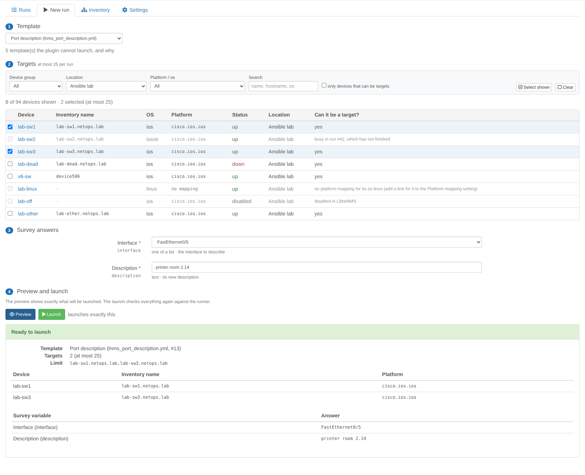

# LibreNMS Ansible plugin

Run reviewed Ansible templates on [LibreNMS](https://www.librenms.org) devices from the LibreNMS pages, through
[Semaphore UI](https://semaphoreui.com), with an inventory built from LibreNMS, live status and log, and an audit log
that is also written to each device's eventlog. This is phase 1 of
[change automation with Ansible](../ROADMAP.md#change-automation-with-ansible).

* **Runs:** the audit log (who ran which template on which devices, when, with which answers, and what each device
  reported), with filters.
* **New run:** pick a template, the target devices and the survey answers, see exactly what will be launched, launch.
* **Run:** live status, per-device result and the Ansible log, refreshed every 2 seconds; Stop.
* **Inventory:** what the runner gets from LibreNMS, the devices left out and why, and the setup steps.
* An **Ansible** panel on each device's overview page, and **Settings** in Plugin Admin.


It is a plugin of its own, next to the [topology plugin](../README.md) in this repository: the topology plugin only
reads LibreNMS data, while this one lets LibreNMS change devices, and it needs a runner with the device credentials.
Many teams will want the topology tools without that. Both appear in the same LibreNMS menu and device pages.

The plugin does not run Ansible itself and holds no device credentials. Semaphore UI keeps the credentials, the
playbooks stay in Git where they are reviewed, and the plugin only picks the targets, checks what it launches,
launches, follows and records.

| Runs | New run (with refused devices) |
|---|---|
|  |  |

| Inventory | Settings with a connection test |
|---|---|
|  |  |


*(Screenshots: a LibreNMS test instance with simulated devices and three simulated Cisco IOS switches.)*

## Contents

* [Requirements](#requirements)
* [Installation](#installation)
* [Semaphore UI setup](#semaphore-ui-setup)
* [Settings](#settings)
* [Permissions](#permissions)
* [Using it](#using-it)
* [How it works](#how-it-works)
* [Safety](#safety)
* [Semaphore UI behaviour the plugin relies on](#semaphore-ui-behaviour-the-plugin-relies-on)
* [Limitations](#limitations)
* [Later phases](#later-phases)

## Requirements

* LibreNMS 26.x (developed and tested against 26.10), PHP 8.2+ with the curl and mbstring extensions (LibreNMS needs
  them too), and the LibreNMS scheduler (`librenms-scheduler` timer or cron, see `./validate.php`).
* [Semaphore UI](https://semaphoreui.com) 2.x; developed and tested against 2.19.17. The plugin needs only the free
  edition: API tokens, the project roles, survey variables, file inventories, environments with secrets, every launch
  option and the task output API are all free. (Pro adds project runners, external secret storages, the Docker
  executor, the per-host task summary and audit-log export; Enterprise adds high availability, custom roles and
  per-template permissions. Official builds contain the paid code and unlock it with a licence key.)
* Ansible on the runner with the collections of your platforms. The Semaphore UI container image ships Ansible with
  `cisco.ios`, `cisco.iosxr`, `cisco.nxos`, `arista.eos`, `junipernetworks.junos`, `vyos.vyos`, `community.routeros`,
  `community.ciscosmb` and `dellemc.enterprise_sonic`, among others.
* The runner must reach LibreNMS over HTTP(S) (it fetches the inventory from it), and LibreNMS must reach the runner's
  API.

## Installation

The plugin is the Composer package `agoodley/librenms-ansible-plugin` in the `ansible/` directory of this
repository. Composer cannot install a package from a subdirectory of a Git repository, so it is installed from a clone,
through a Composer *path* repository. Create the directory of the clone as root, then run everything else as the
`librenms` user:

```bash
# as root: a directory for the clone, owned by the librenms user (it cannot create one in /opt itself)
mkdir -p /opt/librenms-plugins && chown librenms:librenms /opt/librenms-plugins

sudo su - librenms

# 1. a clone of the repository
git clone https://github.com/agoodley/librenms_dashplugin /opt/librenms-plugins/librenms_dashplugin

# 2. tell composer where the package is (stored in the librenms user's global composer config, so it survives
#    LibreNMS updates)
composer config --global repositories.librenms-ansible '{"type": "path", "url": "/opt/librenms-plugins/librenms_dashplugin/ansible", "options": {"symlink": true}}'

# 3. install it with LibreNMS' plugin installer, and create its tables and its permission
cd /opt/librenms
./lnms plugin:add agoodley/librenms-ansible-plugin @dev
./lnms migrate
```

The plugin is enabled when it is installed (LibreNMS enables new plugins), but does nothing until an admin enters the
runner connection. Its pages are for LibreNMS admins: **Overview → Plugins → Ansible**, and its settings in
**Overview → Plugins → Plugin Admin → ansible → Settings**.

The plugin keeps its data in tables of its own: the runs (`ansible_runs`, `ansible_run_targets`), the runner's inventory
fetches (`ansible_inventory_fetches`) and its settings, the runner connection encrypted (`ansible_config`). The
migrations also create the permission `ansible.run`. `./validate.php` then warns that the schema "has extra
migrations (2026_10_24_000000_create_ansible_tables, 2026_10_26_000000_ansible_run_lifecycle, ...)": those are the
plugin's migrations (`database/migrations`), and the warning stays while the plugin is installed. Do not delete its row from the `migrations` table, and never apply validate.php's offer to drop the
`ansible_*` tables: they hold the audit log.

**Updating:** `git pull` in the clone (the path repository links to it), then `./lnms migrate`. When
`contrib/librenms_inventory.py` changed (its `VERSION`), copy it into the playbook repository again, as in step 5
of [Semaphore UI setup](#semaphore-ui-setup), and commit and push it: the Inventory page says which version the
runner's last fetch came from, and warns when it is older than the one the plugin ships.

**Removing:**

```bash
./lnms migrate:reset --path=vendor/agoodley/librenms-ansible-plugin/database/migrations   # drops the ansible_* tables and the permission
./lnms plugin:remove agoodley/librenms-ansible-plugin
```

`migrate:reset` prints "Migration not found" for each of LibreNMS' own migrations: that is expected, it only rolls back
the plugin's (a `--pretend` run shows that it drops only the `ansible_*` tables). `./lnms plugin:remove` alone keeps the
tables, so a reinstall keeps the audit log.

## Semaphore UI setup

The plugin talks to one Semaphore UI project with the token of a user who may only run tasks (the **Task Runner**
role). The runner **pulls** the inventory from LibreNMS with a script of the plugin, so LibreNMS never needs a token
that could change Semaphore. Step by step (the names are suggestions):

1. **A project for the plugin**, e.g. "LibreNMS changes". Everything below belongs to it; keep it apart from projects
   whose templates the plugin should not run.
2. **A Task Runner user and its token.** Create a user (e.g. `librenms`, not an admin), add it to the project with the
   role *Task Runner*, log in as that user and create an API token (user menu → *API Tokens*). That token goes in the
   plugin's settings. Not an Owner's or Manager's token, nor a Semaphore admin's: those may change templates, and so
   their playbook and repository, which lets whoever holds the token run any code with the stored device credentials.
   The plugin launches nothing with such a token (it asks the runner for the token's role and user before every
   preview and launch), nor with one whose user may not run tasks (*Guest*); *Test connection* says why and what to
   change.
3. **The device credentials** in the project's *Key Store*: a *Login with password* key (or an SSH key) for the
   devices, and the enable password as a key too when your platforms need it (the plugin's platform mapping sets
   `ansible_become` and `ansible_become_method: enable` for IOS, IOS-XE and EOS).
4. **The repository** of your playbooks (*Repositories*): only reviewed playbooks belong there (see [Safety](#safety)).
5. **The inventory script:** copy [`contrib/librenms_inventory.py`](contrib/librenms_inventory.py) into the
   repository, e.g. as `inventory/librenms_inventory.py`, make it executable and commit it:

   ```bash
   # in a clone of the playbook repository
   mkdir -p inventory
   cp /opt/librenms-plugins/librenms_dashplugin/ansible/contrib/librenms_inventory.py inventory/
   git add inventory/librenms_inventory.py && git update-index --chmod=+x inventory/librenms_inventory.py
   git commit -m "LibreNMS inventory" && git push
   ```

   It is plain Python (standard library only): `--list` prints the inventory of the plugin, `--host NAME` one host's
   variables. It reads `LIBRENMS_URL`, `LIBRENMS_TOKEN`, and optionally `LIBRENMS_CA_BUNDLE` (a PEM file to verify
   LibreNMS' certificate with) and `LIBRENMS_TIMEOUT` (seconds, default 30); it always verifies TLS certificates,
   never follows redirects, and on an error prints what to check to stderr and exits with code 1; when LibreNMS
   refuses the request (HTTP 4xx) it quotes the reason LibreNMS gives, e.g. that the token is not the inventory user's
   (cleaned, cut, its double quotes replaced). The token is left out of that text when LibreNMS echoes it verbatim or
   split by escape sequences, control, invisible, combining or blank characters; a server that already holds the
   token and reshapes it otherwise is not caught.
6. **A LibreNMS user for the inventory** and its API token: a user whose LibreNMS role sees the devices the runner may
   change (e.g. *global-read*, or a user limited to some devices). In LibreNMS 26.10 API tokens need the `api.access`
   permission (a *global-read* user has no *API* menu) and an admin cannot create one for another user in the web UI,
   so create it on the LibreNMS server: `./lnms api:token-create <user> --name=ansible-inventory` (it prints the token
   once). Or give the user a role with `api.access` and, logged in as that user, create it in the settings (gear)
   menu → *API* → *API Tokens*. The inventory has only the devices this user may see; it is the plugin's *inventory
   user* (see the end of this section).
7. **A variable group** (*Variable Groups*, called environment in Semaphore's API): on its *Variables* tab, under
   *Environment variables*, `LIBRENMS_URL` = the LibreNMS address (e.g. `https://librenms.example.com`); on its
   *Secrets* tab, under *Environment variables*, `LIBRENMS_TOKEN` = the token of step 6. Use the *Environment
   variables* parts, not the *Extra variables* ones: the inventory script only sees environment variables. Semaphore
   passes both to Ansible, and so to the inventory script; secrets are write-only in Semaphore. The plugin refuses a
   template whose variable group lacks either.
8. **The LibreNMS inventory** (*Inventory*): type *File*, path `inventory/librenms_inventory.py` in the repository of
   step 4, with the device key of step 3 as its user credentials (and the enable key as *Sudo credentials* when
   needed). Semaphore UI does not show inventory ids: save the plugin's connection without one and press *Test
   connection*, which lists the project's inventories with their ids and says which one runs the plugin's script; or
   ask the API: `curl -H "Authorization: Bearer <token>" https://semaphore.example.com/api/project/<project id>/inventory`.
9. **Templates:** each template the plugin may launch uses the LibreNMS inventory and the variable group of step 7,
   and under **Ansible prompts** has **Limit** ticked (`task_params.allow_override_limit` in the API). Without it,
   Semaphore silently ignores the limit and runs the template on every host of the inventory: the plugin refuses such
   templates. Do not confuse it with the **Limit** field under **Ansible options**: that is a limit of the template's
   own, and the plugin refuses a template that has one. A template must not have CLI arguments other than verbosity,
   `--diff`, `--check`, `--forks`, `--timeout`, `--tags`, `--skip-tags`, `--force-handlers` and `--flush-cache`.
10. **Survey variables** are the only variables the plugin sends, as typed answers: *String*, *Text* (several lines),
    *Integer*, *Enum* (one of a list) and *Secret*; *required* is enforced by the plugin. Their names may not be
    Ansible connection or magic variables (`ansible_*`, `hostvars`, `inventory_hostname`, `omit`, ...) nor `librenms_*`;
    environment-variable survey variables may not set `PATH`, `ANSIBLE_*`, `LIBRENMS_*`, proxies or other variables
    that change how Ansible, Python, SSH or the inventory script run. For a playbook that takes a list (such as several
    interfaces), use a *Text* variable and split its lines in the playbook.

Then, in the plugin's settings: the runner URL, the token and the project id, **Save connection**, and **Test
connection**: it shows the Semaphore version, the token's role, the project's inventories with their ids (the one that
runs the plugin's script with a *use* button) and every template of the project as usable or not, with what to change.
Enter the id of the LibreNMS inventory of step 8 (or press its *use* button), **Save connection** and test again.
Choose the **inventory user**: the user of step 6. From then on the inventory endpoint answers only that user's tokens,
and the plugin checks targets against what that user may see; until it is chosen the plugin launches nothing. Finally
grant the run permission to the admins who may launch runs. The Inventory page shows when the runner last fetched the
inventory with the inventory user's token and how many hosts it got: the first run makes it fetch it.

## Settings

All settings are on the plugin's settings page (*Plugin Admin → ansible*), and the plugin saves them itself: only
LibreNMS admins can see or change them, and each change goes to the eventlog (type `ansible`: who changed what; never
the token). They decide where the token is sent, which devices runs can reach and how. LibreNMS opens that page to
holders of its `plugin.admin` permission, which roles other than admin can have, and stores whatever is posted to it,
so the plugin keeps nothing in LibreNMS' own plugin settings: a `plugin.admin` holder who is not an admin sees a note.
The runner connection is stored encrypted with LibreNMS' `APP_KEY`.

| Setting | Default | Meaning |
|---|---|---|
| *Runner connection* | | |
| Runner URL | – | Semaphore UI's address, e.g. `https://semaphore.example.com` (http or https; without `/api`) |
| API token | – | the Task Runner user's token; write-only: never shown again, never sent to a browser; an empty field keeps it, except when the runner URL (scheme, host, port or path) or the CA bundle changes or TLS verification is turned off: then it must be entered again, so the saved token only ever goes where it was saved for |
| Project id | – | the project of the plugin (the number in its address, `/project/<id>/...`) |
| LibreNMS inventory id | – | the file inventory that runs the inventory script; only templates with this inventory can be launched |
| Verify TLS certificates | on | off only for a test lab: anyone between LibreNMS and the runner could read the token |
| CA bundle | (system CAs) | a PEM file on the LibreNMS server to verify the runner's certificate with |
| Timeout | 15 s | per call to the runner (1–120) |
| *Inventory user* | | |
| Inventory user | not chosen | the LibreNMS user whose API token the runner uses; once chosen, only that user's tokens get the inventory, and targets are checked against what that user may see; until then nothing is launched |
| *Targets and runs* | | |
| Platform mapping | the defaults below | lines that add to the defaults: one per LibreNMS os, `os ansible_network_os [connection] [become]`; a line for an os of the defaults replaces its default, and `os -` switches it off. The settings page shows the mapping in effect. A device whose os has no line cannot be a target |
| Allowed device group | every device | only the members of this LibreNMS device group are in the inventory and can be targets |
| Max targets per run | 25 | 1–500 |
| Output size | 1024 KB | the log kept per run (16–8192 KB): a longer log keeps its start and its end (the PLAY RECAP, the errors) with a line that counts the lines left out; the runner keeps the whole log |
| Stop after | 24 h | a run still unfinished after this long is stopped by the plugin (1–720 h); it keeps its devices until the runner confirms the stop |
| Hold after a stop | 30 min | a stopped run keeps its devices this long after the runner reported the stop (1–1440 min), because the step each device was in runs on; holders of the run permission can release them earlier on the run page |
| *Run permission* | | which admins may launch and stop runs, and release the devices of a stuck or stopped run ([Permissions](#permissions)) |

A setting that cannot be used is refused with the reason, and nothing is saved: a platform mapping line that cannot
be read, a device group or user that does not exist, a number out of its range. When the stored settings cannot be
read, the plugin launches nothing and its inventory endpoint answers with an error, rather than fall back to defaults
that may reach more devices.

The default platform mapping, for platforms whose LibreNMS os names and Ansible collections were both checked:

```text
ios          cisco.ios.ios                   network_cli  become
iosxe        cisco.ios.ios                   network_cli  become
iosxr        cisco.iosxr.iosxr               network_cli
nxos         cisco.nxos.nxos                 network_cli
arista_eos   arista.eos.eos                  network_cli  become
junos        junipernetworks.junos.junos     network_cli
vyos         vyos.vyos.vyos                  network_cli
routeros     community.routeros.routeros     network_cli
ciscosb      community.ciscosmb.ciscosmb     network_cli
dell-sonic   dellemc.enterprise_sonic.sonic  network_cli
```

The connection is `network_cli`, `netconf`, `httpapi` (short for `ansible.netcommon.*`), `ssh`, `paramiko` or a full
plugin name; `become` sets `ansible_become: true` and `ansible_become_method: enable`. Junos uses `network_cli` because
its `netconf` connection needs the `ncclient` Python library on the runner, which the Semaphore UI image does not
have: with it installed, `junos junipernetworks.junos.junos netconf` lets the Junos resource modules work. Platforms
not listed (Cisco ASA, ArubaOS-CX, Fortinet, ...) need their collection on the runner first, then a line of their own
(e.g. `asa cisco.asa.asa network_cli become`), which keeps every default.

## Permissions

* **Viewing** the runs, a run, the inventory, the JSON and the device panel is for LibreNMS **admins**. Everyone else
  gets HTTP 403 on every route of the plugin and sees no menu entry, panel or button.
* **Launching and stopping** runs (and releasing the devices of a run the runner could not be asked about, or of a
  stopped run) also needs the plugin's own permission, `ansible.run`, which an admin grants on the settings page (*Run
  permission*). Admins do not get it automatically: an admin without it sees everything, but no *New run*, *Stop* or
  *Release the devices*, and the plugin answers 403 to such requests.
* Any LibreNMS admin can grant the run permission, also to themselves: it is an explicit, logged opt-in (each grant
  and revoke goes to the eventlog, with who did it), not a separation of duties between admins. Each change of the
  runner connection or of the other settings is logged the same way (never the token).
* `ansible.run` is a **direct permission of the user**, not of a role. LibreNMS' role editor (*Roles*) saves only the
  permissions of its own list (`resources/definitions/permissions.yaml`), so a plugin permission given to a role is
  dropped the next time someone saves that role; its user editor sets roles only, and keeps a user's direct
  permissions. (Both were checked in LibreNMS 26.10.) The permission is read from the user's own permissions, because
  LibreNMS lets admins pass every permission check.
* **The inventory endpoint** (`/plugin/ansible/api/inventory`) takes a LibreNMS API token (as `X-Auth-Token`, like
  LibreNMS' API, or as a Bearer token) instead of a session, and answers with the devices that token's user may see.
  Once an admin chose the inventory user, it answers only that user's tokens (any other gets a JSON 403 that says
  why): the user the plugin trusts for the target checks is always one an admin chose, never whoever fetched last.
* **Every setting** is for admins, on the plugin's own routes. LibreNMS opens the plugin's settings page to holders of
  `plugin.admin` and stores what is posted to it; the plugin reads none of that, so a `plugin.admin` holder who is not
  an admin cannot change what runs reach (the page shows them a note).

## Using it

* **New run** (*Runs → New run*, or *Run a template on this device* in a device's Ansible panel): choose a template
  (the ones the plugin cannot launch are listed with the reason), then the targets: filter by device group, location,
  platform or text; each device shows its inventory name, platform, LibreNMS status and, when it cannot be a target,
  why (disabled, no platform mapping, outside the allowed group, busy in another unfinished run, not visible to the
  inventory user, no usable address). Answer the survey variables, then **Preview**: it shows exactly what will be
  launched: the template, the targets with their inventory names, refused devices, the answers (secrets masked) and
  the limit. **Launch** checks everything again against the runner and opens the run.
* **Run:** the status, the template, who launched it and when, each target's result with the PLAY RECAP counters, the
  answers, and the log with Ansible's colours, followed every 2 seconds while the run is unfinished. **Stop** asks the
  runner to stop the task: no further task starts, but the step each device is in runs on, with all its loop items
  (see [Limitations](#limitations)), so a stopped run keeps its devices for *Hold after a stop* (30 minutes by
  default) and its page says until when; **Release the devices** frees them earlier, once that step no longer runs on
  the runner. When the plugin could not ask the runner about an unfinished run for 15 minutes, **Release the
  devices** ends it as *released* so its devices can be targets again; see [Run states](#run-states). Both are for
  holders of the run permission, and written to the eventlog of each device.
* **Runs:** filter by device, user, template, status and dates; each run lists its targets and their results. The
  *JSON* button gives the same list.
* **Inventory:** the hosts with their variables and groups, the groups, the devices left out and why, the runner's
  last fetch (when, as which user, how many hosts) and a JSON download of the inventory.
* **Device panel:** the device's latest runs (template, when, who, result) and a link to run a template on it.
* **Eventlog:** each target gets an entry (type `ansible`) when its run starts ("Ansible run #12 started: template
  'Port descriptions' by admin") and when it ends, with its result and counters; the severity follows the result
  (ok, info for skipped, notice for changed, warning for not run and unknown, error for failed and unreachable). A
  device the runner ran on although it was not a target gets an error entry too. The reference is the run's address
  (`plugin/ansible/runs/12`), and the entries of a run carry the user who launched it (in LibreNMS' *User* column),
  whoever's page or the sync command recorded them; configuration entries carry the admin who made the change.

## How it works

* **Inventory:** built from LibreNMS' devices by the plugin for the user of the API token: the devices that user may
  see that are enabled, in the allowed device group (when set), have a platform mapping and a usable address. A
  host's name is its LibreNMS hostname when that is a plain Ansible host name (letters, digits, `.`, `_`, `-`, not
  starting with `-` or `.`, at most 253 characters), else `device<id>` (IPv6 addresses, names with other characters);
  a name used twice (ignoring case) goes to the device with the lowest id, and a host never has a group's name (a
  limit naming a group would select all of its hosts). Names are computed over every LibreNMS device, so they do not
  depend on which devices a user may see. Host variables: `ansible_host` (the device's overwrite IP, else its
  hostname), `ansible_network_os`, `ansible_connection` (and `ansible_become` / `ansible_become_method`) from the
  platform mapping, and `librenms_device_id`, `librenms_hostname`, `librenms_os`, `librenms_sysname`,
  `librenms_location`, `librenms_hardware`, `librenms_version`, `librenms_type`. Groups: `os_<os>`,
  `platform_<ansible_network_os>`, `group_<device group>`, `location_<location>` and `type_<device type>`, in
  `[a-z0-9_]`, numbered when two names collide. The answer is Ansible's dynamic inventory JSON with `_meta.hostvars`.
* **Templates:** before every preview and launch the plugin asks the runner for the template again (no cache) and
  launches it only when its inventory is the LibreNMS one (a file inventory), a launch may set its limit (*Ansible
  prompts → Limit*), it has no limit of its own, its variable group has `LIBRENMS_URL` and the secret `LIBRENMS_TOKEN`, its CLI arguments are on the short list above, its survey variables have safe names and known
  types, and the token's user may run it.
* **Launch:** the targets are checked again (the plugin's own run of the target check, as the inventory user sees
  them), at most *Max targets per run*; then, under a lock (LibreNMS' cache), the plugin checks that no target is busy
  in another unfinished run and records the run before it asks the runner: two launches cannot take the same device,
  and a form that is submitted twice starts one run (each form has a one-time token). The runner gets the template id,
  the limit (the targets' inventory names), the answers that are not secret as extra variables, the secret ones in
  Semaphore's write-only secret field, and a message "LibreNMS Ansible run #N by user [nonce]"; nothing else. The
  nonce is random per run: a launch whose answer never came (a timeout) is found again by its message, among the
  tasks created after the run (two minutes of clock difference between the servers allowed), so it never takes a
  task of another database that shares the project.
* **Following:** the run page asks the plugin every 2 seconds, and the plugin asks the runner at most every 2 seconds
  per run (a lock per run, held longer than the slowest refresh, keeps two pages and the sync command from doing it at
  once; every write is a compare-and-set on the run's version, so a slow answer never writes over a newer state). The
  `ansible:sync` command does the same every minute for every unfinished run, and every few minutes for a lost or
  released run (through the LibreNMS scheduler, one at a time, on one server, while the plugin is enabled and its
  connection set up; output in `logs/ansible-sync.log`), so the audit log is complete when nobody watches. The log is
  stored as it comes, only the new lines at each refresh, in pieces of at most 512 KB per statement and one
  transaction per change, up to *Output size*; past it the new lines go to the end kept (the tail), which is cut to
  three quarters of its size when it is full. After an update of the plugin, `./lnms migrate` adds what its tables
  lack; until then the run pages and launches answer 503 and say so.
* **Results:** when the runner reports the task finished, the plugin reads the output once more (Semaphore reports
  the end before the last lines are readable) and takes each target's result from the last `PLAY RECAP`: unreachable,
  failed, changed, ok, skipped, or *not run* for a target the recap does not name. Without a recap (a stopped or
  killed run) the result comes from Ansible's task result lines (`ok:`, `changed:`, `failed:`, `fatal:`,
  `skipping:` for the host): changed, failed or unreachable when a line says so, *unknown* when the host only had ok
  or skipped results before the run ended, *not run* when the log never names it. After a stop, a target whose step
  was still in progress (its task started without a result for it, or a loop partly done) is *unknown*, unless it
  failed: that step runs on after the stop. A target whose connection failed
  (the message of its first failure starts with an SSH or network error) without any task succeeding counts as
  unreachable (network connections report an unreachable device as a failed task). A host the runner ran on that is
  not a target flags the run: it is listed with its result on the run page, its device (found by its inventory name)
  gets an error entry in the eventlog, and the run gets one too.

### Run states

| State | When | Devices |
|---|---|---|
| Launching, Queued, Running, Stopping | the plugin recorded the run and follows the task on the runner | busy |
| Success | the runner ended the task with success, and every target is in the PLAY RECAP without a failure | free |
| Incomplete | the runner ended the task with success, but targets did not run (or failed): the run page says how many and the likely cause, quoting the inventory script's error when there is one (a template without the LibreNMS variable group, a revoked token) | free |
| Failed | the runner ended the task with an error | free |
| Stopped | the runner stopped the task (a user's Stop, the plugin's after *Stop after*, or a stop in Semaphore UI); a target whose step was in progress is *unknown*, as that step runs on (see [Limitations](#limitations)) | held for *Hold after a stop* after the runner's stop, unless released earlier; free at once when the task was stopped in the runner's queue (it never started, its targets are *not run*) |
| Not launched | the runner refused the launch, or a launch whose answer never came has no task 10 minutes later, according to a search of the runner's tasks that reached back to the launch | free |
| Lost | the runner did not find the task at least 3 times over 5 minutes while the token still saw the project (the task was deleted); results from the log as far as the plugin read it, *unknown* where it says nothing | free; watched for a week |
| Released | an admin with the run permission released the devices after the plugin could not ask the runner about the run for 15 minutes; results *unknown* where the log says nothing | free; watched for a week |

The plugin never ends a run, nor frees its devices, on ambiguous evidence: a timeout, a server error, a "not found"
while the token cannot see the project, a search that failed, are noted on the run page and the run keeps its devices
while the plugin keeps asking. A run unfinished after *Stop after* is stopped, and is forced if the runner has not
stopped it 5 minutes later; it stays *Stopping* until the runner confirms, and then holds its devices for *Hold after
a stop* like any stopped run. The times of the runs are kept in UTC and shown in LibreNMS' time zone, so these
deadlines mean the same to the web server and to the sync command even if their PHP time zones differ (which
`./validate.php` reports). A lost or released run is still asked about every few minutes for a week (a run released
before its task was known is looked for by its launch's message and nonce, as a launch is): a later end is recorded
with its real results ("the runner reported this end after the plugin had given the run up"), once the runner's log
has its PLAY RECAP or a minute after the end, and a task that runs again makes the run unfinished again, its devices
busy.

## Safety

* **The runner token is a Task Runner's**: before every preview and launch the plugin asks Semaphore for the token's
  role in the project (`GET /api/project/{p}/role`) and its user (`GET /api/user`), and launches nothing when the
  role is Owner or Manager or the user is a Semaphore admin (they could change templates), or when the role may not
  run tasks. The token is stored encrypted (Laravel's `Crypt` with LibreNMS' `APP_KEY`), never
  shown again or sent to a browser, never in an error message or log, and only sent to the URL an admin saved with it
  (changing the URL, the CA bundle or turning TLS verification off needs the token entered again).
  Calls to the runner verify TLS certificates (unless an admin turns that off), never follow redirects, and time out.
* **Only reviewed templates and playbooks:** the plugin launches only templates that pass the checks above, and sends
  only the survey answers, never playbooks, inventories, branches, CLI arguments or configuration text. But a Task
  Runner token can start any template of the project and pass any extra variables to it, and a task may name any
  playbook file of the repository: anyone who steals the token can run any playbook in that repository on the
  inventory's devices, and likely run commands on the runner through Ansible's connection variables. So the repository
  behind the plugin's project must hold only reviewed playbooks, the project only the plugin's templates, and the
  token must be guarded like the device credentials. Semaphore Enterprise's per-template permissions and custom roles
  narrow it further.
* **Who:** admins only, and only those holding `ansible.run` may launch, stop, and release the devices of a stuck or stopped run.
* **Targets:** only devices that exist, are enabled, in the allowed group, mapped, not busy, visible to the
  inventory user, at most the max; the limit is made only of the plugin's own inventory names, which cannot be
  Ansible patterns (no `,` `:` `!` `&` `*` `?` `[` `]` `~` `@`) or group names. Ansible applies the limit to every
  play of a playbook: a play on `localhost` or on a host the playbook adds at run time is skipped (checked with
  Ansible core 2.20); tasks delegated to another host still run there, on behalf of a target.
* **Network data is untrusted:** sysName, location, hardware, version and display, device group and location names
  can be anything a device or user reported. Before they go into the inventory, control and format characters become
  spaces and everything outside letters, digits, space and `.,:_-/()@+=` is dropped (so no `{`, `}`, `%` or `#`, and no
  Jinja can reach a playbook), at most 128 characters. Group names are reduced to `[a-z0-9_]`. An address that starts
  with `-` or has other characters (an SSH option, a scope) leaves the device out.
* **Answers** are checked on the server by type: a whole number, one of the choices, or text without control
  characters (new lines only in *Text*), without Jinja delimiters (`{{ }}`, ``, `{# #}`: Ansible renders every
  string it is given), at most 1,000 characters (10,000 for *Text*); required ones must be given. Secret answers go
  to the runner only: never into the database, the eventlog, a log line (they are marked as sensitive parameters, so
  PHP leaves them out of stack traces), the task message or a page.
* **Output** is untrusted too: it is stored capped and shown escaped; ANSI colours become a fixed set of CSS classes,
  other escape sequences and control characters are dropped, and the run page adds new lines as text, never as HTML.
* **Inventory endpoint:** read only (GET; other methods get 405), a LibreNMS API token (a session cookie is not
  enough), only the inventory user's once it is chosen, scoped to the token user's devices, cleaned values, no
  credentials (no SNMP data), JSON.
* **CSRF** on every POST; errors are JSON that says what to fix.

## Semaphore UI behaviour the plugin relies on

Checked against Semaphore UI 2.19.17:

* A task is started with `POST /api/project/{p}/tasks` and `{"template_id", "message", "environment", "secret",
  "params": {"limit": [...]}}`; the plugin never sends `inventory_id`, `playbook`, `git_branch` or `arguments`.
* Survey answers go in `environment` (a JSON object; JSON types are kept, so the plugin sends whole numbers as
  numbers, while Semaphore's own page sends them as text), secret ones in `secret`: Semaphore passes them to Ansible
  as extra variables, does not store them, and does not return them with the task. An answer to a survey variable of
  the *environment* kind becomes an environment variable of the run, not an extra variable. Semaphore's API does not
  enforce *required*: the plugin does.
* With *Ansible prompts → Limit* ticked (`allow_override_limit`), the task's limit replaces the template's own limit, and a `--limit` in the template's
  CLI arguments too (the task's comes later); but a `-e` in the arguments overrides the survey answers (later extra
  variables win), and in Ansible an `-i` adds an inventory. Without the override, Semaphore ignores the task's limit and
  runs on every host of the inventory, while the launch answer still shows the limit; a task's `inventory_id` is
  ignored too.
* Task statuses: `waiting`, `starting`, `waiting_confirmation`, `confirmed` (queued), `running`, `stopping`, and the
  final `success`, `error`, `stopped` and `rejected` (a refused confirmation; the plugin counts it as failed). The
  tasks of one template run one after the other: a second launch of a template waits in the queue. A stopped queued
  task stays `stopping` until it would have started.
* **A stop does not end the task in progress.** Stop (`{"force": false}`) and force stop (`{"force": true}`) both end
  only the main `ansible-playbook` process, within seconds, and record the task as `stopped`, so no further task
  starts. But Ansible runs the step each host is in in a worker process of its own session, which neither ends: it
  finishes its task on the runner with all its loop items (a module call, a `wait_for` up to its timeout), and a
  `pause` task waits for ever. Nothing of it reaches the log any more. A stop sent to a task already stopped answers
  204 and does nothing. (Checked with Semaphore UI 2.19.17 and ansible-core 2.20: a stopped pause was still waiting
  12 minutes later; a looped `ios_config` stopped after its first item applied the five others over the next
  minute.)
* `GET .../tasks/{id}/output` returns the whole log at every call, one record per line with ANSI colour codes; the
  task is reported finished before its last lines can be read. `POST .../tasks/{id}/stop` needs the body
  `{"force": false}` (an empty body is refused). `GET .../tasks/{id}` answers HTTP 400 for a task it does not have.
* The per-host task summary is a paid feature; the plugin reads the `PLAY RECAP` itself.

## Limitations

* One runner (Semaphore UI) and one project. The runner interface is ready for an AWX adapter (job templates,
  `ask_limit_on_launch`, `survey_spec`, `/api/v2/job_templates/{id}/launch/`), which would also need a configurable
  API path and authentication: AWX's next release puts its API behind a gateway.
* Semaphore's survey variables are single values: a playbook that changes a list of things takes a *Text* variable
  and splits its lines. Survey variables are the only way to give a run variables.
* The plugin trusts the template's playbook once the template passes its checks; what the playbook does is reviewed
  in Git, not by the plugin.
* Between the check of a template and the launch, someone with Semaphore rights could change the template; the
  plugin checks again at every launch, but cannot close that window.
* **Stop** cannot end the step a run is in on the runner: Semaphore UI (2.19.17) stops a task by ending only its main
  `ansible-playbook` process (see [Semaphore UI behaviour](#semaphore-ui-behaviour-the-plugin-relies-on)), and the
  plugin, which only talks to Semaphore's API, cannot do more. The step each device was in runs on after "stopped",
  with all its loop items, and a `pause` leaves its process waiting for ever. So a stopped run keeps its devices for
  *Hold after a stop* (30 minutes by default) after the runner's stop, its targets whose step was in progress are
  *unknown*, and its page says which task it was in and until when the devices are held. Look on the runner for the
  processes of the run's task with `ps -eo pid,args | grep '"id":<task id>,'` (the run page shows this command with
  its task id), end them (`kill <pid>`), then **Release the devices**; set *Hold after a stop* longer than the longest
  step of your playbooks. A launch on these devices within the hour after a stop also warns. Avoid `pause` in
  playbooks the plugin runs (a `wait_for` with a timeout ends on its own).
* The results come from the PLAY RECAP: a playbook that runs several plays shows the totals per host. A device that
  fails on its connection after an earlier task succeeded counts as failed, not unreachable.
* A run page shows at most *Output size* of the log (its start and its end); the runner keeps all of it.
* The target list loads every device of LibreNMS at once (fine for thousands of devices, slow for many more).
* Runs are not batched yet: all targets of a run go at once (at most *Max targets per run*).

## Later phases

See [ROADMAP.md](../ROADMAP.md#change-automation-with-ansible): dry runs (`--check --diff`) with the diff per device,
approvals, batches that stop at the first failures, Oxidized backups before and after, maintenance windows (phase
2); a rollout plan and the blast radius from the topology plugin (phase 3); verification of the topology before and
after (phase 4). The runner interface already carries the check and diff flags of the dry runs.

Other LibreNMS inventory plugins for Ansible exist (e.g. `0uwl/librenms-inventory-plugin`); they do not map LibreNMS'
os to `ansible_network_os` or clean the network data, which is why this plugin builds its own.

## License

GPL-3.0-or-later, like LibreNMS.
