# LibreNMS Ansible plugin

Change [LibreNMS](https://www.librenms.org) devices from the LibreNMS pages with reviewed Ansible templates, run by
[Semaphore UI](https://semaphoreui.com) on an inventory built from LibreNMS. Every change is **dry-run** first
(`--check --diff`): the plugin proves from Ansible's log that the dry run was one, and shows what would change on each
device. It is **approved**, by a second admin when the settings ask for it, then **applied in batches**: a first batch
on its own, then the others, stopping at the first failures, each batch with an **Oxidized backup** of its devices
before and after it and a **LibreNMS maintenance window**. What was applied is exactly what was dry-run and approved:
the same template as the runner has it, the same commit, the same devices and answers. Everything goes to an audit log
and to each device's eventlog. This is phases 1 and 2 of
[change automation with Ansible](../ROADMAP.md#change-automation-with-ansible).

* **Changes:** every change with its template, devices, reference, dry run and status, with filters.
* **New change:** a template, the target devices and the first batch, the survey answers and a reference (a ticket
  number); the preview shows exactly what the change will be, batch by batch.
* **Change:** its dry run per device with the diff of what would change, the approvals, the batches with their runs,
  the backups and the maintenance windows, the live log and a timeline; *Run the dry run*, *Approve*, *Reject*,
  *Apply*, *Continue*, *Stop* and *Cancel*.
* **Runs:** each run of a change (its dry run or a batch) with live status, per-device result and the Ansible log.
* **Inventory:** what the runner gets from LibreNMS, the devices left out and why, and the setup steps.
* An **Ansible** panel on each device's overview page, and **Settings** in Plugin Admin.

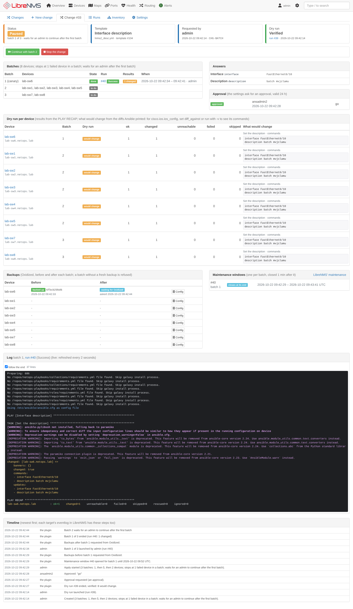

It is a plugin of its own, next to the [topology plugin](../README.md) in this repository: the topology plugin only
reads LibreNMS data, while this one lets LibreNMS change devices, and it needs a runner with the device credentials.
Many teams will want the topology tools without that. Both appear in the same LibreNMS menu and device pages.

The plugin does not run Ansible itself and holds no device credentials. Semaphore UI keeps the credentials, the
playbooks stay in Git where they are reviewed, and the plugin only picks the targets, checks what it launches,
launches, follows and records; Oxidized takes the backups, LibreNMS keeps the maintenance windows.

| Changes | A dry run: what would change on each device |
|---|---|
| 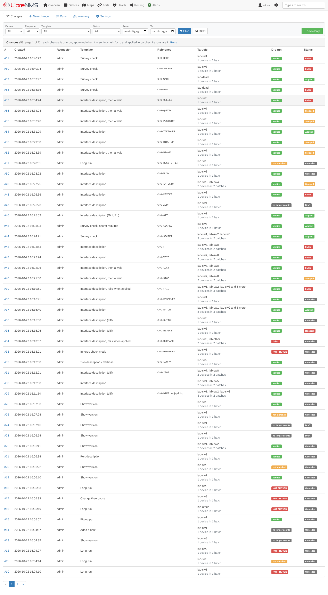 | 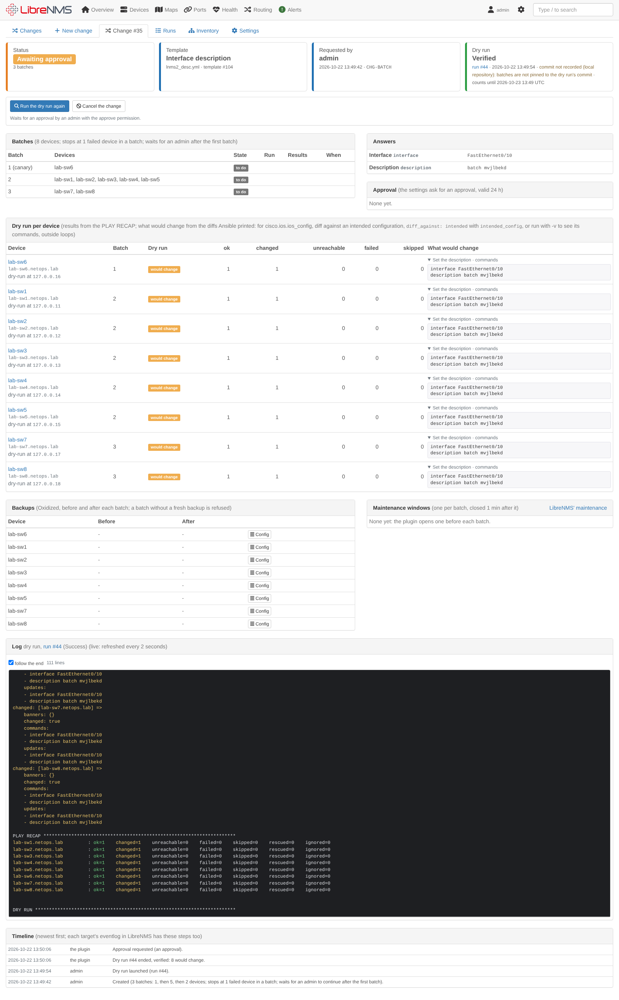 |

| An approval | Backups and maintenance windows of a change |
|---|---|
| 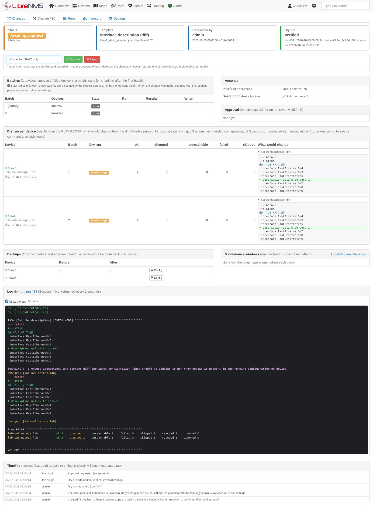 | 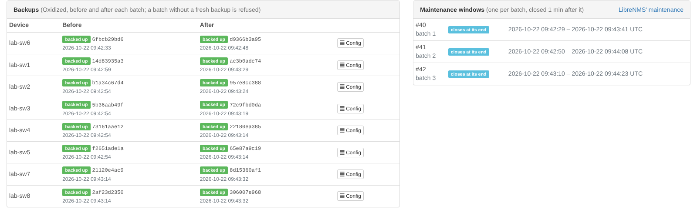 |

| New change (the first batch ticked, the preview with the batches) | Settings of changes, backups and windows |
|---|---|
| 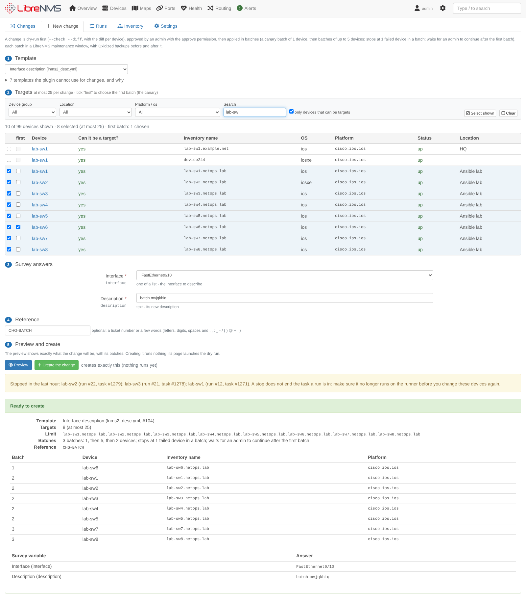 | 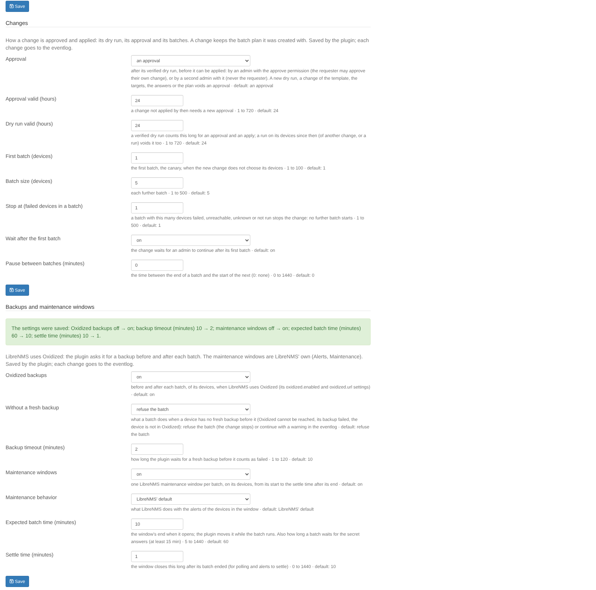 |

| Runs | A batch's run |
|---|---|
| 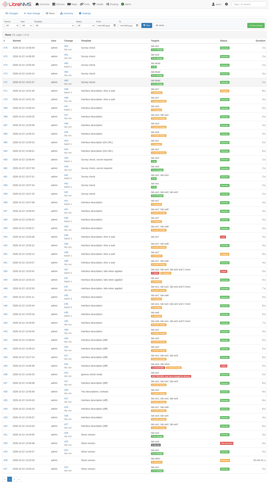 | 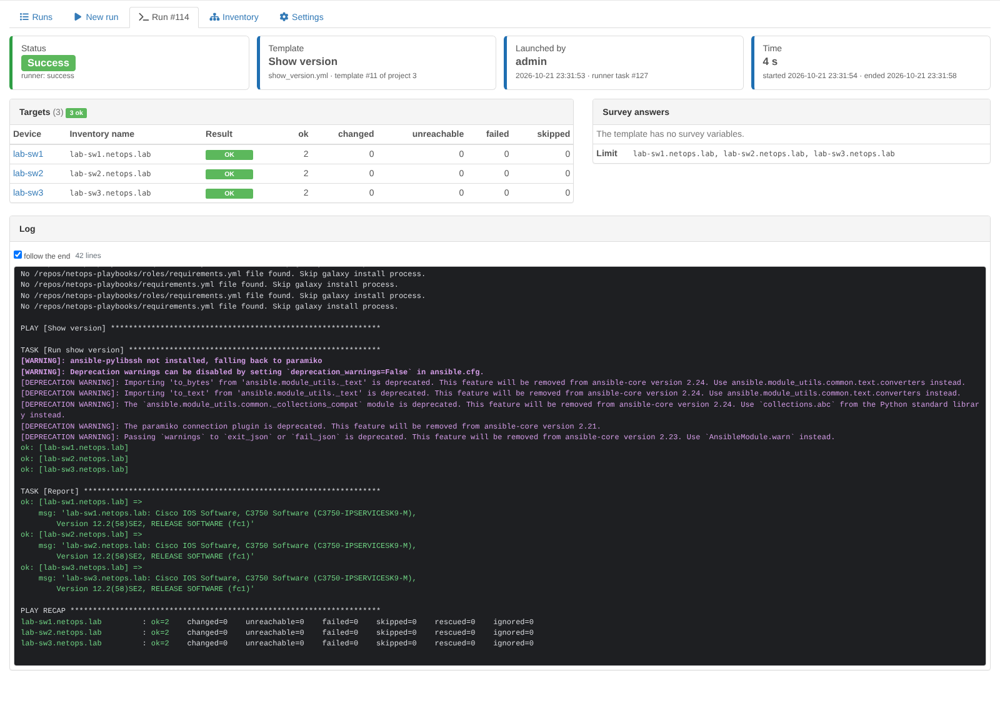 |

| Inventory | Settings with a connection test |
|---|---|
| 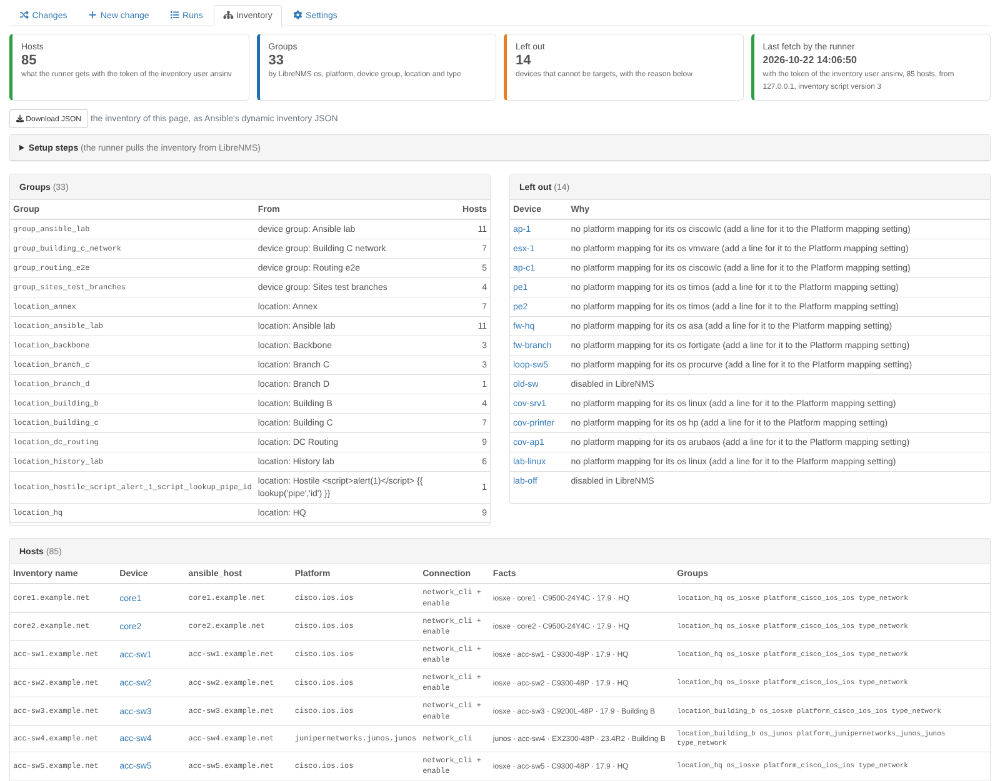 | 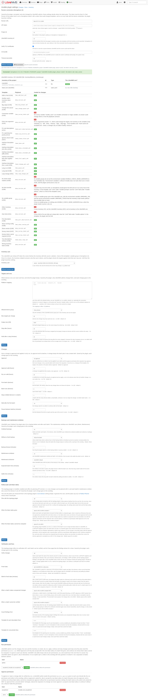 |

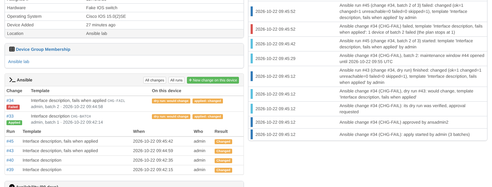

*(Screenshots: a LibreNMS test instance with simulated devices, eight simulated Cisco IOS switches and Oxidized.)*

## Contents

* [Requirements](#requirements)
* [Installation](#installation)
* [Semaphore UI setup](#semaphore-ui-setup)
* [Oxidized and maintenance windows](#oxidized-and-maintenance-windows)
* [Settings](#settings)
* [Permissions](#permissions)
* [Using it](#using-it)
* [How a change works](#how-a-change-works)
* [How runs work](#how-runs-work)
* [Safety](#safety)
* [Semaphore UI behaviour the plugin relies on](#semaphore-ui-behaviour-the-plugin-relies-on)
* [Limitations](#limitations)
* [Later phases](#later-phases)

## Requirements

* LibreNMS 26.x (developed and tested against 26.10), PHP 8.2+ with the curl and mbstring extensions (LibreNMS needs
  them too), and the LibreNMS scheduler (`librenms-scheduler` timer or cron, see `./validate.php`): it moves changes on
  when nobody has their page open.
* [Semaphore UI](https://semaphoreui.com) 2.x; developed and tested against 2.19.17. The plugin needs only the free
  edition: API tokens, the project roles, survey variables, file inventories, environments with secrets, every launch
  option (dry run, diff, commit) and the task output API are all free. (Pro adds project runners, external secret
  storages, the Docker executor, the per-host task summary and audit-log export; Enterprise adds high availability,
  custom roles and per-template permissions. Official builds contain the paid code and unlock it with a licence key.)
* Ansible on the runner with the collections of your platforms, whose default output has the check-mode markers the
  dry runs need (its `check_mode_markers` option; developed and tested with ansible-core 2.20, the one the Semaphore UI
  2.19.17 image ships). The Semaphore UI container image ships Ansible with `cisco.ios`,
  `cisco.iosxr`, `cisco.nxos`, `arista.eos`, `junipernetworks.junos`, `vyos.vyos`, `community.routeros`,
  `community.ciscosmb` and `dellemc.enterprise_sonic`, among others.
* For backups: [Oxidized](https://github.com/ytti/oxidized) with its web API (oxidized-web), set up in LibreNMS
  (*Settings → External → Oxidized*: `oxidized.enabled` and `oxidized.url`); developed and tested with Oxidized 0.37.0
  and oxidized-web 0.18.1. Without it, changes go without backups. See
  [Oxidized and maintenance windows](#oxidized-and-maintenance-windows).
* The runner must reach LibreNMS over HTTP(S) (it fetches the inventory from it), and LibreNMS must reach the runner's
  API and Oxidized's.

## Installation

The plugin is the Composer package `agoodley/librenms-ansible-plugin` in the `ansible/` directory of this
repository. Composer cannot install a package from a subdirectory of a Git repository, so it is installed from a clone,
through a Composer *path* repository. Create the directory of the clone as root, then run everything else as the
`librenms` user:

```bash
# as root: a directory for the clone, owned by the librenms user (it cannot create one in /opt itself)
mkdir -p /opt/librenms-plugins && chown librenms:librenms /opt/librenms-plugins

sudo su - librenms

# 1. a clone of the repository
git clone https://github.com/agoodley/librenms_dashplugin /opt/librenms-plugins/librenms_dashplugin

# 2. tell composer where the package is (stored in the librenms user's global composer config, so it survives
#    LibreNMS updates)
composer config --global repositories.librenms-ansible '{"type": "path", "url": "/opt/librenms-plugins/librenms_dashplugin/ansible", "options": {"symlink": true}}'

# 3. install it with LibreNMS' plugin installer, and create its tables and its permissions
cd /opt/librenms
./lnms plugin:add agoodley/librenms-ansible-plugin @dev
./lnms migrate
```

The plugin is enabled when it is installed (LibreNMS enables new plugins), but does nothing until an admin enters the
runner connection. Its pages are for LibreNMS admins: **Overview → Plugins → Ansible**, and its settings in
**Overview → Plugins → Plugin Admin → ansible → Settings**.

The plugin keeps its data in tables of its own: the changes (`ansible_changes`, and `ansible_change_targets`,
`_batches`, `_approvals`, `_windows`, `_diffs` and `_events`), the runs (`ansible_runs`, `ansible_run_targets`), the
runner's inventory fetches (`ansible_inventory_fetches`) and its settings, the runner connection encrypted
(`ansible_config`). The migrations also create the permissions `ansible.run` and `ansible.approve`. `./validate.php`
then warns that the schema "has extra migrations (2026_10_24_000000_create_ansible_tables, ...,
2026_11_01_000000_ansible_changes)": those are the plugin's migrations (`database/migrations`), and the warning stays
while the plugin is installed. Do not delete their rows from the `migrations` table, and never apply validate.php's
offer to drop the `ansible_*` tables: they hold the audit log.

**Updating:** `git pull` in the clone (the path repository links to it), then `./lnms migrate`; until then the plugin's
pages say the tables are out of date and nothing is launched. When `contrib/librenms_inventory.py` changed (its
`VERSION`), copy it into the playbook repository again, as in step 5 of [Semaphore UI setup](#semaphore-ui-setup), and
commit and push it: the Inventory page says which version the runner's last fetch came from, and warns when it is older
than the one the plugin ships.

**From phase 1**, every run belongs to a change, and the defaults of phase 2 stop more than phase 1 did. After
`./lnms migrate`:

1. Add `ANSIBLE_CHECK_MODE_MARKERS` = `true` to the template's variable group ([step 7](#semaphore-ui-setup)): without
   it a template cannot be dry-run, so it cannot be used.
2. Remove `--check` (`-C`) from the templates' CLI arguments: phase 1 accepted it, changes refuse it (the plugin adds
   it to the dry run, and a batch with it would apply nothing).
3. Give the playbook repository a Git URL in Semaphore: Semaphore records the commit of a task only then, and the plugin
   pins each batch to the commit of its dry run. With a local path nothing is pinned, and the change page says
   *commit not recorded*.
4. Grant the approve permission (Settings, *Approve permission*): approval is on by default, so nothing is applied
   until an admin holds it (or set *Approval* to off). Approvers find what waits for them under Changes, status
   *Awaiting approval*.
5. Check Oxidized: backups are on by default with *Without a fresh backup* = refuse, so the batch of a device
   Oxidized does not back up is refused (the preview and the dry run name such devices). Add them to Oxidized, or set
   *continue with a warning*. Oxidized's `next_adds_job` is false by default: a backup request only moves the node to
   the head of Oxidized's queue (see [Oxidized and maintenance windows](#oxidized-and-maintenance-windows)).
6. Check the maintenance windows: on by default, with LibreNMS' default behavior (alerts skipped) for a batch's devices
   during the batch and the settle time after it (*Maintenance behavior* changes it).
7. Check the settings of batches (first batch, batch size, *Stop at*, *Wait after the first batch*).

The runs of phase 1 stay in the audit log as they were.

**Removing:**

```bash
./lnms migrate:reset --path=vendor/agoodley/librenms-ansible-plugin/database/migrations   # drops the ansible_* tables and the permissions
./lnms plugin:remove agoodley/librenms-ansible-plugin
```

`migrate:reset` prints "Migration not found" for each of LibreNMS' own migrations: that is expected, it only rolls back
the plugin's (a `--pretend` run shows that it drops only the `ansible_*` tables). `./lnms plugin:remove` alone keeps the
tables, so a reinstall keeps the audit log. Maintenance windows the plugin opened stay in LibreNMS (they have ended).

## Semaphore UI setup

The plugin talks to one Semaphore UI project with the token of a user who may only run tasks (the **Task Runner**
role). The runner **pulls** the inventory from LibreNMS with a script of the plugin, so LibreNMS never needs a token
that could change Semaphore. Step by step (the names are suggestions):

1. **A project for the plugin**, e.g. "LibreNMS changes". Everything below belongs to it; keep it apart from projects
   whose templates the plugin should not run.
2. **A Task Runner user and its token.** Create a user (e.g. `librenms`, not an admin), add it to the project with the
   role *Task Runner*, log in as that user and create an API token (user menu → *API Tokens*). That token goes in the
   plugin's settings. Not an Owner's or Manager's token, nor a Semaphore admin's: those may change templates, and so
   their playbook and repository, which lets whoever holds the token run any code with the stored device credentials.
   The plugin launches nothing with such a token (it asks the runner for the token's role and user before every
   preview and launch), nor with one whose user may not run tasks (*Guest*); *Test connection* says why and what to
   change.
3. **The device credentials** in the project's *Key Store*: a *Login with password* key (or an SSH key) for the
   devices, and the enable password as a key too when your platforms need it (the plugin's platform mapping sets
   `ansible_become` and `ansible_become_method: enable` for IOS, IOS-XE and EOS).
4. **The repository** of your playbooks (*Repositories*): only reviewed playbooks belong there (see [Safety](#safety)).
   Give it a **Git URL** (`https://`, `ssh://` or `file://`), not a local path: the runner then records the commit of
   each task, and the plugin applies a change with the commit its dry run ran (a local path records none, and a change
   is applied with whatever the path holds then).
5. **The inventory script:** copy [`contrib/librenms_inventory.py`](contrib/librenms_inventory.py) into the
   repository, e.g. as `inventory/librenms_inventory.py`, make it executable and commit it:

   ```bash
   # in a clone of the playbook repository
   mkdir -p inventory
   cp /opt/librenms-plugins/librenms_dashplugin/ansible/contrib/librenms_inventory.py inventory/
   git add inventory/librenms_inventory.py && git update-index --chmod=+x inventory/librenms_inventory.py
   git commit -m "LibreNMS inventory" && git push
   ```

   It is plain Python (standard library only): `--list` prints the inventory of the plugin, `--host NAME` one host's
   variables. It reads `LIBRENMS_URL`, `LIBRENMS_TOKEN`, and optionally `LIBRENMS_CA_BUNDLE` (a PEM file to verify
   LibreNMS' certificate with) and `LIBRENMS_TIMEOUT` (seconds, default 30); it always verifies TLS certificates,
   never follows redirects, and on an error prints what to check to stderr and exits with code 1; when LibreNMS
   refuses the request (HTTP 4xx) it quotes the reason LibreNMS gives, e.g. that the token is not the inventory user's
   (cleaned, cut, its double quotes replaced). The token is left out of that text when LibreNMS echoes it verbatim or
   split by escape sequences, control, invisible, combining or blank characters; a server that already holds the
   token and reshapes it otherwise is not caught.
6. **A LibreNMS user for the inventory** and its API token: a user whose LibreNMS role sees the devices the runner may
   change (e.g. *global-read*, or a user limited to some devices). In LibreNMS 26.10 API tokens need the `api.access`
   permission (a *global-read* user has no *API* menu) and an admin cannot create one for another user in the web UI,
   so create it on the LibreNMS server: `./lnms api:token-create <user> --name=ansible-inventory` (it prints the token
   once). Or give the user a role with `api.access` and, logged in as that user, create it in the settings (gear)
   menu → *API* → *API Tokens*. The inventory has only the devices this user may see; it is the plugin's *inventory
   user* (see the end of this section).
7. **A variable group** (*Variable Groups*, called environment in Semaphore's API): on its *Variables* tab, under
   *Environment variables*, `LIBRENMS_URL` = the LibreNMS address (e.g. `https://librenms.example.com`) and
   `ANSIBLE_CHECK_MODE_MARKERS` = `true`; on its *Secrets* tab, under *Environment variables*, `LIBRENMS_TOKEN` = the
   token of step 6. Use the *Environment variables* parts, not the *Extra variables* ones: the inventory script only
   sees environment variables. Semaphore passes both to Ansible, and so to the inventory script; secrets are
   write-only in Semaphore. `ANSIBLE_CHECK_MODE_MARKERS` makes Ansible mark what runs in check mode, which is how the
   plugin proves a dry run (see [The dry run and its proof](#the-dry-run-and-its-proof)); it must be a plain variable
   (the plugin reads its value), and the group must not set `ANSIBLE_STDOUT_CALLBACK`, `ANSIBLE_DISPLAY_OK_HOSTS` or
   `ANSIBLE_DISPLAY_SKIPPED_HOSTS` to anything else than the defaults. The plugin refuses a template whose variable
   groups break any of this.
8. **The LibreNMS inventory** (*Inventory*): type *File*, path `inventory/librenms_inventory.py` in the repository of
   step 4, with the device key of step 3 as its user credentials (and the enable key as *Sudo credentials* when
   needed). Semaphore UI does not show inventory ids: save the plugin's connection without one and press *Test
   connection*, which lists the project's inventories with their ids and says which one runs the plugin's script; or
   ask the API: `curl -H "Authorization: Bearer <token>" https://semaphore.example.com/api/project/<project id>/inventory`.
9. **Templates:** each template the plugin may use uses the LibreNMS inventory and the variable group of step 7, and
   under **Ansible prompts** has **Limit** ticked (`task_params.allow_override_limit` in the API). Without it,
   Semaphore silently ignores the limit and runs the template on every host of the inventory: the plugin refuses such
   templates. Do not confuse it with the **Limit** field under **Ansible options**: that is a limit of the template's
   own, and the plugin refuses a template that has one. A template must not have CLI arguments other than verbosity,
   `--diff`, `--forks`, `--timeout`, `--tags`, `--skip-tags`, `--force-handlers` and `--flush-cache` (`--check` makes
   every run a dry run: the plugin launches the dry run itself). `cisco.ios.ios_config` prints no diff in check mode
   by itself: see [The diff per device](#the-diff-per-device) for `diff_against: intended`, or `-v`.
10. **Survey variables** are the only variables the plugin sends, as typed answers: *String*, *Text* (several lines),
    *Integer*, *Enum* (one of a list) and *Secret*; *required* is enforced by the plugin. Their names may not be
    Ansible connection or magic variables (`ansible_*`, `hostvars`, `inventory_hostname`, `omit`, ...) nor `librenms_*`;
    environment-variable survey variables may not set `PATH`, `ANSIBLE_*`, `LIBRENMS_*`, proxies or other variables
    that change how Ansible, Python, SSH or the inventory script run. For a playbook that takes a list (such as several
    interfaces), use a *Text* variable and split its lines in the playbook.

Then, in the plugin's settings: the runner URL, the token and the project id, **Save connection**, and **Test
connection**: it shows the Semaphore version, the token's role, the project's inventories with their ids (the one that
runs the plugin's script with a *use* button) and every template of the project as usable for changes or not, with
what to change. Enter the id of the LibreNMS inventory of step 8 (or press its *use* button), **Save connection** and
test again. Choose the **inventory user**: the user of step 6. From then on the inventory endpoint answers only that
user's tokens, and the plugin checks targets against what that user may see; until it is chosen the plugin launches
nothing. Finally grant the run permission to the admins who may prepare and apply changes, and the approve permission
to those who may approve them. The Inventory page shows when the runner last fetched the inventory with the inventory
user's token and how many hosts it got: the first run makes it fetch it.

## Oxidized and maintenance windows

**Backups** go through LibreNMS' own Oxidized integration: when `oxidized.enabled` and `oxidized.url` are set in
LibreNMS, the plugin asks Oxidized for a backup of each device of a batch before the batch and after it, and follows it
to its end. It finds a device's Oxidized node as LibreNMS' device config page does (its hostname or IP address, its
group with *group support*); a device whose os or type LibreNMS excludes from Oxidized, or that Oxidized does not
know, has no backup. Two things in Oxidized's configuration matter:

* `next_adds_job: true` (Oxidized's default is `false`) makes a backup asked for start at once. With `false`, the
  plugin's request (the `PUT /node/next/<node>` LibreNMS' Oxidized client sends) only moves the node to the head of
  the queue, and the backup comes when a worker is free: set *Backup timeout* long enough for your Oxidized interval.
* Oxidized's clock and LibreNMS' must agree (NTP): a backup is fresh when an attempt *started* after the request and
  ended with `success`.

A backup that Oxidized could not take (a failed attempt and no retry within 90 seconds, or none within *Backup
timeout*), a node Oxidized does not know or an Oxidized that cannot be reached means *no fresh backup*: with the
default setting the batch is refused and the change stops before it touched anything; with *continue with a warning*
the batch goes, and the eventlog warns. So that this is known before the apply, the preview of a new change and its
dry run ask Oxidized about each target and name those it cannot back up (the change page warns until the apply, and
their eventlog says it). The change page shows each device's backups (the Oxidized version before and after) with a
link to LibreNMS' config page of the device, where Oxidized's versions and their diffs are.

**Maintenance windows** are LibreNMS' own (*Alerts → Maintenance*): before each batch the plugin adds one, named
after the change and its batch, with the batch's devices, from now until now plus *Expected batch time*; while the
batch runs it moves the end to *Expected batch time* from then whenever less than a quarter of it (at least two
minutes) is left, sets it to the end of the batch plus *Settle time* once the batch has ended, and records it as
closed when that time has passed. A stopped batch's window lasts until the end of the hold after the stop (*Hold after
a stop*) plus *Settle time*, as the step in progress at the stop may still run: with the defaults, 30 + 10 minutes of
the window's behavior (alerts skipped, for example) after the stop. The window's *behavior* (skip, mute or run alerts) is LibreNMS' default unless
the settings choose one. A window someone removed in LibreNMS is recorded as such; the windows of batches that never
ran end at once.

## Settings

All settings are on the plugin's settings page (*Plugin Admin → ansible*), and the plugin saves them itself: only
LibreNMS admins can see or change them, and each change goes to the eventlog (type `ansible`: who changed what; never
the token). They decide where the token is sent, which devices changes can reach and how, and how a change is approved
and applied. LibreNMS opens that page to holders of its `plugin.admin` permission, which roles other than admin can
have, and stores whatever is posted to it, so the plugin keeps nothing in LibreNMS' own plugin settings: a
`plugin.admin` holder who is not an admin sees a note. The runner connection is stored encrypted with LibreNMS'
`APP_KEY`.

| Setting | Default | Meaning |
|---|---|---|
| *Runner connection* | | |
| Runner URL | – | Semaphore UI's address, e.g. `https://semaphore.example.com` (http or https; without `/api`) |
| API token | – | the Task Runner user's token; write-only: never shown again, never sent to a browser; an empty field keeps it, except when the runner URL (scheme, host, port or path) or the CA bundle changes or TLS verification is turned off: then it must be entered again, so the saved token only ever goes where it was saved for |
| Project id | – | the project of the plugin (the number in its address, `/project/<id>/...`) |
| LibreNMS inventory id | – | the file inventory that runs the inventory script; only templates with this inventory can be used |
| Verify TLS certificates | on | off only for a test lab: anyone between LibreNMS and the runner could read the token |
| CA bundle | (system CAs) | a PEM file on the LibreNMS server to verify the runner's certificate with |
| Timeout | 15 s | per call to the runner (1–120) |
| *Inventory user* | | |
| Inventory user | not chosen | the LibreNMS user whose API token the runner uses; once chosen, only that user's tokens get the inventory, and targets are checked against what that user may see; until then nothing is launched |
| *Targets and runs* | | |
| Platform mapping | the defaults below | lines that add to the defaults: one per LibreNMS os, `os ansible_network_os [connection] [become]`; a line for an os of the defaults replaces its default, and `os -` switches it off. The settings page shows the mapping in effect. A device whose os has no line cannot be a target |
| Allowed device group | every device | only the members of this LibreNMS device group are in the inventory and can be targets |
| Max targets per change | 25 | 1–500, also per run |
| Output size | 1024 KB | the log kept per run (16–8192 KB): a longer log keeps its start and its end (the PLAY RECAP, the errors) with a line that counts the lines left out; the runner keeps the whole log, and the proof and the diffs of a dry run read it from the runner |
| Stop after | 24 h | a run still unfinished after this long is stopped by the plugin (1–720 h); it keeps its devices until the runner confirms the stop |
| Hold after a stop | 30 min | a stopped run keeps its devices this long after the runner reported the stop (1–1440 min), because the step each device was in runs on; holders of the run permission can release them earlier on the run page |
| *Changes* | | |
| Approval | an approval | after a verified dry run, before the apply: *no approval*, *an approval* (by an admin with the approve permission, who may be the requester) or *an approval from a second admin* (never the requester) |
| Approval valid | 24 h | an approval counts this long, for the apply and every batch: a change not applied by then needs a new approval, and one still being applied then stops before its next batch (a new change takes the remaining devices) (1–720 h) |
| Dry run valid | 24 h | a verified dry run counts this long for the approval and every batch: a change still being applied then stops before its next batch (1–720 h) |
| First batch | 1 device | the first batch (the canary), when the new change does not tick its devices (1–100) |
| Batch size | 5 devices | each further batch (1–500) |
| Stop at | 1 device | a batch with this many devices failed, unreachable, unknown or not run stops the change (1–500) |
| Wait after the first batch | on | the change waits for an admin to *Continue* after its first batch |
| Pause between batches | 0 min | the time between the end of a batch and the start of the next (0–1440) |
| *Backups and maintenance windows* | | |
| Oxidized backups | on | before and after each batch, when LibreNMS uses Oxidized |
| Without a fresh backup | refuse the batch | or *continue with a warning* |
| Backup timeout | 10 min | how long the plugin waits for Oxidized (1–120) |
| Maintenance windows | on | one LibreNMS maintenance window per batch, on its devices |
| Maintenance behavior | LibreNMS' default | skip, mute or run alerts in the window |
| Expected batch time | 60 min | the end of a window when it opens; the plugin moves it while the batch runs; also how long a batch waits for the secret answers, at least 15 min (5–1440) |
| Settle time | 10 min | a window ends this long after its batch (0–1440) |
| *Run permission*, *Approve permission* | | who may prepare and apply changes, and who may approve them ([Permissions](#permissions)) |

A setting that cannot be used is refused with the reason, and nothing is saved: a platform mapping line that cannot
be read, a device group or user that does not exist, a number out of its range. When the stored settings cannot be
read, the plugin launches nothing and its inventory endpoint answers with an error, rather than fall back to defaults
that may reach more devices. A change keeps the batch plan it was created with; the approval, backup and window
settings apply to what it does next.

The default platform mapping, for platforms whose LibreNMS os names and Ansible collections were both checked:

```text
ios          cisco.ios.ios                   network_cli  become
iosxe        cisco.ios.ios                   network_cli  become
iosxr        cisco.iosxr.iosxr               network_cli
nxos         cisco.nxos.nxos                 network_cli
arista_eos   arista.eos.eos                  network_cli  become
junos        junipernetworks.junos.junos     network_cli
vyos         vyos.vyos.vyos                  network_cli
routeros     community.routeros.routeros     network_cli
ciscosb      community.ciscosmb.ciscosmb     network_cli
dell-sonic   dellemc.enterprise_sonic.sonic  network_cli
```

The connection is `network_cli`, `netconf`, `httpapi` (short for `ansible.netcommon.*`), `ssh`, `paramiko` or a full
plugin name; `become` sets `ansible_become: true` and `ansible_become_method: enable`. Junos uses `network_cli` because
its `netconf` connection needs the `ncclient` Python library on the runner, which the Semaphore UI image does not
have: with it installed, `junos junipernetworks.junos.junos netconf` lets the Junos resource modules work. Platforms
not listed (Cisco ASA, ArubaOS-CX, Fortinet, ...) need their collection on the runner first, then a line of their own
(e.g. `asa cisco.asa.asa network_cli become`), which keeps every default.

## Permissions

* **Viewing** the changes, the runs, the inventory, the JSON and the device panel is for LibreNMS **admins**. Everyone
  else gets HTTP 403 on every route of the plugin and sees no menu entry, panel or button.
* **Preparing and applying** changes (a new change, its dry run, *Apply*, *Continue*, *Stop*, *Cancel*), stopping a
  run and releasing the devices of a run the runner could not be asked about, or of a stopped run, also needs the
  plugin's **run permission**, `ansible.run`. **Approving and rejecting** changes needs its **approve permission**,
  `ansible.approve`. An admin grants them on the settings page. Admins do not get them automatically: an admin without
  them sees everything, but no buttons, and the plugin answers 403 to such requests.
* With *an approval*, an approver may approve their own change; with *an approval from a second admin*, the requester
  never may, whoever holds the approve permission. An approval counts only while its approver still is an admin with
  the approve permission, and a batch is launched only while the admin who launches it (who applied the change or
  continued it) still holds the run permission.
* Any LibreNMS admin can grant either permission, also to themselves: it is an explicit, logged opt-in (each grant and
  revoke goes to the eventlog, with who did it); the separation of duties is the second-admin approval. Each change of
  the runner connection or of the other settings is logged the same way (never the token).
* Both are **direct permissions of the user**, not of a role. LibreNMS' role editor (*Roles*) saves only the
  permissions of its own list (`resources/definitions/permissions.yaml`), so a plugin permission given to a role is
  dropped the next time someone saves that role; its user editor sets roles only, and keeps a user's direct
  permissions. (Both were checked in LibreNMS 26.10.) The permissions are read from the user's own permissions,
  because LibreNMS lets admins pass every permission check.
* **The inventory endpoint** (`/plugin/ansible/api/inventory`) takes a LibreNMS API token (as `X-Auth-Token`, like
  LibreNMS' API, or as a Bearer token) instead of a session, and answers with the devices that token's user may see.
  Once an admin chose the inventory user, it answers only that user's tokens (any other gets a JSON 403 that says
  why): the user the plugin trusts for the target checks is always one an admin chose, never whoever fetched last.
* **Every setting** is for admins, on the plugin's own routes. LibreNMS opens the plugin's settings page to holders of
  `plugin.admin` and stores what is posted to it; the plugin reads none of that, so a `plugin.admin` holder who is not
  an admin cannot change what changes reach (the page shows them a note).

## Using it

* **New change** (*Changes → New change*, or *New change on this device* in a device's Ansible panel): choose a
  template (the ones the plugin cannot use for changes are listed with the reason), then the targets: filter by device
  group, location, platform or text; each device shows its inventory name, platform, LibreNMS status and, when it
  cannot be a target, why (disabled, no platform mapping, outside the allowed group, busy in an unfinished run,
  reserved by a change being applied, not visible to the inventory user, no usable address). Tick **first** on the
  devices of the first batch (the canary), or the first devices of the list form it. Answer the survey variables
  (secret ones are asked later), give a **reference** (a ticket number), then **Preview**: the template, the targets
  with their batches, the refused devices, the answers and the limit. **Create the change** checks everything again;
  nothing runs yet.
* **Change:** **Run the dry run** (with the secret answers, when the template has some): Ansible runs the playbook with
  `--check --diff`; the page shows, per device, the dry run's result and the diffs of what would change. A dry run the
  plugin cannot prove to be one is shown in red, *NOT PROVEN*, with why: it may have changed the devices, and it can be
  neither approved nor applied. Once it is verified, an admin with the approve permission **Approve**s (with a
  comment) or **Reject**s; approvers find the changes that wait for them on the Changes page, with the status filter
  *Awaiting approval*. **Apply** starts the first batch: its maintenance window, the backups, then its run; after
  it the change waits for **Continue** (when *Wait after the first batch* is on), and the next batches follow on their
  own until the last, or until one fails. An Apply or a Continue while a device of the batch is busy in another
  unfinished run (or held after a stop) is refused and changes nothing: the change stays ready, or waiting. **Stop** stops the running batch (as a run's stop: the step in progress runs
  on) and launches nothing more. It never waits, even while another request is busy with the change (or died while
  at it): the stop is recorded at once, the runner is asked at once to stop the batch's task, no batch launches
  afterwards (a launch under way looks for the stop again right before it records its run and right before it asks
  the runner, and then launches nothing; a stop that comes while the runner is being asked stops the task it just got
  at once; a launch whose request died after asking the runner has its task looked for at once), and the change ends
  at its next step; a batch whose run had already ended is
  recorded with its results, and the change ends after it. After a stop the page says, as the run page does, how long the batch's devices stay
  held and how to find the step that may still run on the runner. **Cancel** drops a change that has not been applied.
  A change that failed or was stopped offers **a new change with the remaining devices** (the devices that failed or
  were never reached; held ones are left out and named, with until when), and a dry run that failed on some devices
  offers **a new change without them**: the same template, answers (not the secret ones), reference and first batch,
  the devices chosen and listed first, to dry-run and approve again. The page follows the change every 2 seconds: the batches with their
  runs and results, the backups (with a link to each device's config page), the maintenance windows, the log of the
  run it follows, and a timeline of every step.
* **Changes:** filter by device, requester, template, status ("Not ended" for the changes still going) and dates; the
  *JSON* button gives the same list, with each change's status and the state of its dry run as the page shows them
  (`dry_run_state`, and `dry_run_label`: *NOT PROVEN* for a dry run not proven to be one, which may have changed its
  devices).
* **Runs:** each run of a change, its dry run or a batch (and the runs of phase 1), with the change it belongs to;
  filter by device, user, template, status and dates. A run's page shows its status, each target's result with the
  PLAY RECAP counters, the answers and the log, live; **Stop** and **Release the devices** as in phase 1 (see [Run
  states](#run-states)).
* **Inventory:** the hosts with their variables and groups, the groups, the devices left out and why, the runner's
  last fetch (when, as which user, how many hosts) and a JSON download of the inventory.
* **Device panel:** the device's latest changes (with its dry run and its result there) and runs, and *New change on
  this device*.
* **Eventlog:** each target gets entries (type `ansible`) for every step of a change: created, the dry run launched and
  what it found for that device ("would change", or an error when it is not proven to be a dry run), the approval
  asked for and given, the apply, its maintenance window, its backups (each fresh one with the version Oxidized keeps,
  each missing one with why; the change's timeline lists them too), its batch launched and ended, and how the change
  ended; and, as in phase 1, the start and end of each run with its result and counters. The severity follows the
  result. The reference is the change's address (`plugin/ansible/changes/12`) or the run's, and the entries carry the
  user who did the step (in LibreNMS' *User* column): who launched the dry run, approved, rejected, applied, continued,
  stopped, cancelled or released; for a step the plugin takes on its own (a window, a backup, a batch's end), the admin
  who started that batch.

## How a change works

### Change states

| State | When |
|---|---|
| Draft | created, or back from a dry run that failed, was not proven, or no longer counts; nothing runs |
| Dry run | its dry run runs |
| Awaiting approval | its dry run is verified; the settings need an approval |
| Ready to apply | approved (or the settings need none) |
| Applying | a batch is being prepared (window, backups) or runs |
| Paused | it waits: for an admin after the first batch, for the end of a pause between batches, or for the secret answers of the next batch |
| Stopping | an admin stopped it; the runner is stopping its batch |
| Applied, Failed, Stopped, Rejected, Cancelled | it ended; failed: a batch reached *Stop at* (that many failed devices), or the plugin stopped it because what was approved no longer holds (see below) |

The devices of a change that is being applied, paused or stopping are **reserved** for it: another change cannot take
them, as the change's later batches will change them. A run cannot target them, nor can another change's dry run, and
another change's **Apply** is refused (naming the devices and the change that reserves them) until that change has
ended; its dry run and approval still count meanwhile. The check and the switch to *Applying* are made under the lock every launch takes, so
two applies, or an apply and a run, cannot take the same device at once.

### The dry run and its proof

The dry run is a run of the template on every target with Semaphore's dry-run and diff options, which make the runner
add `--check --diff` to `ansible-playbook`. A dry run is only worth something if it really was one: a task with
`check_mode: false` runs for real even then, and a runner could ignore the option. With `ANSIBLE_CHECK_MODE_MARKERS`
(checked in the template's variable groups before the launch) Ansible's default output prints `DRY RUN` before the
first play when `--check` is on, and `[CHECK MODE]` at the end of the banner of every play, task and handler that runs
in check mode. When the dry run ends, the plugin reads its whole log from the runner and calls it **verified** only
when:

* the `DRY RUN` banner comes before the first play;
* at least one play ran, and every `PLAY`, `TASK` and `RUNNING HANDLER` banner carries the marker; any line that starts
  like such a banner counts, so device output that imitates a banner without the marker blocks the dry run, and one
  with the marker cannot hide a real one;
* the log shows every result the PLAY RECAP counts as ok for each host (with `display_ok_hosts` off Ansible prints a
  task's banner only with a result it shows, so a task outside check mode with a hidden result would leave no
  banner); ok results, ignored failures and includes are counted as Ansible counts them.

Anything it cannot read (no PLAY RECAP, as after a stop; a log the runner cannot give) leaves the dry run **not
proven**: the change page says so in red with the findings, each target's eventlog gets an error ("may have changed
this device"), and the change can be neither approved nor applied. Wherever the dry run's result would show (the
change page per device, the run page, the runs list, the device panel, the end entry of its run in the eventlog), a
red *NOT PROVEN: may have changed this device* shows instead. A proven dry run's results read *would change* and *no
change* there. A dry run that never ran (the runner refused it,
or it was stopped in the runner's queue) proves nothing and claims nothing: the change is back to a draft.

A verified dry run with a failed, unreachable or unknown target, or a run on a host that was not a target, cannot be
approved either. Each target's result comes from the PLAY RECAP: *would change* (changed), *no change*, *failed*, ...

### The diff per device

With `--diff` Ansible prints, before a task's result line, what the task would change: a unified diff for modules
that compute one (`template`, `copy`, `lineinfile`, network config modules diffing against an intended
configuration), and with `-v` a module's details below its result line, such as the `commands` of
`cisco.ios.ios_config` (read from the details' first level, in YAML or JSON).

`cisco.ios.ios_config` in check mode prints no diff by itself, and `diff_against: running` only prints *unable to
perform diff against running-config due to check mode*. For a unified diff per device, diff against an intended
configuration: the running one with the change, as in this task (the lab's `lnms2_desc_intended.yml`):

```yaml
- name: Read the running configuration
  cisco.ios.ios_command:
    commands: [show running-config]
  register: running
- name: Set the description
  cisco.ios.ios_config:
    parents: "interface {{ interface }}"
    lines: ["description {{ description }}"]
    diff_against: intended
    intended_config: "{{ running.stdout[0] | regex_replace('(?m)^(interface ' ~ interface ~ ')$', '\\1\n description ' ~ description) }}"
```

Or give the template `-v`: the dry run then shows the commands `ios_config` would send, except in a loop, where
they are listed as *not attributed* (a loop item's label could imitate the next result line); the device's row then
points to them. The plugin takes each block and gives it to the device whose result line follows it, only when
nothing in the log contradicts that: the host is a target and the task names it once (once per loop item), the host
has no more *changed* results in the log than its PLAY RECAP counts, in a loop only unified diffs (whose every line
starts with a prefix device text cannot avoid), and no raw text right after another result's details that a foreign
line cut short (it may hold their rest). Ansible's warnings go to stderr, which Semaphore merges into the log line by
line, so they can land inside a diff or a result's details: the plugin skips them there. Anything else is listed under
the devices as *not attributed*, with the reason. A block keeps at most 400 lines of 1,000 characters, a device
128 KB, a change 1 MB (cut parts are marked). Diffs are device text: the page shows them as text, never as HTML.

### What is approved, and what stays true until the last batch

When the dry run launches, the plugin takes a **fingerprint** of what it runs: the template as the runner has it
(playbook, inventory, repository and its branch, variable groups with their values hashed, CLI arguments, survey, limit
settings), the targets with their inventory names, **how the runner reaches each target** (the `ansible_*` variables
the inventory gives its host: `ansible_host`, the overwrite IP else the hostname, and `ansible_network_os`,
`ansible_connection` and become from the platform mapping), the answers (not the secret ones) and the batch plan. The
change page shows the address each device was dry-run at. An approval binds that fingerprint, the dry run and the
commit the dry run ran. Before an approval, the apply and **every batch** (and again right before its launch) the
plugin reads the template from the runner and the devices from LibreNMS again and compares; and it checks that:

* the dry run is still verified and younger than *Dry run valid*, and no other run touched its devices since: a run
  of phase 1, a batch of another change, or a dry run of another change that is not proven to be one (it may have
  changed them); a dry run still running is judged when it ends;
* the inventory reaches every target as at the dry run: a device given another overwrite IP or hostname (so maybe
  another physical device: editing a device needs only LibreNMS' device permission, not the plugin's), another
  platform mapping, or no longer a host voids the dry run, with the device and what changed
  (`sec-sw1: ansible_host 127.0.1.11 → 127.0.1.12`). Its facts (sysName, location, version, hardware) do not count;
* the approval (when the settings need one) is younger than *Approval valid*, approved this dry run, and its approver
  still is an admin with the approve permission (and, with a second admin, not the requester);
* the admin who launches the batch still holds the run permission.

A batch is checked when it starts, before its window opens and its backups are taken (with the template and its
targets as a launch checks them, so a batch that would be refused opens nothing), and again right before its launch,
after the backups, a wait for the secret answers or a pause: an approval that expired or a permission withdrawn
meanwhile stops the change there. When one of these fails before the apply, the dry run or the approval no longer
counts and the change goes back to a draft or awaits a new approval. A runner that cannot give the template at an
Approve or an Apply (unreachable, a server error, a timeout) says nothing about the template: the action is refused
("try again in a moment") and the dry run and approval stand. During the apply, the change stops: no further batch
is launched. The batch itself
is launched with the commit of the dry run (Semaphore's commit option), and a batch whose run reports another commit
stops the change.

The runner fetches the inventory from the plugin only when the task starts, which can be well after the checks right
before the launch: Semaphore UI runs a template's tasks one after another, so a batch may wait behind another task,
then for its checkout. So while a change's dry run or batch is in progress, the inventory endpoint serves its devices
only as the dry run recorded how the runner reaches them. A device edited meanwhile (another address, platform, or no
longer a host) is **left out** of what the runner gets: neither its new address (it may be another device's) nor the
old one. The change's timeline, the batch and the device's eventlog say so at the fetch, the batch does not run there,
and the change stops when the batch ends (a dry run with a device left out does not count). Each fetch records what
it served each device of a dry run or batch in progress (a hash of its connection, or that it was left out), and the
end of the batch or dry run checks that record, not LibreNMS as it is by then: an edit set back before the batch ended
is still caught, and one made after the runner had the inventory does not blame the batch (the next batch's checks
see it; without any fetch recorded, the devices are compared as LibreNMS has them at the end). The Inventory page
shows such a device as left out meanwhile.

### Batches

A change's batches are fixed when it is created: the first batch (the devices ticked *first*, else the first devices
of the list, *First batch* of them), then batches of *Batch size*. Each batch:

1. opens its maintenance window and asks Oxidized for the backups before it, and waits for them (*Backup timeout*);
   without a fresh backup the batch is refused (the change stops) or goes with a warning, as set;
2. checks again everything above, then launches its run, limited to the batch's devices, under the same lock and
   one-time token as any launch: a page clicked twice, two pages and the sync command can never launch a batch twice;
3. when its run ends, records each device's result, sets the end of its window, asks for the backups after it;
4. stops the change when the batch reached *Stop at* failed devices (failed, unreachable, unknown and not run count), when the
   plugin lost track of its run or it was stopped or released, when it ran on a host that was not a target, when it
   ran another commit than the dry run, or when the plugin left one of its devices out of the inventory the runner
   fetched (see above); else waits after the first batch for *Continue* (when set), or for *Pause between batches*,
   and starts the next.

The change page moves the change on while it is open, and the `ansible:sync` command does every minute for every
change that is not over (and for the windows and backups of ended changes), so a change goes on when nobody watches,
except where it waits for an admin.

**Secret answers** are never stored, so they are not part of the fingerprint or the approval, and the plugin cannot
launch a batch that needs them on its own. They are asked at the dry run, at *Apply* and at each *Continue*, which are
refused (changing nothing) while a secret answer the template requires is empty. A batch whose backups are fresh
within that request launches with them at once; the change page keeps them in its memory (not in the browser's
storage) and launches each later batch with them while it stays open, as soon as the batch is ready (after its window
and backups). When it was closed, a batch that needs them waits (*waits for the secret answers*, said in the timeline
once it has waited 30 seconds) for an admin to continue with them, with its maintenance window open and its backups
taken: for the *Expected batch time* (maintenance setting, at least 15 minutes), after which the change ends as failed
and the window closes.

## How runs work

* **Inventory:** built from LibreNMS' devices by the plugin for the user of the API token: the devices that user may
  see that are enabled, in the allowed device group (when set), have a platform mapping and a usable address. A
  host's name is its LibreNMS hostname when that is a plain Ansible host name (letters, digits, `.`, `_`, `-`, not
  starting with `-` or `.`, at most 253 characters), else `device<id>` (IPv6 addresses, names with other characters);
  a name used twice (ignoring case) goes to the device with the lowest id, and a host never has a group's name (a
  limit naming a group would select all of its hosts). Names are computed over every LibreNMS device, so they do not
  depend on which devices a user may see. Host variables: `ansible_host` (the device's overwrite IP, else its
  hostname), `ansible_network_os`, `ansible_connection` (and `ansible_become` / `ansible_become_method`) from the
  platform mapping, and `librenms_device_id`, `librenms_hostname`, `librenms_os`, `librenms_sysname`,
  `librenms_location`, `librenms_hardware`, `librenms_version`, `librenms_type`. Groups: `os_<os>`,
  `platform_<ansible_network_os>`, `group_<device group>`, `location_<location>` and `type_<device type>`, in
  `[a-z0-9_]`, numbered when two names collide. The answer is Ansible's dynamic inventory JSON with `_meta.hostvars`.
  While a change's dry run or batch is in progress, its devices are served only as its dry run recorded how the
  runner reaches them, else left out (see [What is approved](#what-is-approved-and-what-stays-true-until-the-last-batch)), and each fetch records what it served
  them.
* **Templates:** before every preview and launch the plugin asks the runner for the template again (no cache) and
  launches it only when its inventory is the LibreNMS one (a file inventory), a launch may set its limit (*Ansible
  prompts → Limit*), it has no limit of its own, its variable group has `LIBRENMS_URL`, the secret `LIBRENMS_TOKEN` and
  `ANSIBLE_CHECK_MODE_MARKERS`, its CLI arguments are on the short list above, its survey variables have safe names and
  known types, and the token's user may run it.
* **Launch:** the targets are checked again (the plugin's own run of the target check, as the inventory user sees
  them), at most *Max targets per change*; then, under a lock (LibreNMS' cache), the plugin checks that no target is
  busy in another unfinished run or reserved by another change and records the run before it asks the runner: two
  launches cannot take the same device, and a form that is submitted twice makes one change (each form has a one-time
  token), a dry run or batch launched twice one run (a run of a change has a token made of the change's id and its own
  random one, and a run found by it counts only for the same change, dry run or batch: a change that gets the id of an
  earlier one, after the change tables were rolled back and made again, never takes over its runs). The runner gets the template id, the limit (the targets' inventory
  names), the answers that are not secret as extra variables, the secret ones in Semaphore's write-only secret field,
  for a dry run the dry-run and diff options, for a batch the dry run's commit, and a message "LibreNMS Ansible run #N
  by user [nonce]"; nothing else. The nonce is random per run: a launch whose answer never came (a timeout) is found
  again by its message, among the tasks created after the run (two minutes of clock difference between the servers
  allowed), so it never takes a task of another database that shares the project.
* **Following:** the change and run pages ask the plugin every 2 seconds, and the plugin asks the runner at most every
  2 seconds per run (a lock per run and per change, held longer than the slowest refresh, keeps two pages and the sync
  command from doing it at once; a change's lock is renewed during long work, and a step whose lock another request
  took meanwhile stops before its next call to the runner, Oxidized or LibreNMS' maintenance, so a window is opened
  and a backup asked for once, and the request holding the lock goes on from what was recorded; every write is a
  compare-and-set on the row's version, so a slow answer never writes over a newer state). The `ansible:sync` command does the same every minute for every unfinished run and change, and
  every few minutes for a lost or released run (through the LibreNMS scheduler, one at a time, on one server, while the
  plugin is enabled and its connection set up; output in `logs/ansible-sync.log`), so the audit log is complete when
  nobody watches. The log is stored as it comes, only the new lines at each refresh, in pieces of at most 512 KB per
  statement and one transaction per change, up to *Output size*; past it the new lines go to the end kept (the tail),
  which is cut to three quarters of its size when it is full.
* **Results:** when the runner reports the task finished, the plugin reads the output once more (Semaphore reports
  the end before the last lines are readable) and takes each target's result from the last `PLAY RECAP`: unreachable,
  failed, changed, ok, skipped, or *not run* for a target the recap does not name. Without a recap (a stopped or
  killed run) the result comes from Ansible's task result lines (`ok:`, `changed:`, `failed:`, `fatal:`,
  `skipping:` for the host): changed, failed or unreachable when a line says so, *unknown* when the host only had ok
  or skipped results before the run ended, *not run* when the log never names it. After a stop, a target whose step
  was still in progress (its task started without a result for it, or a loop partly done) is *unknown*, unless it
  failed: that step runs on after the stop. A target whose connection failed (the message of its first failure starts
  with an SSH or network error) without any task succeeding counts as unreachable (network connections report an
  unreachable device as a failed task). A host the runner ran on that is not a target flags the run: it is listed with
  its result on the run page, its device (found by its inventory name) gets an error entry in the eventlog, and the
  run gets one too.

### Run states

| State | When | Devices |
|---|---|---|
| Launching, Queued, Running, Stopping | the plugin recorded the run and follows the task on the runner | busy |
| Success | the runner ended the task with success, and every target is in the PLAY RECAP without a failure | free |
| Incomplete | the runner ended the task with success, but targets did not run (or failed): the run page says how many and the likely cause, quoting the inventory script's error when there is one (a template without the LibreNMS variable group, a revoked token) | free |
| Failed | the runner ended the task with an error | free |
| Stopped | the runner stopped the task (a user's Stop, the plugin's after *Stop after*, or a stop in Semaphore UI); a target whose step was in progress is *unknown*, as that step runs on (see [Limitations](#limitations)) | held for *Hold after a stop* after the runner's stop, unless released earlier; free at once when the task was stopped in the runner's queue (it never started, its targets are *not run*) |
| Not launched | the runner refused the launch, or a launch whose answer never came has no task 10 minutes later, according to a search of the runner's tasks that reached back to the launch | free |
| Lost | the runner did not find the task at least 3 times over 5 minutes while the token still saw the project (the task was deleted); results from the log as far as the plugin read it, *unknown* where it says nothing | free; watched for a week |
| Released | an admin with the run permission released the devices after the plugin could not ask the runner about the run for 15 minutes; results *unknown* where the log says nothing | free; watched for a week |

The plugin never ends a run, nor frees its devices, on ambiguous evidence: a timeout, a server error, a "not found"
while the token cannot see the project, a search that failed, are noted on the run page and the run keeps its devices
while the plugin keeps asking. A run unfinished after *Stop after* is stopped, and is forced if the runner has not
stopped it 5 minutes later; it stays *Stopping* until the runner confirms, and then holds its devices for *Hold after
a stop* like any stopped run. The times of the changes and runs are kept in UTC, so these deadlines mean the same to
the web server and to the sync command even if their PHP time zones differ (which `./validate.php` reports), and the
pages show them as LibreNMS shows its own: in each user's time zone (which LibreNMS takes from the browser or the
user's settings), deadlines such as a hold or *Stop after* with their zone. A time in a text the plugin stores (the
eventlog, a change's timeline, a run's or a change's error) is in UTC with its zone, whoever wrote it (a page or the
sync command), and the plugin's pages show it in the reader's zone. A lost or
released run is still asked about every few minutes for a week (a run released before its task was known is looked
for by its launch's message and nonce, as a launch is): a later end is recorded with its real results ("the runner
reported this end after the plugin had given the run up"), once the runner's log has its PLAY RECAP or a minute after
the end, and a task that runs again makes the run unfinished again, its devices busy. A change whose batch was lost or
released has stopped by then.

## Safety

* **A dry run that is not proven to be one is never approved or applied**, and says so loudly on its page and in the
  eventlog of each target; it counts as a run that may have changed its devices.
* **What is applied is exactly what was dry-run and approved:** the same template as the runner has it (read again
  and compared before the approval, the apply and every batch), the same commit, the same devices reached the same
  way (address and platform, compared with the inventory before the approval, the apply, every batch and right before
  its launch, and served to the runner only that way while the batch is in progress), the same answers, the same batch
  plan; each batch runs on its own devices only.
* **No batch after** a stop, a batch that reached the failure threshold, a batch the plugin lost track of (or whose result is
  unknown, stopped, released, or ran another commit or on another host), an approval that no longer counts, a dry run
  that no longer counts, a refused backup. A batch is launched once at most; a stopped change launches nothing more.
* **Approvals** only from admins with the approve permission, never from the requester with a second admin, never for
  a dry run that is unverified, failed or expired; approvals expire.
* **Maintenance windows and backups** are always ended or recorded: a window ends with its batch plus the settle time,
  or at once when its batch never ran; a removed window is recorded; a backup is fresh, failed, or recorded as not
  possible, never left unknown.
* **The runner token is a Task Runner's**: before every preview and launch the plugin asks Semaphore for the token's
  role in the project (`GET /api/project/{p}/role`) and its user (`GET /api/user`), and launches nothing when the
  role is Owner or Manager or the user is a Semaphore admin (they could change templates), or when the role may not
  run tasks. The token is stored encrypted (Laravel's `Crypt` with LibreNMS' `APP_KEY`), never
  shown again or sent to a browser, never in an error message or log, and only sent to the URL an admin saved with it
  (changing the URL, the CA bundle or turning TLS verification off needs the token entered again).
  Calls to the runner and to Oxidized verify TLS certificates (unless an admin turns that off for the runner, or
  LibreNMS for Oxidized), never follow redirects, and time out.
* **Only reviewed templates and playbooks:** the plugin launches only templates that pass the checks above, and sends
  only the survey answers, never playbooks, inventories, branches, CLI arguments or configuration text. But a Task
  Runner token can start any template of the project and pass any extra variables to it, and a task may name any
  playbook file of the repository: anyone who steals the token can run any playbook in that repository on the
  inventory's devices, and likely run commands on the runner through Ansible's connection variables. So the repository
  behind the plugin's project must hold only reviewed playbooks, the project only the plugin's templates, and the
  token must be guarded like the device credentials. Semaphore Enterprise's per-template permissions and custom roles
  narrow it further.
* **Who:** admins only; only those holding `ansible.run` may prepare, apply and stop changes and stop runs, and only
  those holding `ansible.approve` approve.
* **Targets:** only devices that exist, are enabled, in the allowed group, mapped, not busy, not reserved by another
  change, visible to the inventory user, at most the max; the limit is made only of the plugin's own inventory names,
  which cannot be Ansible patterns (no `,` `:` `!` `&` `*` `?` `[` `]` `~` `@`) or group names. Ansible applies the
  limit to every play of a playbook: a play on `localhost` or on a host the playbook adds at run time is skipped
  (checked with Ansible core 2.20); tasks delegated to another host still run there, on behalf of a target.
* **Network data is untrusted:** sysName, location, hardware, version and display, device group and location names
  can be anything a device or user reported. Before they go into the inventory, control and format characters become
  spaces and everything outside letters, digits, space and `.,:_-/()@+=` is dropped (so no `{`, `}`, `%` or `#`, and no
  Jinja can reach a playbook), at most 128 characters. Group names are reduced to `[a-z0-9_]`. An address that starts
  with `-` or has other characters (an SSH option, a scope) leaves the device out. A change's reference and the
  comments of approvals are cleaned the same way.
* **Answers** are checked on the server by type: a whole number, one of the choices, or text without control
  characters (new lines only in *Text*), without Jinja delimiters (`{{ }}`, ``, `{# #}`: Ansible renders every
  string it is given), at most 1,000 characters (10,000 for *Text*); required ones must be given. Secret answers go
  to the runner only: never into the database, the eventlog, a log line (they are marked as sensitive parameters, so
  PHP leaves them out of stack traces), the task message, the browser's storage or a page.
* **Output** is untrusted too: it is stored capped and shown escaped; ANSI colours become a fixed set of CSS classes,
  other escape sequences and control characters are dropped, and the pages add new lines and diffs as text, never as
  HTML. The change page fetches only its own address to refresh itself.
* **Inventory endpoint:** read only (GET; other methods get 405), a LibreNMS API token (a session cookie is not
  enough), only the inventory user's once it is chosen, scoped to the token user's devices, cleaned values, no
  credentials (no SNMP data), JSON; the devices of a dry run or batch in progress only as its dry run recorded how the
  runner reaches them, else not at all, with what each fetch served them recorded.
* **CSRF** on every POST; errors are JSON that says what to fix.

## Semaphore UI behaviour the plugin relies on

Checked against Semaphore UI 2.19.17 and ansible-core 2.20:

* A task is started with `POST /api/project/{p}/tasks` and `{"template_id", "message", "environment", "secret",
  "params": {"limit": [...]}}`, for a dry run with `"params": {"dry_run": true, "diff": true}` (the runner adds
  `--check --diff`), for a batch with `"commit_hash"` (the runner checks that commit out); the plugin never sends
  `inventory_id`, `playbook`, `git_branch` or `arguments`.
* The task records the commit it ran (`commit_hash`) only when its repository has a Git URL; with a local path it has
  none, and a `commit_hash` given at the launch is not checked out.
* A template's variable groups are merged in their order, later ones winning, and a secret wins over a plain variable
  of the same name.
* With `ANSIBLE_CHECK_MODE_MARKERS=true`, Ansible's default output prints `DRY RUN` before the first play of a
  `--check` run and `[CHECK MODE]` after the banner of every play, task and handler that runs in check mode; a task
  with `check_mode: false` has no marker.
* Survey answers go in `environment` (a JSON object; JSON types are kept, so the plugin sends whole numbers as
  numbers, while Semaphore's own page sends them as text), secret ones in `secret`: Semaphore passes them to Ansible
  as extra variables, does not store them, and does not return them with the task. An answer to a survey variable of
  the *environment* kind becomes an environment variable of the run, not an extra variable. Semaphore's API does not
  enforce *required*: the plugin does.
* With *Ansible prompts → Limit* ticked (`allow_override_limit`), the task's limit replaces the template's own limit,
  and a `--limit` in the template's CLI arguments too (the task's comes later); but a `-e` in the arguments overrides
  the survey answers (later extra variables win), and in Ansible an `-i` adds an inventory. Without the override,
  Semaphore ignores the task's limit and runs on every host of the inventory, while the launch answer still shows the
  limit; a task's `inventory_id` is ignored too.
* Task statuses: `waiting`, `starting`, `waiting_confirmation`, `confirmed` (queued), `running`, `stopping`, and the
  final `success`, `error`, `stopped` and `rejected` (a refused confirmation; the plugin counts it as failed). The
  tasks of one template run one after the other: a second launch of a template waits in the queue. A stopped queued
  task stays `stopping` until it would have started.
* **A stop after a task's end turns it into `stopped`:** Semaphore UI records a task that ended with `success` or
  `error` as `stopped` when a stop comes after its end. So the plugin asks the runner for the task's status first and
  never sends a stop to a task that has ended (it records its end at its next refresh), and an end it already saw
  (success, error) stays when the runner reports the task stopped afterwards.
* **A stop does not end the task in progress.** Stop (`{"force": false}`) and force stop (`{"force": true}`) both end
  only the main `ansible-playbook` process, within seconds, and record the task as `stopped`, so no further task
  starts. But Ansible runs the step each host is in in a worker process of its own session, which neither ends: it
  finishes its task on the runner with all its loop items (a module call, a `wait_for` up to its timeout), and a
  `pause` task waits for ever. Nothing of it reaches the log any more. A stop sent to a task already stopped answers
  204 and does nothing. (Checked with Semaphore UI 2.19.17 and ansible-core 2.20: a stopped pause was still waiting
  12 minutes later; a looped `ios_config` stopped after its first item applied the five others over the next
  minute.)
* `GET .../tasks/{id}/output` returns the whole log at every call, one record per line with ANSI colour codes; the
  task is reported finished before its last lines can be read. `POST .../tasks/{id}/stop` needs the body
  `{"force": false}` (an empty body is refused). `GET .../tasks/{id}` answers HTTP 400 for a task it does not have.
* The per-host task summary is a paid feature; the plugin reads the `PLAY RECAP` itself.

## Limitations

* **A dry run is only as good as the playbook's check-mode support.** Modules without check mode are skipped in a
  dry run (so it shows nothing for them), and modules whose check mode guesses (`command` and `shell` are skipped,
  many network modules compute what they would send from the running configuration) can apply differently. The proof
  shows that nothing ran outside check mode, not that the dry run predicts the apply.
* **The runner fetches the inventory when its run starts**, after the plugin last compared how it reaches the devices
  (a batch may wait behind another task of its template): the plugin then serves the batch's devices only as the dry
  run recorded them and leaves out one edited meanwhile, so the run cannot reach another device through it, but the
  batch does not run there and the change stops. A repository's own `group_vars` or `host_vars` that set connection
  variables are not part of the comparison (the plugin's inventory is).
* **A `check_mode` set by a Jinja expression** gets its banner's marker from the expression as written, not from its
  value: Ansible prints the banner before it evaluates the expression for each host. A task with `check_mode: "{{
  ... }}"` that evaluates to false runs for real under a `[CHECK MODE]` banner, which the plugin cannot see. Keep
  `check_mode` a literal in playbooks the plugin runs (review them for it).
* **Diffs of device text in loops:** a module's raw "prepared" text in a loop, shaped like a whole unified diff with a
  forged loop item line, could be given to the wrong device. Unified diffs are safe, and a raw block is attributed only
  outside loops; a callback plugin of the plugin's own (a later step) would remove this.
* **Display settings in the repository:** the plugin reads the variable groups, not the repository's `ansible.cfg`; a
  config that hides ok results is caught by the PLAY RECAP comparison, one that changes the callback leaves the dry run
  not proven.
* **A repository with a local path** records no commit: a change is then applied with what the path holds at each
  batch, and the plugin cannot tell. Use a Git URL.
* **Secret answers** are not part of what was dry-run and approved, and a batch that needs them waits for an admin when
  the change page that holds them is closed (for the *Expected batch time*, then the change ends).
* **Backups** depend on Oxidized knowing the device and on its clock (see [Oxidized and maintenance
  windows](#oxidized-and-maintenance-windows)); a device LibreNMS excludes from Oxidized has none, which counts as no
  fresh backup.
* One runner (Semaphore UI) and one project. The runner interface is ready for an AWX adapter (job templates,
  `ask_limit_on_launch`, `survey_spec`, `/api/v2/job_templates/{id}/launch/`), which would also need a configurable
  API path and authentication: AWX's next release puts its API behind a gateway.
* Semaphore's survey variables are single values: a playbook that changes a list of things takes a *Text* variable
  and splits its lines. Survey variables are the only way to give a run variables.
* The plugin trusts the template's playbook once the template passes its checks; what the playbook does is reviewed
  in Git, not by the plugin.
* Between the plugin's last read of a template and the runner's start of a task, someone with Semaphore rights could
  change the template; the plugin reads it before every launch and compares it with the dry run's, but cannot close
  that window.
* **Stop** cannot end the step a run is in on the runner: Semaphore UI (2.19.17) stops a task by ending only its main
  `ansible-playbook` process (see [Semaphore UI behaviour](#semaphore-ui-behaviour-the-plugin-relies-on)), and the
  plugin, which only talks to Semaphore's API, cannot do more. The step each device was in runs on after "stopped",
  with all its loop items, and a `pause` leaves its process waiting for ever. So a stopped run keeps its devices for
  *Hold after a stop* (30 minutes by default) after the runner's stop, its targets whose step was in progress are
  *unknown*, and its page says which task it was in and until when the devices are held. Look on the runner for the
  processes of the run's task with `ps -eo pid,args | grep '"id":<task id>,'` (the run page shows this command with
  its task id), end them (`kill <pid>`), then **Release the devices**; set *Hold after a stop* longer than the longest
  step of your playbooks. A launch on these devices within the hour after a stop also warns. Avoid `pause` in
  playbooks the plugin runs (a `wait_for` with a timeout ends on its own): Ansible pauses in a dry run too.
* The results come from the PLAY RECAP: a playbook that runs several plays shows the totals per host. A device that
  fails on its connection after an earlier task succeeded counts as failed, not unreachable.
* A run page shows at most *Output size* of the log (its start and its end); the runner keeps all of it.
* The target list loads every device of LibreNMS at once (fine for thousands of devices, slow for many more).

## Later phases

See [ROADMAP.md](../ROADMAP.md#change-automation-with-ansible): a rollout plan and the blast radius from the topology
plugin, the maintenance window also covering what each batch cuts off (phase 3); verification of the topology before
and after (phase 4).

Other LibreNMS inventory plugins for Ansible exist (e.g. `0uwl/librenms-inventory-plugin`); they do not map LibreNMS'
os to `ansible_network_os` or clean the network data, which is why this plugin builds its own.

## License

GPL-3.0-or-later, like LibreNMS.
