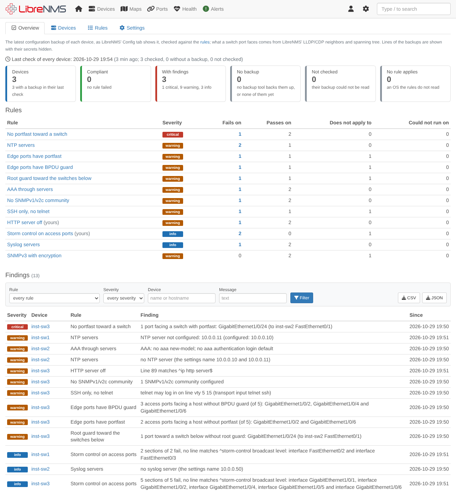
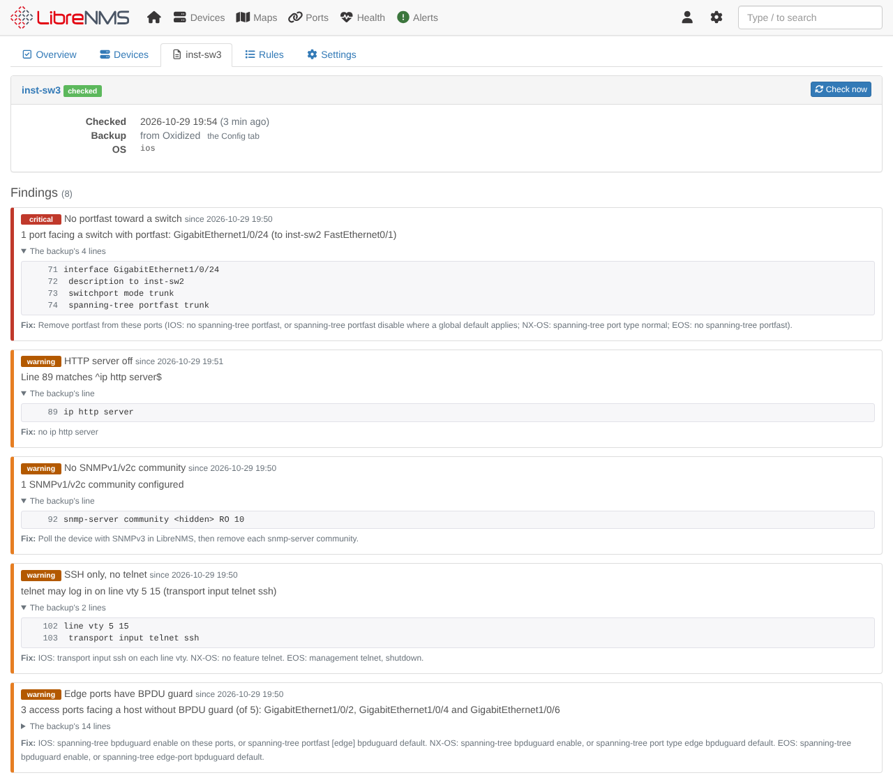
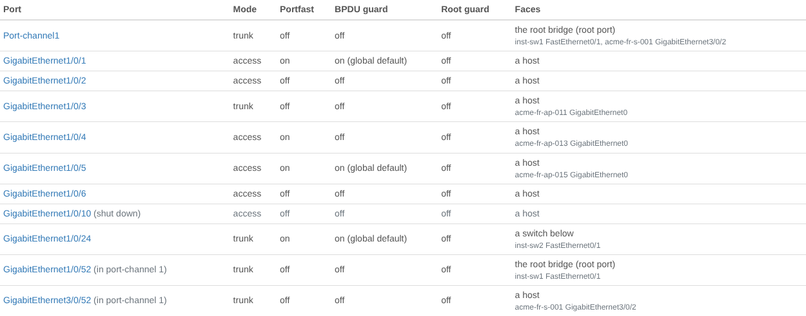
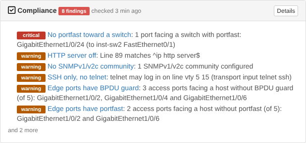
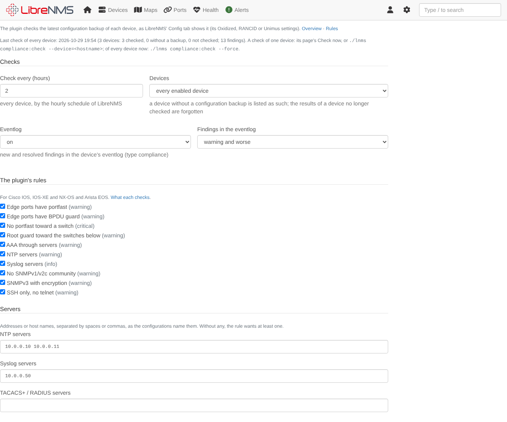
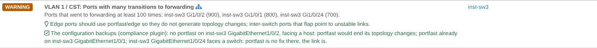

# LibreNMS Compliance plugin

Rule checks on the configuration backups of [LibreNMS](https://www.librenms.org) devices: the latest backup of each
device, as LibreNMS' **Config** tab shows it (Oxidized, RANCID or Unimus), checked against

* the **spanning tree of the switch ports:** portfast and BPDU guard on the edge ports, no portfast toward another
  switch, root guard toward the switches below. What each port faces comes from LibreNMS' own data: its LLDP/CDP
  neighbors, which of them run spanning tree, and their root ports;
* **management baselines:** AAA through a TACACS+ or RADIUS server group, NTP and syslog servers (the ones you name),
  no SNMPv1/v2c community, SNMPv3 with encryption, SSH only;
* **your own rules,** written in YAML: lines a configuration (or each of its interfaces, line vtys, ...) must or must not
  have, as regular expressions.

The plugin's rules read Cisco IOS and IOS-XE, NX-OS and Arista EOS; your rules read any configuration.

Each finding says what is wrong, shows the lines of the backup that show it (secrets hidden) and how to fix it. The
plugin checks every device every hour by default (LibreNMS' scheduler), keeps the findings with the time each was
first seen, writes the new and resolved ones to the device's eventlog, and adds a **Compliance** panel to the device
pages. It never stores a configuration: only each rule's outcome, the findings and the facts of the switch ports.

It is a plugin of its own in this repository, next to the [topology plugin](../README.md) and the
[Ansible plugin](../ansible/README.md), and needs neither. With the topology plugin, the
[spanning tree page](../README.md#spanning-tree-diagnostics) says what the backups configure on the ports it suspects
of lacking portfast.



*(Screenshots: the test network of the [installer](../install/rocky/README.md), with configurations given to Oxidized.)*

## Contents

* [Requirements](#requirements)
* [Installation](#installation)
* [The checks](#the-checks)
* [The plugin's rules](#the-plugins-rules)
* [Your rules](#your-rules)
* [Pages](#pages)
* [Eventlog](#eventlog)
* [Settings](#settings)
* [Permissions](#permissions)
* [With the topology plugin](#with-the-topology-plugin)
* [API for other plugins](#api-for-other-plugins)
* [Limitations](#limitations)

## Requirements

* LibreNMS 26.x (developed and tested against 26.10) with PHP 8.2+, and its scheduler (`librenms-scheduler` timer or
  cron, see `./validate.php`): it runs the checks.
* Configuration backups LibreNMS shows on a device's Config tab: [Oxidized](https://github.com/ytti/oxidized) (LibreNMS'
  `oxidized.enabled` and `oxidized.url`), RANCID or Unimus, as LibreNMS' documentation sets them up. The plugin reads
  each device's latest backup through the provider LibreNMS uses for that device, so a device whose Config tab shows no
  backup is listed as having none.
* For the spanning tree rules, LibreNMS' LLDP/CDP neighbors (discovery module `discovery-protocols`) and spanning tree
  data (module `stp`) of the switches: without them every port faces a host.

## Installation

The plugin is the Composer package `agoodley/librenms-compliance-plugin` in the `compliance/` directory of this
repository, installed from a clone through a Composer *path* repository, as the Ansible plugin is. The
[installer](../install/rocky/README.md) for Rocky Linux sets it up with the other two plugins. By hand, create the
directory of the clone as root, then run everything else as the `librenms` user:

```bash
# as root: a directory for the clone, owned by the librenms user (it cannot create one in /opt itself)
mkdir -p /opt/librenms-plugins && chown librenms:librenms /opt/librenms-plugins

sudo su - librenms

# 1. a clone of the repository (skip when the Ansible or topology plugin installed one)
git clone https://github.com/agoodley/librenms_dashplugin /opt/librenms-plugins/librenms_dashplugin

# 2. tell composer where the package is (stored in the librenms user's global composer config, so it survives
#    LibreNMS updates)
composer config --global repositories.librenms-compliance '{"type": "path", "url": "/opt/librenms-plugins/librenms_dashplugin/compliance", "options": {"symlink": true}}'

# 3. install it with LibreNMS' plugin installer, renew LibreNMS' route cache (plugin:add leaves it without the
#    plugin's pages, which then answer 500: "Route [compliance.overview] not defined"), and create its tables
cd /opt/librenms
./lnms plugin:add agoodley/librenms-compliance-plugin @dev
./lnms route:cache
./lnms migrate

# 4. the first check of every device, now (else the next hourly run of the scheduler does it)
./lnms compliance:check --force
```

The plugin is enabled when it is installed (LibreNMS enables new plugins). Its pages: **Overview → Plugins →
Compliance**; its settings: **Overview → Plugins → Plugin Admin → compliance → Settings**.

It keeps its data in tables of its own: its settings and the time of its last run (`compliance_config`), each device's
last check (`compliance_devices`) and the findings (`compliance_findings`). `./validate.php` then warns that the schema
"has extra migrations (2026_11_10_000000_create_compliance_tables)": that is the plugin's migration, and the warning
stays while the plugin is installed. Do not apply validate.php's offer to drop the `compliance_*` tables.

**Updating:** `git pull` in the clone, then `./lnms route:cache` and `./lnms migrate`.

**Removing:**

```bash
./lnms migrate:reset --path=vendor/agoodley/librenms-compliance-plugin/database/migrations   # drops the compliance_* tables
./lnms plugin:remove agoodley/librenms-compliance-plugin
```

`migrate:reset` prints "Migration not found" for each of LibreNMS' own migrations: it only rolls back the plugin's.

## The checks

`compliance:check` runs every hour through LibreNMS' scheduler (at 37 minutes past, one at a time, on one server of
a distributed poller) and checks every device when the settings' interval has passed since its last run, or when the
settings changed. Its output goes to `compliance-check.log` in LibreNMS' log directory; a failed run is an error in the
eventlog.

```bash
./lnms compliance:check                     # what the schedule runs: every device when the interval has passed
./lnms compliance:check --force -v          # every device now, each device's result printed
./lnms compliance:check --device=acc-sw1    # one device now (its hostname or id)
```

For each enabled device (of the device group the settings name, or every one):

1. **The backup.** LibreNMS' backup provider for the device (`ConfigBackupManager`: Unimus, Oxidized or RANCID, the
   first that LibreNMS' settings configure and that backs the device up) gives its latest backup. Oxidized is asked
   with a 20 s timeout (LibreNMS' own page waits 90 s), and a backup tool that cannot be reached is asked for no other
   device in that run: the run's eventlog says so once. A device the provider has no backup of (Oxidized answers a node
   it never backed up with *node not found*) has **no backup**; a provider that fails or cannot be reached leaves the
   device **not checked**, with the results of its last check (marked as such).
2. **The configuration**, read in blocks by indentation, as IOS, NX-OS and EOS write it: comments (`!`), `end`, the text
   of banners (IOS `banner motd ^C ... ^C`, EOS `banner login` ... `EOF`) and the bodies of IOS macros are left out, so a
   banner that says `ntp server 192.0.2.1` configures nothing. Each line keeps its number in the backup.
3. **The switch ports:** each physical interface and port-channel of the backup (no SVI, subinterface or management
   port), its mode (access, trunk, routed; IOS' dynamic mode is *unknown*), whether it is shut down or a member of a
   port-channel, and its portfast, BPDU guard and root guard, the global defaults included (IOS `spanning-tree portfast
   [edge] default` and `... bpduguard default`, NX-OS `spanning-tree port type edge [bpduguard] default`, EOS'
   automatic edge detection and `spanning-tree edge-port bpduguard default`). Each is matched to its LibreNMS port by
   name (`GigabitEthernet1/0/3` is `Gi1/0/3`).
4. **What each port faces**, from LibreNMS: *a host* (no LLDP/CDP neighbor that LibreNMS polls spanning tree of: a PC,
   a phone, an access point, a server, an unmonitored switch), *a switch*, *toward the root bridge* (the device's own
   root port), or *a switch below* (the neighbor's root port faces this port: it reaches the root bridge through this
   device). A port-channel faces what its members face.
5. **The rules** of the settings, each with an outcome: *passed*, *failed* (a finding), *does not apply* (an OS it does
   not read, no port of its kind) or *could not run* (a pattern of yours that failed).

## The plugin's rules

| Rule | Severity | Fails when |
|---|---|---|
| Edge ports have portfast | warning | an access port that faces a host (not shut down, not in a port-channel) has no portfast, neither its own nor a global default's (EOS: `no spanning-tree portfast auto`) |
| Edge ports have BPDU guard | warning | such a port has no BPDU guard, neither its own nor the global default's (which needs portfast on the port) |
| No portfast toward a switch | critical | a port that faces a switch is an edge port (IOS/NX-OS trunks only with `portfast trunk` / `port type edge trunk`) |
| Root guard toward the switches below | warning | a port toward a switch below has no `spanning-tree guard root` (on the port-channel of a bundle) |
| AAA through servers | warning | logins are not authenticated by a server group (`aaa authentication login default group ...`; IOS also needs `aaa new-model`), or a TACACS+/RADIUS server of the settings is not configured |
| NTP servers | warning | no `ntp server`, or one of the settings is missing |
| Syslog servers | info | no syslog server (IOS/EOS `logging host`, NX-OS `logging server`), or one of the settings is missing |
| No SNMPv1/v2c community | warning | the device has an `snmp-server community` (poll it with SNMPv3) |
| SNMPv3 with encryption | warning | an SNMPv3 group (IOS, EOS) or user (NX-OS) authenticates without encryption (`noauth`, `auth`) |
| SSH only, no telnet | warning | IOS: a `line vty` without `transport input`, or with telnet or all; NX-OS: `feature telnet`; EOS: `management telnet` not shut down |

Each rule's page says what it checks and how to fix a failure, per OS. A rule can be switched off in the settings.

## Your rules

In the settings, as a YAML list. Each rule checks the lines of the configuration (without their indentation) with
regular expressions: a pattern without delimiters matches anywhere in a line, ignoring case (`^ip http server$`); one
between delimiters (`/.../`, `#...#`, `~...~`, with flags such as `i`) is used as written.

```yaml
- id: http-server-off             # letters, digits, - and _; not one of the plugin's
  title: HTTP server off
  severity: warning               # critical, warning (the default) or info
  os: [ios, iosxe]                # LibreNMS os names (default: every device with a backup)
  must_not: '^ip http server$'
  fix: no ip http server
- id: access-storm-control
  title: Storm control on access ports
  severity: info
  section: '^interface '          # each block whose first line matches: its lines are checked
  when: '^switchport mode access$'  # only the blocks with such a line (a list: each)
  unless: '^shutdown$'            # not the blocks with such a line
  ports: host                     # of an interface: what it faces (host, switch, upstream, downstream)
  must: '^storm-control broadcast level'
  fix: storm-control broadcast level 1.00 on each access port
```

`must`: each pattern matches a line; `must_not`: no line matches one (each can be a list). A rule needs one of them.
Without a `section` the lines at the left margin are checked. Keys: `id`, `title`, `severity`, `description`, `os`,
`section`, `ports` (with a section), `when`, `unless`, `must`, `must_not`, `fix`. At most 200 rules and 64 KB; the
settings are not saved while a rule has an error (a key the plugin does not know, a pattern that does not compile, ...),
and the form says which. A pattern that fails on a configuration (PCRE's backtracking limit) makes the rule *could not
run* on that device, and the others still run.

## Pages

* **Overview:** how many devices are compliant (no rule failed), have findings (by severity), have no backup, were
  not checked, or have no rule that applies; each rule with the devices it fails on, passes on, does not apply to; the
  findings, the worst first, filtered by rule, severity, device and message, exported as CSV (one finding per row) or
  JSON (with the lines of the backups).
* **Devices:** each device's state and findings by severity, when its backup was taken and checked; filtered by state
  and name.
* **A device:** its last check (of which backup, from which tool), *Check now* for admins, its findings with the lines
  of the backup that show them (secrets hidden) and how to fix them, each rule's outcome and why, and its switch ports:
  mode, portfast, BPDU guard, root guard and what each faces, with its LLDP/CDP neighbors.
* **Rules:** what each of the plugin's rules checks and how to fix it, and your rules with their patterns.
* **Device panel:** on each device's overview page, its findings, when it was checked and of which backup (nothing
  for a device that has no backup and was never checked).







## Eventlog

Entries of type `compliance` on the device's eventlog, for the findings at or above the settings' minimum severity
(warning by default), at most two per device and check: its new findings (the first check of a device: its findings),
error for a critical one, warning for a warning, info for info; and its resolved findings (ok). Also: a device whose
backup can no longer be read after a check that read it (once), a device that has no backup any more (its findings go,
and are not reported as resolved), a backup tool that cannot be reached (once per run, while it was reachable on the
run before), and each change of the settings. An alert rule can match them (`eventlog.type = compliance`).

## Settings

LibreNMS admins change them on the plugin's settings page; the plugin stores them itself.

| Setting | Default | |
|---|---|---|
| Check every (hours) | 1 | the interval of the checks of every device, from 1 to 24 |
| Devices | every enabled device | or the enabled devices of a device group; the results of the devices left out are forgotten at the next run |
| Eventlog | on | the new and resolved findings in the eventlog |
| Findings in the eventlog | warning and worse | critical, warning and worse, or every finding |
| The plugin's rules | all on | each can be switched off |
| NTP / syslog / TACACS+ and RADIUS servers | none | the servers each device must have; without any, the rule wants at least one (AAA: a server group) |
| Your rules | none | YAML, see [Your rules](#your-rules) |

Once the settings are saved, the next scheduled run checks every device with them.



## Permissions

The findings show lines of the configurations, so the plugin's pages, its device panel and its exports are for the
users LibreNMS lets read configuration backups: **admins**, and users with LibreNMS' **config-backup.view**
permission (`device.showConfig` in older LibreNMS releases), each for the devices they may see, as on the Config tab.
LibreNMS' global read role alone is not enough there, and is not here either. *Check now* and the settings are for
admins. The lines are shown with their secrets hidden: passwords, secrets and keys (`enable secret`, `username ...
secret`, `key 7 ...`, `tacacs-server key`, `snmp-server community`, SNMPv3 auth and priv keys, NTP and OSPF keys,
pre-shared keys, crypt hashes, certificate data); a secret in a form the plugin does not know stays as the backup has
it, which is why the permission is needed anyway.

## With the topology plugin

The [spanning tree page](../README.md#spanning-tree-diagnostics) of the topology plugin guesses why the topology changes:
ports with many transitions to forwarding, "edge ports should use portfast". With this plugin enabled, those findings
say what the backups configure on their ports, for the users who may read the backups: the ports without portfast that
face a host (portfast would end their topology changes), those that have it already, those that face a switch
(portfast is no fix there).



## API for other plugins

`Agoodley\LibrenmsCompliance\Api\Compliance` (version 1.0): what the last checked backups configure on the devices' switch
ports, and their findings, as data (never a configuration's text). `Compliance::forUser($user)` sees the devices that
LibreNMS user may see, and nothing for a user who may not read configuration backups; `Compliance::system()` sees every
device and is for console commands only. Both throw `RuntimeException` while the plugin is disabled or its tables are
missing.

* `ports(array $deviceIds)`: by device id, `backup_at`, `checked_at` (UTC, ISO 8601), `ports` by LibreNMS port id (the
  backup's interfaces LibreNMS knows) and `unmatched` (those it does not): `name`, `mode`, `shutdown`, `member` (the
  port-channel's number), `portfast` (`on`, `default`, `auto`, `off`), `bpduguard` (`on`, `default`, `off`),
  `rootguard`, `role` (`host`, `switch`, `upstream`, `downstream`).
* `findings(array $deviceIds)`: by device id and rule, `severity`, `message`, `ports`, `evidence` (`[line, text]`,
  secrets hidden), `first_seen`.

A caller checks that the class exists and that its `VERSION`'s major number is 1: it changes only when a method or a
field changes incompatibly. At most 5000 devices per call.

## Limitations

* The plugin's rules read IOS and IOS-XE, NX-OS and EOS (LibreNMS os `ios`, `iosxe`, `nxos`, `arista_eos`); for other
  devices with a backup they do not apply, and your rules do.
* What a port faces is as good as LibreNMS' neighbors and spanning tree data: a switch LibreNMS does not monitor, or
  whose spanning tree it does not poll, counts as a host, so a trunk toward it is no edge port (the edge rules check
  access ports) and a missing root guard toward it is not found. A neighbor seen on a port-channel's member counts for
  the port-channel.
* The configuration is read as written, not as the device runs it: a feature's default that the backup does not show
  (`show running-config` without `all`) is the platform's default the rules assume (portfast off, BPDU guard off, root
  guard off; EOS' automatic edge detection on). A backup is checked as it was when it was taken: *Check now* reads the
  latest backup, not the device.
* The checks are as fresh as the backups and the interval: an hourly check of a backup taken daily finds a change at
  the next backup.
* Each device's check reads its whole backup into memory: a backup of more than 200,000 lines is refused (*not
  checked*).

## License

GPL-3.0-or-later, like LibreNMS.
