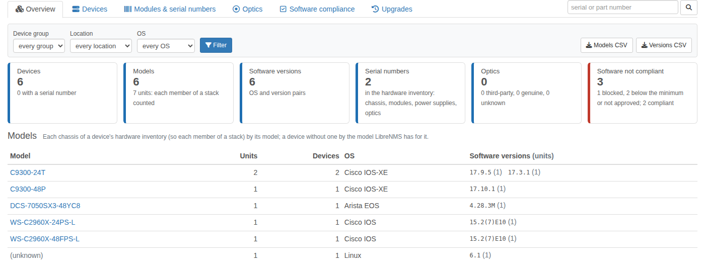
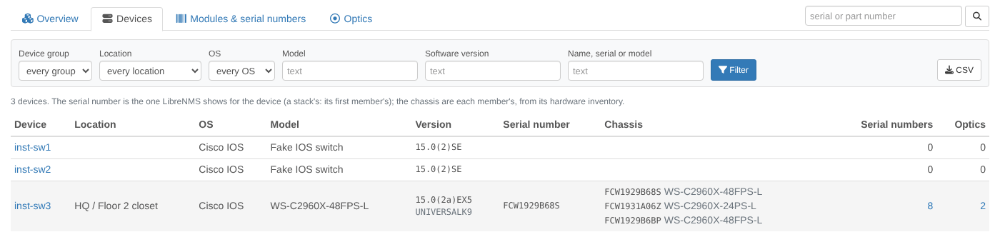
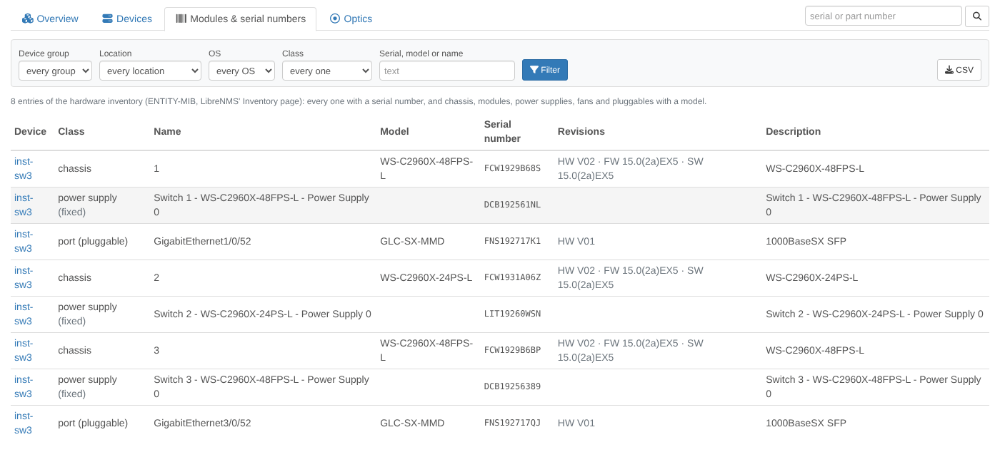
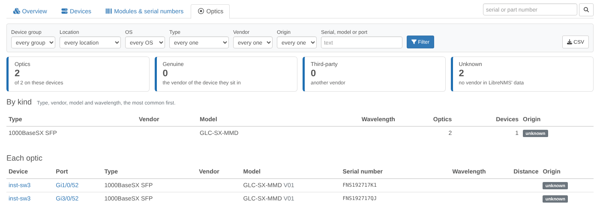
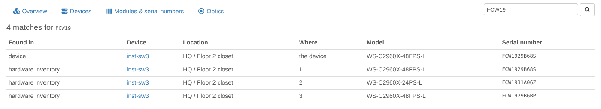
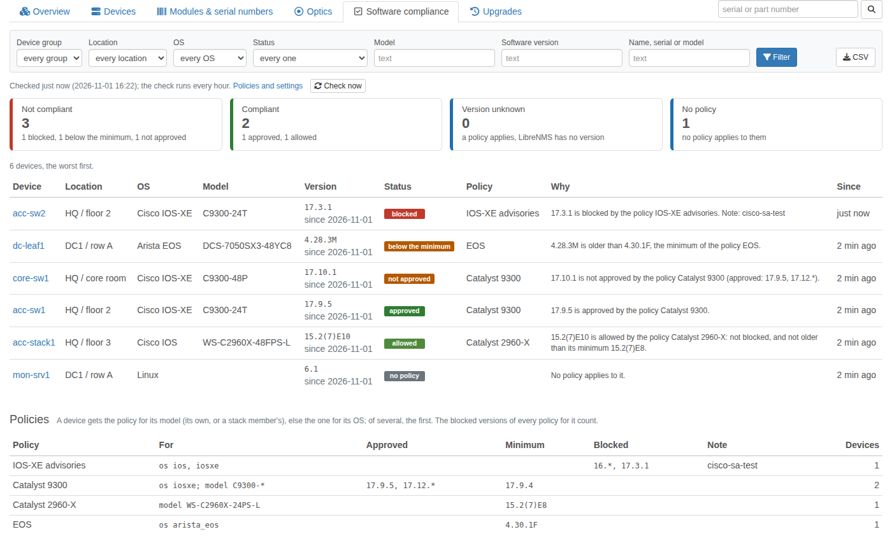
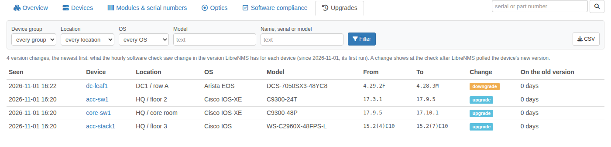
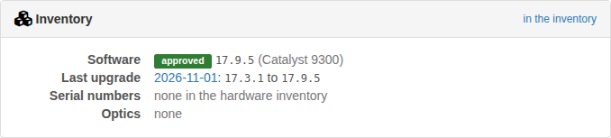
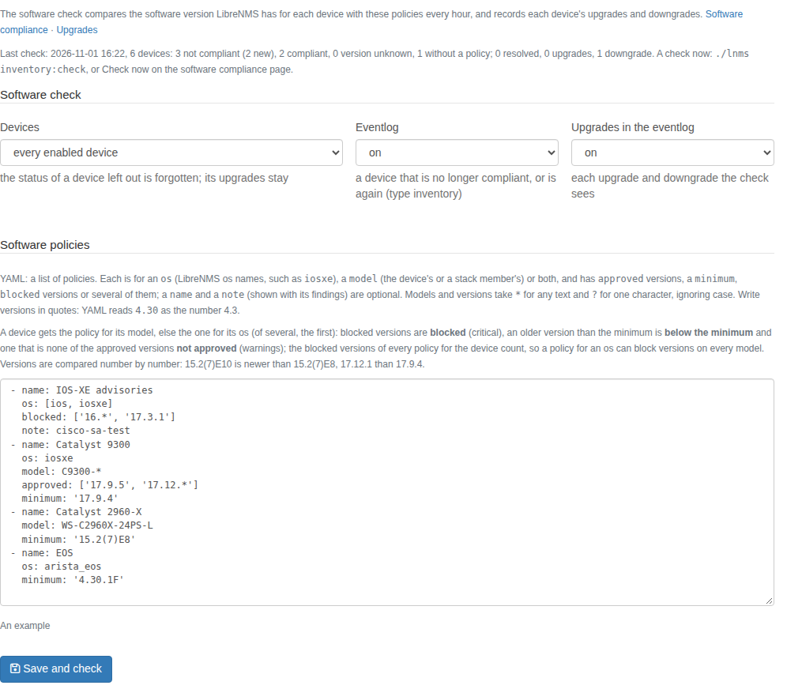

# LibreNMS Inventory plugin

Inventory reports across the network from what [LibreNMS](https://www.librenms.org) already collects, for the devices
each user may see:

* **models** across the network, each unit counted (each member of a stack by its own model), with the software
  versions they run;
* **software versions**: each OS and version with its devices and their models;
* **serial numbers** of the devices and of their hardware inventory: chassis, line cards, power supplies, fans and
  pluggables, with their hardware, firmware and software revisions;
* **optics** by type, vendor, model and wavelength, with the port each sits in, and whether it is the vendor of the
  switch it sits in or a third-party one;
* a **search** for a serial number or part number: which device, module or optic has it, and where;

filtered by device group, location and OS, each exported as CSV, and an **Inventory** panel on each device's page (its
stack members with their serial numbers, its software's status, how many serial numbers and optics it has); and
**software compliance**:

* **policies** an admin writes: approved, minimum and blocked versions per model or OS;
* a **check every hour** of each device's software version against them: blocked, below the minimum or not approved
  (the findings), approved or allowed, with since when, on a page of its own and on each device's panel;
* **eventlog** entries when a device's software stops being compliant or is compliant again, which alert rules can
  match, and for each upgrade and downgrade;
* a **history of the upgrades** (and downgrades) the check saw: from which version to which, when, after how long.

The plugin polls nothing: it reads LibreNMS' tables (`devices`, `entPhysical`, `transceivers`) and keeps only its
settings and what the software check saw in tables of its own. It is phases 1 and 2 of the
[inventory & lifecycle plan](../ROADMAP.md#inventory--lifecycle); end-of-life dates come next.

It is a plugin of its own in this repository, next to the [topology plugin](../README.md), the
[Ansible plugin](../ansible/README.md) and the [compliance plugin](../compliance/README.md), and needs none of them.



*(Screenshots: the test network of the [installer](../install/rocky/README.md), with a simulated stack of three Cisco
switches.)*

## Contents

* [Requirements](#requirements)
* [Installation](#installation)
* [Pages](#pages)
* [Optics: genuine or third-party](#optics-genuine-or-third-party)
* [Software compliance](#software-compliance)
* [Eventlog and alerts](#eventlog-and-alerts)
* [Settings](#settings)
* [Permissions](#permissions)
* [Limitations](#limitations)

## Requirements

* LibreNMS 26.x (developed and tested against 26.10) with PHP 8.2+.
* LibreNMS' discovery modules `os` (model, version, serial number and features of each device), `entity-physical`
  (the hardware inventory: LibreNMS' **Inventory** tab) and `transceivers` (the optics, for the OSes LibreNMS reads them
  of). They are on by default; LibreNMS refreshes them at discovery (every 6 hours by default).

## Installation

The plugin is the Composer package `agoodley/librenms-inventory-plugin` in the `inventory/` directory of this
repository, installed from a clone through a Composer *path* repository, as the other plugins are. The
[installer](../install/rocky/README.md) for Rocky Linux sets it up with the other three. By hand, create the directory
of the clone as root, then run everything else as the `librenms` user:

```bash
# as root: a directory for the clone, owned by the librenms user (it cannot create one in /opt itself)
mkdir -p /opt/librenms-plugins && chown librenms:librenms /opt/librenms-plugins

sudo su - librenms

# 1. a clone of the repository (skip when another of its plugins installed one)
git clone https://github.com/agoodley/librenms_dashplugin /opt/librenms-plugins/librenms_dashplugin

# 2. tell composer where the package is (stored in the librenms user's global composer config, so it survives
#    LibreNMS updates)
composer config --global repositories.librenms-inventory '{"type": "path", "url": "/opt/librenms-plugins/librenms_dashplugin/inventory", "options": {"symlink": true}}'

# 3. install it with LibreNMS' plugin installer, renew LibreNMS' route cache (plugin:add leaves it without the
#    plugin's pages, which then answer 500: "Route [inventory.overview] not defined"), and create its tables
cd /opt/librenms
./lnms plugin:add agoodley/librenms-inventory-plugin @dev
./lnms route:cache
./lnms migrate

# 4. the first software check, now (else the next hourly run of the scheduler does it)
./lnms inventory:check
```

The plugin is enabled when it is installed (LibreNMS enables new plugins). Its pages: **Overview → Plugins →
Inventory**; its settings (the software policies): **Overview → Plugins → Plugin Admin → inventory → Settings**.

It keeps its settings and the software checks in tables of its own: its settings and its last check
(`inventory_config`), each device's software as the last check saw it (`inventory_software`) and the version changes
(`inventory_upgrades`). `./validate.php` then warns that the schema "has extra migrations
(2026_11_20_000000_create_inventory_tables)": that is the plugin's migration, and the warning stays while the plugin is
installed. Do not apply validate.php's offer to drop the `inventory_*` tables. The inventory pages need none of them:
they work before `./lnms migrate`, and only software compliance says it waits for it.

**Updating:** `git pull` in the clone, then `./lnms route:cache` and `./lnms migrate`. A plugin installed before
software compliance (phase 2) needs `./lnms migrate` once for it, and installs `symfony/yaml` with it (LibreNMS has
it already).

**Removing:**

```bash
./lnms migrate:reset --path=vendor/agoodley/librenms-inventory-plugin/database/migrations   # drops the inventory_* tables
./lnms plugin:remove agoodley/librenms-inventory-plugin
```

`migrate:reset` prints "Migration not found" for each of LibreNMS' own migrations: it only rolls back the plugin's.

## Pages

Every page has the filters device group, location and OS, its own filters and a CSV export of what it shows (all of
it, not one page of it), and a search box for a serial number or part number. The groups and locations are those the
user may see; for a user who sees only some devices, another group's or location's id in the address shows no device.

**Overview** (`plugin/inventory/overview`): the devices, how many models (units: each member of a stack counted),
software versions, serial numbers and optics; then

* **Models:** each chassis of a device's hardware inventory by its model, so a stack of two 48-port and one 24-port
  switch counts as two units of one model and one of the other; a device without a chassis that names its model counts
  by the model LibreNMS has for it. With the devices, their OS and the software versions the units run, newest first.
  A model links to its devices.
* **Software versions:** each OS and version (newest first) with its devices and their models; a version links to its
  devices.

**Devices** (`plugin/inventory/devices`): each device's location, OS, model, software version and features, the serial
number LibreNMS shows for it (a stack's: its first member's) and each of its chassis with their serial numbers, how many
serial numbers its hardware inventory has and how many optics. Filtered by model (a member of a stack too), version and
a text of the name, serial number or model.



**Modules & serial numbers** (`plugin/inventory/modules`): the entries of the hardware inventory with a serial number,
and the chassis, modules, power supplies, fans and pluggables with a model: their class, name, model, serial number,
hardware, firmware and software revisions, whether they are field replaceable, and their description. Filtered by class
and a text of the serial number, model, name or description.



**Optics** (`plugin/inventory/optics`): how many are genuine, third-party or unknown, then the optics by kind (type,
vendor, model and wavelength, the most common first) and each optic with its device, port (and the port's status when
it is not up), type, vendor, model and revision, serial number, wavelength, distance and origin. Filtered by type,
vendor, origin and a text of the serial number, model or port.



**Search** (`plugin/inventory/search?q=FCW19`): a serial number or part number, or a part of it (3 characters or more),
in the devices (their serial number and model), their hardware inventory and their optics: where each match is, with
its device, location and port.



**Software compliance** (`plugin/inventory/software`): when the software was last checked (admins: *Check now*), how
many devices are not compliant (blocked, below the minimum, not approved), compliant (approved, allowed), with a
policy but no version, and without a policy; each device with its version (and since when the checks see it), its
status, the policy that gave it, why, and since when; the worst first. Filtered by status (one, or each kind of not
compliant or compliant), model, version and a text. Then the policies, each with whom it is for, its versions and how
many devices of the filters it gave their status. See [Software compliance](#software-compliance).



**Upgrades** (`plugin/inventory/upgrades`): each version change the hourly check saw, the newest first: when, the
device, its OS and model, from which version to which, upgrade or downgrade, and how long the device ran the old
version (as the checks saw it: the first upgrade after the plugin's first check counts from that check).



**Device page:** an **Inventory** panel with the device's chassis when it has several (a stack's members with their
serial numbers and models), its software's status against the policies (and why, when it is not compliant) and its
last upgrade or downgrade, how many serial numbers its hardware inventory has and its optics, with links to them. A
device with none of these (without a policy, never upgraded) gets no panel.



**Exports** (`plugin/inventory/export/devices|modules|optics|models|versions|software|upgrades`, with the page's
filters): CSV with a header row, quoted where needed, the times UTC; a cell a spreadsheet would read as a formula gets an
apostrophe first.

## Optics: genuine or third-party

An optic is **genuine** when its vendor names the maker of the device it sits in (Cisco optics report "CISCO-FINISAR",
Arista ones "Arista Networks") or its part number is that maker's (Juniper's `740-…`, HPE's `J9150A`), **third-party**
when its vendor is another one, and **unknown** when LibreNMS has no vendor for it (often for Cisco optics: then the
model, such as `GLC-SX-MMD`, says more) or the device's maker is not one the plugin knows: Cisco, Juniper, Arista,
HPE Aruba, Dell, Extreme, Huawei, MikroTik, Ubiquiti, Fortinet and Palo Alto Networks, by the device's LibreNMS OS.
Optics coded for a switch report that switch's maker whoever made them: this tells the coding, not the factory.

## Software compliance

An admin writes the **policies** in the plugin's settings, in YAML: a list of policies, each for the devices of an
`os` (LibreNMS os names, such as `ios`, `iosxe`, `nxos`, `junos`, `arista_eos`), of a `model` (the model LibreNMS has for
the device, or the model of one of its chassis: any member of a stack) or both, with `approved` versions, a `minimum`
version, `blocked` versions or several of them. A `name` (shown on the pages and in the eventlog) and a `note` (shown
with its findings: an advisory, a change number) are optional. `os`, `model`, `approved` and `blocked` take one value or
a list; models and versions take `*` for any text and `?` for one character, ignoring case, and must match the whole
model or version.

```yaml
# blocked on every IOS and IOS-XE device, whatever its policy
- name: IOS-XE advisories
  os: [ios, iosxe]
  blocked: ['16.*', '17.3.1']
  note: cisco-sa-iosxe-webui-privesc-j22SaA4z

# the Catalyst 9300 switches: approved versions and a minimum
- name: Catalyst 9300
  os: iosxe
  model: C9300-*
  approved: ['17.9.5', '17.12.*']
  minimum: '17.9.4'

# the stacks of 2960-X switches: a minimum only
- name: Catalyst 2960-X
  model: WS-C2960X-*
  minimum: '15.2(7)E8'
```

Write versions in quotes: YAML reads `4.30` as the number 4.3, so the plugin refuses a version it reads as a number
with a fraction. The settings are checked when they are saved: nothing is saved while a policy is wrong (an unknown key,
a policy for no devices or with nothing to check, two policies of one name).

**Which policy a device gets:** the first policy for its model; without one, the first policy for its os. Its
version is checked against that policy's approved versions and minimum, and against the **blocked versions of every
policy for it**: a policy for an os can block versions on every model, whatever their own policies approve.

**Status** of each device, the worst first:

| Status | | When |
|---|---|---|
| **blocked** | critical | its version is one a policy for it blocks |
| **below the minimum** | warning | its version is older than its policy's minimum |
| **not approved** | warning | its policy approves versions, and its version is none of them |
| **approved** | compliant | its version is one of its policy's approved versions |
| **allowed** | compliant | its policy approves no list, and its version is neither blocked nor below the minimum |
| **version unknown** | | a policy applies, but LibreNMS has no software version for the device |
| **no policy** | | no policy is for the device |

Versions are compared by their release: LibreNMS writes many versions with other words around it, and the plugin checks
the release in it, the first word that starts with a number (or a `v` before one), up to a comma. IOS-XE's
`CAT9K_IOSXE 17.9.4` is `17.9.4`, FortiGate's `v6.4.8,build1914,211117 (GA)` is `6.4.8`, Cisco SB's
`Software 2.5.9.13, Bootldr …` is `2.5.9.13`; a `v` before a dotted number is left out (`v6.4.8`, `V6.2`), Huawei's
`V600R024C00SPC100` keeps its `V`, and a version without such a word is taken whole (ProCurve's `W.15.08.0012`, Aruba CX's
`ML.10.07.0005`: their letters are their release train). A pattern matches the release or the whole version as LibreNMS
has it (`CAT9K_IOSXE 17.*` too): Huawei VRP's `5.170 (V200R010C00SPC600)` is release `5.170`, and `*V200R010*` matches
it. The pages and the eventlog show the whole version. Releases are compared number by number, the rest as text ignoring case: `15.2(7)E10` is newer than `15.2(7)E8`,
`17.12.1` than `17.9.4`, `21.4R3-S5` than `21.4R3`. Leading zeros do not count, in comparisons and in patterns alike:
`17.09.04a` (as Cisco pads IOS-XE versions in some outputs) is `17.9.4a`, newer than a minimum of `17.9.4` and matched
by `17.9.*`. That is no release train: `17.10.1` is above a minimum of `17.9.4` whether or not
it is a train you run, so a list of approved versions says what a minimum cannot.

**The check** (`./lnms inventory:check`, `-v` lists each device) runs every hour through LibreNMS' scheduler, at 23
minutes past, while the plugin is enabled; its output goes to `inventory-check.log` in LibreNMS' log directory, and a
failed run to the eventlog. It reads the version LibreNMS has for each enabled device (`devices.version`, which LibreNMS'
`os` module refreshes) and the models of its chassis, and writes a device's row only when something of it changed: its status,
version, policy or why. A version LibreNMS no longer has (a failed poll) leaves the last one in place, the status
*version unknown*, so the version that comes back is compared with it. Saving the settings and *Check now* (admins, on
the software compliance page) check every device at once; the checks run one at a time.

**Upgrades:** a device whose version changed since the last check gets a row in the history: an upgrade when the new
version is newer, else a downgrade. A version only written another way (`17.9.4a`, then `17.09.04a` or
`CAT9K_IOSXE 17.9.4a`) is no change. The history starts with the plugin's first check (the first version of a device is
no change); a device the settings no longer cover keeps its history, a device deleted from LibreNMS loses it.

## Eventlog and alerts

Entries of type `inventory` on the device's eventlog. Each begins the same way, so an alert rule can match it:

| Entry | Severity | When |
|---|---|---|
| `Inventory: software not compliant: 17.3.1 is blocked by the policy IOS-XE advisories. Note: …` | error (blocked), warning | a device becomes not compliant, or is not compliant another way (another status or version); at its first check too |
| `Inventory: software compliant: 17.9.5 is approved by the policy Catalyst 9300.` | ok | a device that was not compliant is compliant |
| `Inventory: software not checked any more: No policy applies to it.` | notice | a device that was not compliant has no policy or no version any more |
| `Inventory: software upgraded from 17.6.5 to 17.9.5` | info | its version is newer than at the last check |
| `Inventory: software downgraded from 17.9.5 to 17.6.5` | notice | its version is older |

Also: each change of the settings (who changed them, no device), and a scheduled check that failed. The settings can
switch the entries of the status off, and those of the upgrades.

An alert rule can match the eventlog: for example, for a device that became not compliant in the last hour,
`eventlog.type = "inventory" AND eventlog.message LIKE "Inventory: software not compliant%" AND eventlog.datetime >=
macros.past_60m` (LibreNMS' time macros are `past_5m`, `past_10m`, `past_15m`, `past_30m` and `past_60m`). The entries are written once per change, not at every check: a
rule without a time window would match them for as long as the eventlog keeps them.

## Settings

LibreNMS admins change them on the plugin's settings page; the plugin stores them itself. Saving them checks every
device with them right away, and says what the check found.

| Setting | Default | |
|---|---|---|
| Devices | every enabled device | or the enabled devices of a device group; the status of a device left out is forgotten (its upgrades stay) |
| Eventlog | on | the entries of the status: not compliant, compliant, not checked any more |
| Upgrades in the eventlog | on | an entry for each upgrade and downgrade |
| Software policies | none | YAML, see [Software compliance](#software-compliance) |

Without policies, every device is listed without a policy, and the check records the upgrades anyway.



## Permissions

Every LibreNMS user may open the pages, each for the devices LibreNMS lets them see, as on LibreNMS' own device and
inventory pages; the search and the exports too. The hardware inventory, the optics and the ports have permissions of
their own in LibreNMS (its policies for `EntPhysical`, `Transceiver` and `Port`, which custom roles can leave out):
what a user's role may not view, the pages leave out and say so. Software compliance and the upgrades are for every
user too, for the devices they may see, and so are the policies (their names, versions and notes). The settings and
*Check now* are for admins.

## Limitations

* The data is what LibreNMS' discovery found at its last run (every 6 hours by default): a module swapped since shows
  after the next discovery. The plugin keeps no history of the hardware yet (phase 4 of the plan); of the software
  versions, only what its hourly check saw.
* Software compliance reads the version LibreNMS has for the device: one per device, so a stack whose members run
  different versions (LibreNMS shows one) is checked by that one. A version changed and changed back between two
  checks is not seen, and a change shows at the first check after LibreNMS polled it.
* An upgrade's *on the old version* counts from when the checks first saw that version: for the first upgrade after
  the plugin's first check, from that check.
* A device's serial number is the one LibreNMS shows for it, its first stack member's for a stack; each member's comes
  from the hardware inventory, which some OSes report only in part or not at all.
* LibreNMS reads optics for the OSes it supports; a switch it reads none of shows none. Their vendor is often empty for
  Cisco optics, so their origin is unknown.
* The lists show 500 rows a page; the exports have every row.

## License

GPL-3.0-or-later, like LibreNMS.
